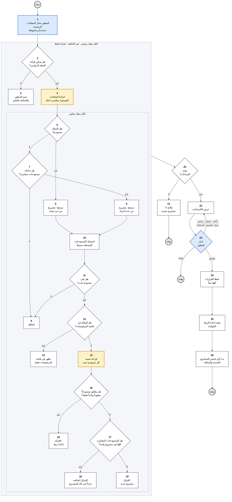
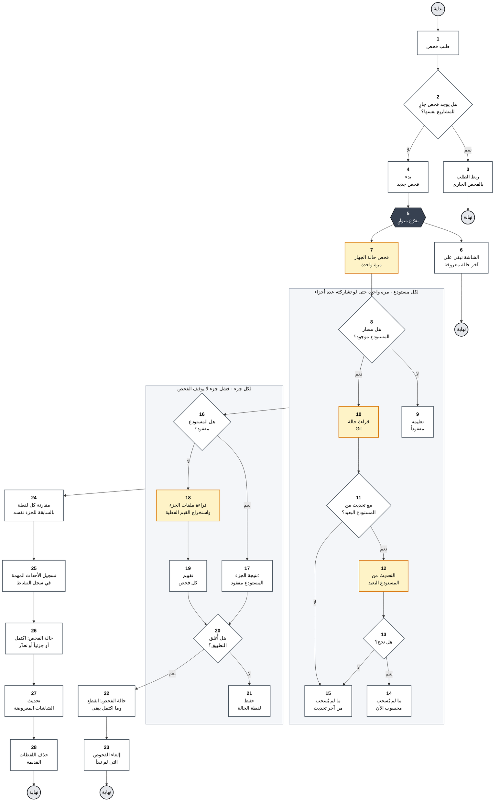
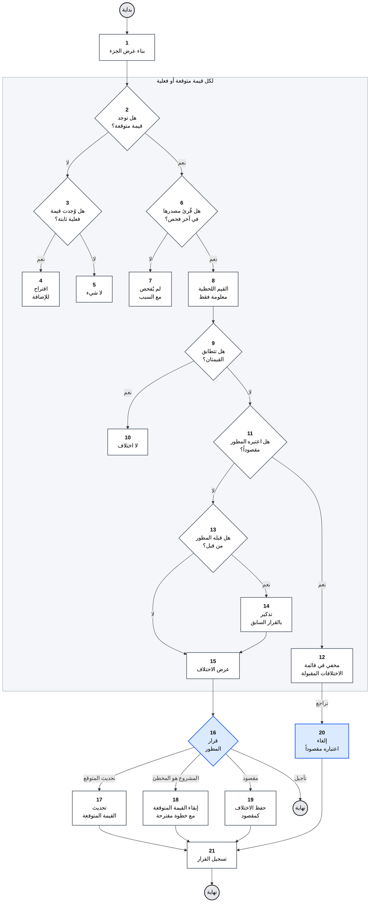

<h1 align="center">ذاكرة · Dhakira</h1>

<a href="../../README.md"><kbd> 🏠 <b>الرئيسية</b> </kbd></a>
&nbsp;&nbsp;
<a href="DhakiraSRS.md"><kbd> 📄 وثيقة المتطلبات </kbd></a>
&nbsp;&nbsp;
<a href="DhakiraVision.md"><kbd> 📄 وثيقة الرؤية vision </kbd></a>
&nbsp;&nbsp;
<a href="DhaliraUseCase.md"><kbd> 📄 وثيقة مخطط حالات الأستخدام </kbd></a>
&nbsp;&nbsp;
<a href="DhakiraDomainModel.md"><kbd> 📄 وثيقة Domain Model  </kbd></a>
&nbsp;&nbsp;
<a href="ActivityDiagrams.md"><kbd> 📄 وثيقة مخطط النشاط لأهم حالات الأستخدام </kbd></a>
&nbsp;&nbsp;
<a href="DhakiraC4.md"><kbd> 📄 وثيقة ال C4 </kbd></a>
&nbsp;&nbsp;
<a href="DhakiraERD.md"><kbd> 📄 وثيقة مخطط قاعدة البيانات </kbd></a>
&nbsp;&nbsp;
<a href="SequenceResume.md"><kbd> 📄 وثيقة مخطط التسلسل لحالة أستئناف المشروع في التطبيق </kbd></a>
&nbsp;&nbsp;
<a href="DhakiraArc42.md"><kbd> 📄 وثيقة المعمارية </kbd></a>
&nbsp;&nbsp;
<a href="DhakiraApiContract.md"><kbd> 📄 وثيقة عقد ال Api  </kbd></a>

# مخططات النشاط: تطبيق ذاكرة
 
Activity Diagrams — Dhakira
 
> **الإصدار:** 1.2 · **الحالة:** معتمدة
>
> تغطي هذه الوثيقة أكثر ثلاثة تدفقات تعقيداً في الإصدار الأول من التطبيق.
 
---
 
## مقدمة
 
بعض وظائف التطبيق تمر بقرارات كثيرة متتالية، ويصعب فهمها من وصف نصي وحده. هذه الوثيقة ترسم ثلاثاً منها خطوة بخطوة: اكتشاف المشاريع، وتحديث حالة المشروع، وكشف الاختلافات بين ما كتبه المطور وما وجده التطبيق.
 
المخططات مبنية على [وثيقة المتطلبات](srs.md) و[مخطط حالات الاستخدام](use-case-diagram.md).
 
### طريقة القراءة
 
حالة الاستخدام تحكي ما يحدث كقصة، ومخطط النشاط يرسم القصة نفسها خطوة بخطوة، فيظهر ترتيب الخطوات والمواضع التي يتفرع فيها الطريق.
 
- الدائرة الرمادية بداية التدفق أو نهايته، وقد يكون للتدفق أكثر من نهاية.
- المستطيل خطوة واحدة، والمعيّن سؤال، ويُتّبع السهم الذي يحمل الجواب.
- الشكل السداسي الداكن تفرّع: الطريقان بعده يجريان في الوقت نفسه.
- الإطار الذي يبدأ عنوانه بكلمة «لكل» حلقة تتكرر لكل عنصر.
- الأزرق الفاتح خطوة يقوم بها المطور، والأصفر الفاتح قراءة من الجهاز، والأبيض خطوة يقوم بها التطبيق.
- الرقم في كل عنصر يقابل سطره في جدول التوصيف تحت المخطط.
- على GitHub تظهر على كل مخطط أزرار للتكبير والتحريك.
---
 
## 1. اكتشاف المشاريع (UC-01)
 
يبحث التطبيق عن المشاريع في مجلدات المطور ويقترحها، والمطور هو من يقرر. يجيب هذا المخطط عن سؤالين: كيف تُبنى الاقتراحات، وبأي ترتيب تُستبعد المستودعات المعروفة والمرفوضة؟
 

 
### جدول توصيف مخطط النشاط
 
| البند | القيمة |
|---|---|
| حالة الاستخدام | UC-01 اكتشاف المشاريع |
| الفاعل الأساسي | المطور |
| الفاعل المساند | النظام المحلي: الملفات وGit، للقراءة فقط |
| نقطة البداية | يطلب المطور البحث عن المشاريع، في أول تشغيل أو في أي وقت لاحق |
| النهايات | لا اقتراحات جديدة (21)، أو إلغاء المطور (23)، أو حفظ القرارات وبدء الفحص (26) |
| الحلقات | لكل مجلد رئيسي (2 إلى 4)، وبداخلها لكل مجلد مباشر (5 إلى 19) |
 
| الرقم | العنصر | النوع | المنفّذ | الوصف |
|:---:|---|---|---|---|
| 1 | اختيار المجلدات الرئيسية | نشاط | المطور | يضيف المطور مجلداً رئيسياً أو أكثر، أو يكمل بالمجلدات المحفوظة من بحث سابق. |
| 2 | هل يمكن قراءة المجلد الرئيسي؟ | قرار | ذاكرة | يتأكد التطبيق أن المجلد موجود وأنه يستطيع قراءته. |
| 3 | تنبيه المطور | نشاط | ذاكرة | يبلغ التطبيق المطور بالمجلد الذي لا يمكن قراءته، ويكمل بالمجلدات الأخرى. |
| 4 | قراءة المجلدات المباشرة | نشاط | النظام المحلي | يقرأ التطبيق المستوى الأول فقط داخل المجلد الرئيسي، ولا يبحث في القرص كله. |
| 5 | هل المجلد مستودع؟ | قرار | ذاكرة | المجلد الذي هو مستودع Git يصبح مرشحاً لمشروع من جزء واحد. |
| 6 | مرشح: مشروع من جزء واحد | نشاط | ذاكرة | مرشح أولي، ولم يصبح اقتراحاً بعد. |
| 7 | هل بداخله مستودعات مباشرة؟ | قرار | ذاكرة | يبحث التطبيق في المستوى الأول داخل المجلد فقط. والمستودع الأعمق يضيفه المطور يدوياً. |
| 8 | يُتجاهل | نشاط | ذاكرة | مجلد ليس مستودعاً ولا يحتوي مستودعات، أو كل مستودعاته مسجلة مسبقاً. |
| 9 | مرشح: مشروع من عدة أجزاء | نشاط | ذاكرة | مجلد يحتوي عدة مستودعات، فيُقترح كمشروع واحد له عدة أجزاء. |
| 10 | استبعاد المستودعات المسجلة | نشاط | ذاكرة | يحذف التطبيق من المرشح كل مستودع مسجل مسبقاً، فلا يغيّر البحث الجديد المشاريع الموجودة. |
| 11 | هل بقي مستودع جديد؟ | قرار | ذاكرة | إذا لم يبقَ في المرشح أي مستودع جديد، يُتجاهل. |
| 12 | هل المجلد في قائمة المرفوضات؟ | قرار | ذاكرة | المجلد الذي رفضه المطور سابقاً لا يُقترح مرة أخرى. |
| 13 | يظهر في قائمة المرفوضات فقط | نشاط | ذاكرة | لا يظهر كاقتراح، لكنه يبقى ظاهراً في قائمة المرفوضات، ويستطيع المطور استعادته. |
| 14 | قراءة بصمة المستودع | نشاط | النظام المحلي | يقرأ التطبيق لكل مستودع جديد بصمة من تاريخه، لا تتغير إذا نُقل المستودع إلى مكان آخر. |
| 15 | هل يطابق مستودعاً مفقوداً واحداً فقط؟ | قرار | ذاكرة | المستودع المفقود مستودع مسجل لم يعد موجوداً في مساره. إذا طابقت البصمة أكثر من مستودع، أو لم تكن للمستودع بصمة، لا يخمّن التطبيق. |
| 16 | اقتراح: إعادة ربط | نشاط | ذاكرة | المستودع الجديد هو مستودع مسجل انتقل من مكانه، فيقترح التطبيق ربطه بمساره الجديد دون خسارة أي معلومة. |
| 17 | هل المستودعات المجاورة كلها في مشروع واحد؟ | قرار | ذاكرة | يُطرح هذا السؤال بعد التأكد من أن المستودع ليس منقولاً. وإذا كانت المستودعات المجاورة موزعة على عدة مشاريع، لا يخمّن التطبيق. |
| 18 | اقتراح: إضافته جزءاً في ذلك المشروع | نشاط | ذاكرة | المستودع الجديد هنا جزء فرعي من المشروع الذي تنتمي إليه المستودعات المجاورة. |
| 19 | اقتراح: مشروع جديد | نشاط | ذاكرة | يظهر مع الاسم والمسار وعدد المستودعات ورابط المستودع البعيد. |
| 20 | توجد اقتراحات؟ | قرار | ذاكرة | يُطرح بعد المرور على كل المجلدات. |
| 21 | إبلاغ: لا مشاريع جديدة | نشاط | ذاكرة | ينتهي البحث دون أي تغيير. |
| 22 | عرض الاقتراحات | نشاط | ذاكرة | لكل اقتراح: الاسم، والمسار، وعدد المستودعات، ورابط المستودع البعيد بعد حذف أي اسم مستخدم أو كلمة سر منه. |
| 23 | قرار المطور | قرار | المطور | يضع المطور قراراته على الاقتراحات: تأكيد مع تعديل الاسم، أو رفض، أو دمج، أو تقسيم، أو استعادة من المرفوضات. لا يُحفظ شيء قبل التطبيق، والإلغاء لا يغيّر شيئاً. |
| 24 | حفظ القرارات كلها معاً | نشاط | ذاكرة | تُحفظ المشاريع الجديدة، والأجزاء المضافة إلى مشاريع موجودة، والمرفوضات، والمجلدات الرئيسية دفعة واحدة، أو لا يُحفظ منها شيء. والاقتراح الذي لم يقرر فيه المطور لا يُحفظ، ويظهر في البحث القادم. |
| 25 | تنفيذ إعادة الربط المؤكدة | نشاط | ذاكرة | يرتبط كل مستودع منقول بمساره الجديد، مع كل ما كُتب عنه. |
| 26 | بدء أول فحص | نشاط | ذاكرة | يبدأ في الخلفية للمشاريع الجديدة والمعدّلة، دون تحديث من المستودع البعيد. |
 
### لماذا يعمل التدفق هكذا؟
 
- تُحفظ قرارات المطور كلها معاً أو لا يُحفظ منها شيء، فلا تبقى قائمة المشاريع نصف محدّثة إذا أُغلق التطبيق في المنتصف.
- يُعرف المستودع المفقود بالتحقق من مساره لحظة البحث، لا من آخر فحص، لأن آخر فحص قد يكون قديماً.
- يبقى البحث في المستوى الأول، لأن البحث العميق يلتقط مستودعات ليست مشاريع، مثل المكتبات المنزّلة داخل المشاريع.
- يُفحص احتمال النقل قبل احتمال الجزء الجديد، لأن المستودع المنقول ليس جديداً، بل مستودع معروف تغيّر مكانه.
- عندما لا تكون الأدلة حاسمة لا يخمّن التطبيق، ويترك القرار للمطور.
---
 
## 2. تحديث حالة المشروع (UC-07)
 
الفحص هو ما يغذي ذاكرة التطبيق، ويحدث كثيراً: عند فتح كل مشروع، وعند كل ضغطة على زر التحديث. لذلك يجب أن يكون سريعاً، وألا يوقفه عطل في مكان واحد. يجيب هذا المخطط عن تسلسل الفحص، وعما يحدث عندما يكون مصدر غير متاح، أو يفشل جزء، أو يُغلق التطبيق في منتصف الفحص.
 

 
### جدول توصيف مخطط النشاط
 
| البند | القيمة |
|---|---|
| حالة الاستخدام | UC-07 تحديث حالة المشروع، ويُستدعى أيضاً عند استئناف مشروع (UC-04) وعند مراجعة جاهزيته (UC-08) |
| الفاعل الأساسي | المطور، بطلب الفحص مباشرة أو بفتح مشروع |
| الفاعلون المساندون | النظام المحلي: Git والملفات والمنافذ والخدمات، وDocker |
| نقطة البداية | طلب فحص: فتح مشروع، أو زر التحديث لمشروع أو لكل المشاريع، أو بعد اكتشاف مشاريع جديدة، أو طلب تحديث من المستودع البعيد |
| النهايات | الانضمام إلى فحص جارٍ (3)، وعودة الشاشة فوراً (6)، وانقطاع الفحص عند إغلاق التطبيق (23)، وانتهاء الفحص وحذف اللقطات القديمة (28) |
| الحلقات | لكل مستودع (8 إلى 15)، ثم لكل جزء (16 إلى 21) |
 
| الرقم | العنصر | النوع | المنفّذ | الوصف |
|:---:|---|---|---|---|
| 1 | طلب فحص | نشاط | المطور | يأتي الطلب من فتح مشروع، أو من زر التحديث لمشروع أو لكل المشاريع، أو بعد اكتشاف مشاريع جديدة، أو من طلب تحديث من المستودع البعيد. وفحص كل المشاريع يبدأ من جديد في كل مرة، ولا يكمل فحصاً سابقاً لم ينتهِ. |
| 2 | هل يوجد فحص جارٍ للمشاريع نفسها؟ | قرار | ذاكرة | لا يبدأ فحصان للجزء نفسه في الوقت نفسه. |
| 3 | ربط الطلب بالفحص الجاري | نشاط | ذاكرة | ينتظر الطلب نتيجة الفحص الجاري بدل أن يبدأ فحصاً جديداً. |
| 4 | بدء فحص جديد | نشاط | ذاكرة | يسجل التطبيق سبب الفحص، وهل يشمل التحديث من المستودع البعيد، ووقت بدايته. |
| 5 | تفرّع متوازٍ | تفرّع | ذاكرة | يبدأ طريقان معاً: الشاشة تعود فوراً، والفحص يعمل في الخلفية. |
| 6 | الشاشة على آخر حالة معروفة | نشاط | ذاكرة | تظهر آخر حالة معروفة مع عمرها، ولا تنتظر الفحص. |
| 7 | فحص حالة الجهاز | نشاط | النظام المحلي | حالة Docker، والمنافذ المستخدمة، وخدمات Windows. تُفحص مرة واحدة في كل فحص، لأنها تخص الجهاز كله لا جزءاً بعينه. |
| 8 | هل مسار المستودع موجود؟ | قرار | النظام المحلي | يتحقق التطبيق من وجود المستودع في مساره الآن. |
| 9 | تعليمه مفقوداً | نشاط | ذاكرة | يظهر المستودع مفقوداً في كل الأجزاء التي تستخدمه، ويقترح التطبيق إعادة ربطه. |
| 10 | قراءة حالة Git | نشاط | النظام المحلي | الفرع، وما لم يُرفع، والملفات المعدّلة، ورسائل آخر commits. تُقرأ مرة واحدة لكل مستودع، حتى لو تشاركته عدة أجزاء. |
| 11 | مع تحديث من المستودع البعيد؟ | قرار | ذاكرة | التحديث أبطأ ويحتاج إنترنت، فلا يحدث إلا بطلب المطور. |
| 12 | التحديث من المستودع البعيد | نشاط | النظام المحلي | الخطوة الوحيدة في الفحص التي تتصل بالشبكة. |
| 13 | هل نجح التحديث؟ | قرار | ذاكرة | فشل التحديث لا يوقف الفحص. |
| 14 | ما لم يُسحب: محسوب الآن | نشاط | ذاكرة | عدد الـ commits التي لم تُسحب محسوب بعد تحديث ناجح في هذا الفحص. |
| 15 | ما لم يُسحب: من آخر تحديث | نشاط | ذاكرة | يظهر العدد مع وقت آخر تحديث، ومع سبب الفشل إن وُجد، حتى لا يُعرض رقم قديم كأنه حالي. |
| 16 | هل المستودع مفقود؟ | قرار | ذاكرة | يعتمد على نتيجة الخطوة 8. |
| 17 | نتيجة الجزء: المستودع مفقود | نشاط | ذاكرة | تُسجَّل مشكلة "المستودع مفقود"، وتظهر بقية فحوصات الجزء "لم يُفحص". |
| 18 | قراءة ملفات الجزء | نشاط | النظام المحلي | يقرأ التطبيق ملفات الجزء، مثل ملف تعريف خدمات Docker وإعدادات المشروع وأسماء المتغيرات فقط، ويستخرج منها القيم الفعلية مع مصدر كل قيمة. |
| 19 | تقييم كل فحص | نشاط | ذاكرة | لكل فحص ثلاث نتائج ممكنة: سليم، أو مشكلة تحتفظ بهويتها عبر الفحوصات، أو "لم يُفحص" مع السبب إذا كان مصدره غير متاح. |
| 20 | هل أُغلق التطبيق؟ | قرار | ذاكرة | قبل حفظ كل جزء يتحقق التطبيق هل طلب المطور إغلاقه. وإذا جاء الإغلاق أثناء حفظ جزء، يكتمل حفظه أولاً، ولا يبدأ حفظ جزء جديد بعده. |
| 21 | حفظ لقطة الحالة | نشاط | ذاكرة | تُحفظ حالة Git والقيم الفعلية ونتائج الفحوصات للجزء. وفشل جزء يُسجَّل ولا يوقف الأجزاء الأخرى. |
| 22 | حالة الفحص: انقطع | نشاط | ذاكرة | ما اكتمل حفظه من الأجزاء يبقى، والأجزاء الباقية تظهر بآخر حالة لها مع عمرها، وبأن فحصها لم يكتمل. ولا يُعتبر المشروع مفحوصاً كاملاً، ويظهر أن فحصه الأخير انقطع. ويُسجَّل الانقطاع في سجل النشاط. |
| 23 | إلغاء الفحوص التي لم تبدأ | نشاط | ذاكرة | تُلغى دون أن تُعرض كأعطال. وإذا توقف التطبيق فجأة بدل أن يُغلق، يصل الفحص إلى الحالة نفسها عند التشغيل التالي، ويعرف المطور أن التطبيق توقف برسالة واضحة. |
| 24 | مقارنة بالحالة السابقة | نشاط | ذاكرة | منها يعرف التطبيق ما تغيّر في الجزء، وهو ما يظهر في شاشة الاستئناف تحت "ما تغيّر منذ زيارتك". |
| 25 | تسجيل الأحداث المهمة | نشاط | ذاكرة | يسجل التطبيق في سجل النشاط ما يستحق التذكر فقط: فحص اكتمل جزئياً أو تعذّر، ونتيجة فحص كل المشاريع. أما الفحص الناجح لمشروع واحد فلا يُسجَّل، لأن وقت آخر فحص ظاهر في الشاشة. |
| 26 | حالة الفحص | نشاط | ذاكرة | اكتمل، أو اكتمل جزئياً إذا فشل جزء، أو تعذّر مع السبب إذا فشل الفحص كله، مع وقت الانتهاء. |
| 27 | تحديث الشاشات المعروضة | نشاط | ذاكرة | عندما ينتهي فحص أي مشروع، تتحدث الشاشات المعروضة وأرقامها وحدها، دون أن يطلب المطور ذلك. |
| 28 | حذف اللقطات القديمة | نشاط | ذاكرة | يحتفظ التطبيق بكل الفحوصات في آخر 30 يوماً، ثم بحالة واحدة لكل يوم حتى سنة. ولا يحذف أبداً الحالة الحالية ولا آخر حالة مختلفة عنها. |
 
### لماذا يعمل التدفق هكذا؟
 
- حالة الجهاز تُفحص مرة واحدة في كل فحص، لأن فحصها لكل جزء أبطأ، وقد يعطي نتائج متضاربة بين أجزاء المشروع الواحد.
- حالة Git تُقرأ مرة واحدة لكل مستودع، لأن عدة أجزاء قد تكون في مستودع واحد.
- دون تحديث من المستودع البعيد، يظهر عدد ما لم يُسحب من آخر تحديث مع وقته. هكذا تبقى المعلومة مفيدة وصادقة: قد تكون قديمة، لكن عمرها معروف.
- فشل جزء لا يُسقط الفحص كله، ويظهر الفحص "مكتملاً جزئياً". ولهذا تُحفظ لقطة لكل جزء على حدة.
- إذا أُغلق التطبيق أثناء الفحص، يبقى الجزء الذي اكتمل حفظه لأنه صحيح وكامل. لكن المشروع لا يُعتبر مفحوصاً كاملاً، حتى لا يظهر أنه فُحص الآن وبعض أجزائه لم تُفحص.
- الإغلاق لا ينتظر انتهاء الفحص، ولا يسأل المطور عنه، لأن الفحص لا يغيّر شيئاً، وفتح المشروع لاحقاً يفحصه من جديد.
- الفحوص التي لم تبدأ تُلغى بصمت، فلا يرى المطور عطلاً لمشروع لم يحدث له شيء.
- فحص كل المشاريع يبدأ من جديد في كل مرة، ولا يكمل من حيث توقف، حتى لا تعتمد نتيجته على شيء قديم.
- الطلب المكرر ينضم إلى الفحص الجاري، فلا يكتب فحصان على الجزء نفسه في الوقت نفسه.
- يعمل الفحص في الخلفية والشاشة حرة، لكن الأجزاء تُفحص واحداً بعد الآخر، وهذا يكفي لعدد المشاريع الشخصية.
---
 
## 3. كشف الاختلافات بين الموثَّق والمكتشف (UC-09)
 
عندما يقول دليل التشغيل إن المنفذ 8000 والمشروع يستخدم 8001، فأحدهما قديم. يجيب هذا المخطط عن سؤالين: متى يكون الاختلاف حقيقياً يستحق أن يُعرض، وماذا يحدث بعد أن يقرر المطور.
 

 
### جدول توصيف مخطط النشاط
 
| البند | القيمة |
|---|---|
| حالة الاستخدام | UC-09 كشف الاختلافات بين الموثَّق والمكتشف |
| الفاعل الأساسي | المطور |
| الفاعل المساند | لا يوجد، فالمقارنة تتم على بيانات آخر فحص |
| نقطة البداية | عرض جزء من مشروع، في شاشة الاستئناف أو في مراجعة الجاهزية |
| النهايات | تأجيل القرار فيبقى الاختلاف ظاهراً (16)، أو تسجيل القرار (21) |
| الحلقات | لكل قيمة متوقعة أو فعلية (2 إلى 15) |
 
| الرقم | العنصر | النوع | المنفّذ | الوصف |
|:---:|---|---|---|---|
| 1 | بناء عرض الجزء | نشاط | ذاكرة | يجمع التطبيق آخر لقطة حالة، والقيم المتوقعة، وقرارات المطور في الاختلافات. والمقارنة تحدث هنا لا أثناء الفحص، فيختفي الاختلاف فور تحديث القيمة المتوقعة. |
| 2 | هل توجد قيمة متوقعة؟ | قرار | ذاكرة | قيمة محددة كتبها المطور أو وافق عليها: منفذ، أو نسخة، أو خدمة، أو اسم متغير. أما النص الحر فلا يُقارن أبداً. |
| 3 | هل وُجدت قيمة فعلية ثابتة؟ | قرار | ذاكرة | قيمة مأخوذة من ملف أو من نسخة مثبتة، لا من حالة تشغيل لحظية. |
| 4 | اقتراح للإضافة | نشاط | ذاكرة | تُقترح القيمة المكتشفة لتُضاف إلى ما يعرفه التطبيق، ولا تُعتبر اختلافاً. |
| 5 | لا شيء | نشاط | ذاكرة | لا قيمة متوقعة ولا قيمة فعلية. |
| 6 | هل قُرئ مصدرها في آخر فحص؟ | قرار | ذاكرة | ما لم يُقرأ أو لم يُفحص لا ينتج اختلافاً. |
| 7 | لم يُفحص مع السبب | نشاط | ذاكرة | يظهر سبب عدم الفحص، ولا تُعرض القيمة كأنها سليمة. |
| 8 | القيم اللحظية معلومة فقط | نشاط | ذاكرة | ما يحدث الآن، مثل برنامج يعمل على منفذ آخر، يظهر كمعلومة في قسم بيئة التشغيل، لا كاختلاف. |
| 9 | هل تتطابق القيمتان؟ | قرار | ذاكرة | لكل نوع قاعدة ثابتة: المنفذ يجب أن يطابق تماماً، والنسخة تكفي بدايتها (3.12 تطابق 3.12.4)، والخدمات يكفي أن تكون المطلوبة موجودة في المكان الذي سُجّلت فيه. وإذا غابت القيمة من الملفات، فغياب خدمة مطلوبة اختلاف، أما غياب منفذ أو نسخة فيظهر "غير موجود" دون اختلاف. |
| 10 | لا اختلاف | نشاط | ذاكرة | القيمتان متطابقتان حسب القاعدة. |
| 11 | هل اعتبره المطور مقصوداً؟ | قرار | ذاكرة | يُخفى الاختلاف فقط إذا كانت كل قيمة مختلفة مقبولة بالضبط، مع القيمة المتوقعة نفسها. |
| 12 | مخفي في الاختلافات المقبولة | نشاط | ذاكرة | يعود الاختلاف إذا تغيّرت إحدى القيمتين، حتى لو رجعت بعد ذلك إلى قيمتها القديمة. |
| 13 | هل قبله المطور من قبل؟ | قرار | ذاكرة | اختلاف قبله المطور، ثم تغيّرت إحدى القيمتين بعد قراره، فلم يعد القرار يخفيه. |
| 14 | تذكير بالقرار السابق | نشاط | ذاكرة | يظهر مع الاختلاف أن المطور قبله من قبل، ومتى، وعلى أي قيمة، ثم تغيّرت القيمة. |
| 15 | عرض الاختلاف | نشاط | ذاكرة | كل القيم ومصادرها، ومنذ متى ظهر الاختلاف. والتاريخ يُحسب من الذاكرة التلقائية. |
| 16 | قرار المطور | قرار | المطور | التطبيق لا يقرر نيابة عن المطور، ولا يعدّل أي طرف تلقائياً. |
| 17 | تحديث القيمة المتوقعة | نشاط | ذاكرة | تأخذ القيمة المتوقعة القيمة المكتشفة، ويختار المطور إحداها إذا اختلفت المصادر. ويختفي الاختلاف فوراً. |
| 18 | إبقاء القيمة المتوقعة | نشاط | ذاكرة | المشروع هو المخطئ، فيبقى الاختلاف مشكلة لها خطوة مقترحة ثابتة، ويمكن إضافتها إلى الخطوات التالية. |
| 19 | حفظ الاختلاف كمقصود | نشاط | ذاكرة | يُحفظ أن هاتين القيمتين بالضبط مقبولتان. |
| 20 | إلغاء اعتباره مقصوداً | نشاط | المطور | يتراجع المطور من قائمة الاختلافات المقبولة، فيعود الاختلاف ظاهراً. |
| 21 | تسجيل القرار | نشاط | ذاكرة | يُسجَّل قرار المطور في سجل نشاط التطبيق، ويبقى فيه دائماً. |
 
### لماذا يعمل التدفق هكذا؟
 
- تحدث المقارنة عند عرض الجزء لا أثناء الفحص. فإذا حدّث المطور القيمة المتوقعة، يختفي الاختلاف فوراً دون انتظار فحص جديد.
- مدة ظهور الاختلاف تُحسب من تاريخ لقطات الحالة، فلا يحتاج التطبيق إلى حفظ معلومة إضافية.
- غياب خدمة مطلوبة من ملف الخدمات اختلاف حقيقي. أما المنفذ غير المذكور في الملفات فقد يكون المنفذ الافتراضي لإطار العمل، واعتباره اختلافاً يولّد تحذيرات بلا معنى.
- إذا اختلفت عدة مصادر، يُخفى الاختلاف فقط إذا قبل المطور كل القيم المختلفة، حتى يظهر أي مصدر جديد بقيمة مختلفة.
- القرار السابق لا يُحذف عندما تتغير القيمة، بل يظهر مع الاختلاف العائد، فيقرر المطور من جديد وهو يعرف ما قرره من قبل.

 
