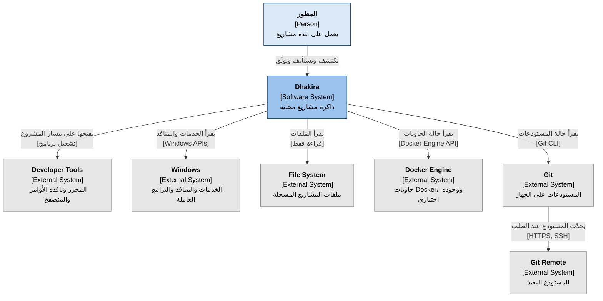
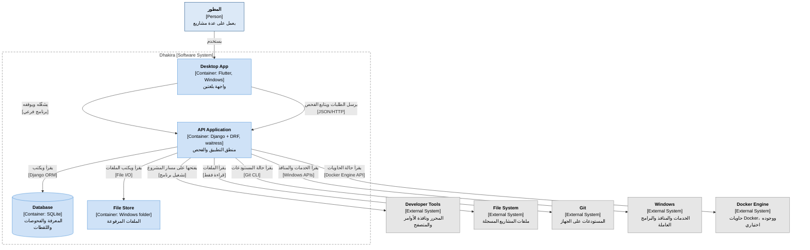
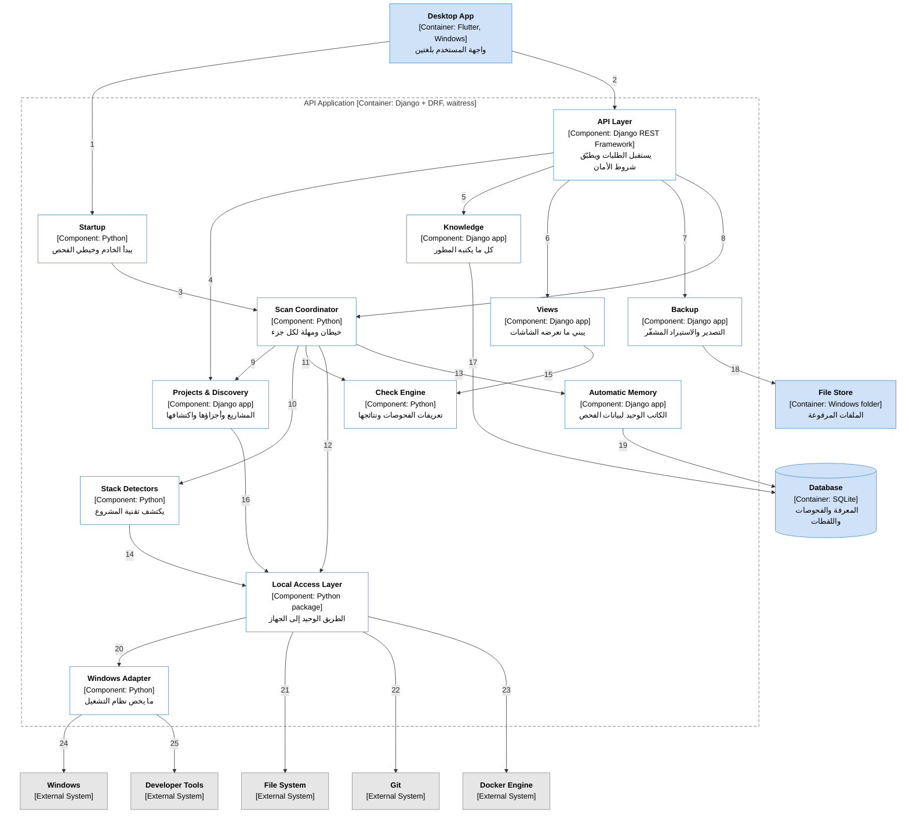

<h1 align="center">ذاكرة · Dhakira</h1>

<a href="../../README.md"><kbd> 🏠 <b>الرئيسية</b> </kbd></a>
&nbsp;&nbsp;
<a href="DhakiraSRS.md"><kbd> 📄 وثيقة المتطلبات </kbd></a>

<a href="DhakiraVision.md"><kbd> 📄 وثيقة الرؤية vision </kbd></a>

<a href="DhaliraUseCase.md"><kbd> 📄 وثيقة مخطط حالات الأستخدام </kbd></a>

<a href="DhakiraDomainModel.md"><kbd> 📄 وثيقة Domain Model  </kbd></a>

<a href="ActivityDiagrams.md"><kbd> 📄 وثيقة مخطط النشاط لأهم حالات الأستخدام </kbd></a>

<a href="DhakiraC4.md"><kbd> 📄 وثيقة ال C4 </kbd></a>

<a href="DhakiraERD.md"><kbd> 📄 وثيقة مخطط قاعدة البيانات </kbd></a>

<a href="SequenceResume.md"><kbd> 📄 وثيقة مخطط التسلسل لحالة أستئناف المشروع في التطبيق </kbd></a>

<a href="DhakiraArc42.md"><kbd> 📄 وثيقة المعمارية </kbd></a>

<a href="DhakiraApiContract.md"><kbd> 📄 وثيقة عقد ال Api  </kbd></a>

# نموذج C4 لتطبيق ذاكرة
 
C4 Architecture Model — Dhakira
 
> **الإصدار:** 1.3 · **الحالة:** معتمدة · **صاحب المنتج:** محمد
>
> مبنية على [وثيقة المتطلبات](DhakiraSRS.md) الإصدار 1.4.
 
---
 
## 1. مقدمة
 
### 1.1 الغرض من الوثيقة
 
تصف هذه الوثيقة كيف يُبنى تطبيق "ذاكرة": من أي أجزاء يتكون، وكيف تتواصل هذه الأجزاء، وما التقنية التي يُبنى بها كل جزء. وهي المرجع لكل من سيكتب كود التطبيق أو يراجعه.
 
لا تدخل الوثيقة في تفاصيل الكود. جداول قاعدة البيانات وتفاصيل الواجهات البرمجية مكانها وثائق التصميم التفصيلي.
 
### 1.2 طريقة القراءة
 
نموذج C4 يصف النظام على مستويات، كخريطة نقرّبها خطوة خطوة. المستوى الأول يرى التطبيق صندوقاً واحداً ومن حوله، والثاني يفتح هذا الصندوق، والثالث يفتح الخادم من الداخل. أما المستوى الرابع، وهو الكود نفسه، فلا يُرسم لأنه يتغير مع كل تعديل.
 
بعد كل مخطط جدولان: جدول بالعناصر وما يفعله كل منها، وجدول بالعلاقات بينها.
 
### 1.3 المصطلحات
 
| المصطلح | المعنى |
|---|---|
| النظام البرمجي | تطبيق ذاكرة كاملاً كما يراه المستخدم. |
| النظام الخارجي | برنامج أو خدمة خارج ذاكرة تتعامل معها، مثل Git وDocker. |
| الحاوية | برنامج يعمل وحده أو مخزن بيانات، بمصطلحات C4. ليست حاوية Docker. |
| المكوّن | قسم داخل الحاوية له مسؤولية واحدة واضحة. |
| الطبقة | مجموعة مكوّنات في المستوى نفسه، تستدعي ما تحتها فقط. |
| خيط التنفيذ | مسار عمل داخل الخادم يعمل بالتوازي مع غيره، فلا يوقف الفحص باقي التطبيق. |
| الفحص | قراءة حالة المشروع من الجهاز في لحظة معينة. |
| لقطة الحالة | ما وجده الفحص لجزء واحد من المشروع، مع وقت الفحص. |
| الجزء | قسم من المشروع مرتبط بمستودع Git، مثل الواجهة الخلفية أو الأمامية. |
 
---
 
## 2. مخطط السياق (System Context)
 
يجيب هذا المخطط عن سؤالين: من يستخدم ذاكرة، ومع أي أنظمة تتعامل؟ والفكرة الأهم فيه أن التطبيق يقرأ من الجهاز ولا يغيّر فيه شيئاً، ولا يتصل بالشبكة إلا عندما يطلب المطور تحديث مستودع من المستودع البعيد.
 

 
### العناصر
 
| # | العنصر | النوع | الوصف |
|---|---|---|---|
| 1 | المطور | Person | المستخدم الوحيد. يعمل على عدة مشاريع شخصية ولعملاء، على جهاز Windows واحد. |
| 2 | Dhakira | Software System | تطبيق يعمل على جهاز المطور، يجمع معرفة المشروع مع حالته المكتشفة، ويحفظ تاريخ هذه الحالة، ويكشف الاختلافات بينهما. |
| 3 | File System | External System | ملفات المشاريع. لا يقرأ التطبيق إلا داخل المشاريع والمجلدات الرئيسية التي سجلها المطور. |
| 4 | Git | External System | المستودعات على الجهاز. يقرؤها التطبيق بأوامر ثابتة لا تغيّر فيها شيئاً. |
| 5 | Windows | External System | خدمات Windows، والمنافذ المستخدمة، والبرامج قيد التشغيل. |
| 6 | Docker Engine | External System | حاويات Docker على الجهاز. إذا لم يكن Docker يعمل، تظهر حالة الحاويات "غير معروفة" لا "متوقفة". |
| 7 | Developer Tools | External System | VS Code ونافذة الأوامر والمتصفح وأداة قاعدة البيانات. يفتحها التطبيق فقط، ولا يشغّل بها شيئاً. |
| 8 | Git Remote | External System | المستودع البعيد، مثل GitHub. هو الاتصال الوحيد بالشبكة، ويحدث فقط عندما يطلب المطور التحديث، وبصلاحيات Git الموجودة على جهازه. |
 
### العلاقات
 
| من | إلى | الوصف | التقنية |
|---|---|---|---|
| المطور | Dhakira | يكتشف المشاريع، ويستأنف العمل، ويوثّق المعرفة | واجهة التطبيق |
| Dhakira | Developer Tools | يفتحها على مسار المشروع | تشغيل برنامج |
| Dhakira | Windows | يقرأ الخدمات والمنافذ والبرامج قيد التشغيل | Windows APIs |
| Dhakira | File System | يقرأ الملفات | قراءة فقط |
| Dhakira | Docker Engine | يقرأ حالة الحاويات | Docker Engine API |
| Dhakira | Git | يقرأ حالة المستودعات | Git CLI |
| Git | Git Remote | يحدّث المستودع من المستودع البعيد عند الطلب | HTTPS, SSH |
 
---
 
## 3. مخطط الحاويات (Containers)
 
يبدو التطبيق للمستخدم برنامجاً واحداً يثبّته ويفتحه بأيقونة واحدة، لكنه من الداخل أربع حاويات: الواجهة، والخادم الذي يحمل منطق التطبيق، وقاعدة البيانات، ومجلد الملفات المرفوعة. عندما يفتح المطور التطبيق، تشغّل الواجهة الخادم في الخلفية، وتغلقه معها عند الإغلاق.
 

 
### الحاويات
 
| # | الحاوية | التقنية | المسؤولية |
|---|---|---|---|
| 1 | Desktop App | Flutter, Windows | واجهة المستخدم بالعربية والإنجليزية. عند الفتح تشغّل الخادم وتمنحه رمزاً سرياً جديداً، وتغلقه عند الإغلاق. تعرض آخر حالة معروفة فوراً دون انتظار أي فحص، وتسأل عن حالة الفحص كل ثانيتين تقريباً ما دام جارياً. وإذا توقف الخادم فجأة، تبلغ المستخدم وتتيح إعادة تشغيله. |
| 2 | API Application | Python, Django + DRF, waitress | يحمل منطق التطبيق كله. لا يقبل إلا طلبات الواجهة على الجهاز نفسه، ومعها الرمز السري. ينفّذ الفحص في الخلفية، ويصل إلى الجهاز عبر طبقة واحدة، ولكل عملية خارجية ولكل جزء مهلة زمنية. وعند بدئه، أي فحص بقي معلّقاً من تشغيل سابق يُسجَّل منقطعاً مع سببه، ويبقى ما اكتمل من أجزائه. مكوّناته في القسم 4. |
| 3 | Database | SQLite | معرفة المشاريع، والفحوصات، وتاريخ لقطات الحالة، وسجل النشاط. ملف واحد يسمح بالقراءة أثناء كتابة الفحص. |
| 4 | File Store | Windows folder | الملفات التي يرفعها المطور. يقع مع قاعدة البيانات في مجلد بيانات التطبيق. |
 
### العلاقات
 
| من | إلى | الوصف | التقنية |
|---|---|---|---|
| المطور | Desktop App | يستخدم التطبيق | واجهة التطبيق |
| Desktop App | API Application | يشغّله ويوقفه | برنامج فرعي |
| Desktop App | API Application | يرسل الطلبات ويتابع حالة الفحص | JSON/HTTP على الجهاز نفسه |
| API Application | Database | يقرأ ويكتب | Django ORM |
| API Application | File Store | يقرأ ويكتب الملفات | قراءة وكتابة ملفات |
| API Application | Developer Tools | يفتحها على مسار المشروع | تشغيل برنامج |
| API Application | File System | يقرأ الملفات | قراءة فقط |
| API Application | Git | يقرأ حالة المستودعات | Git CLI |
| API Application | Windows | يقرأ الخدمات والمنافذ والبرامج قيد التشغيل | Windows APIs |
| API Application | Docker Engine | يقرأ حالة الحاويات | Docker Engine API |
 
---
 
## 4. مخطط المكوّنات (Components)
 
هذا المخطط يفتح الخادم من الداخل، وهو الأساس الذي يُكتب عليه الكود. الخادم مقسّم إلى أربع طبقات، وكل طبقة تستدعي ما تحتها فقط. عندما يفتح المطور مشروعاً مثلاً، يمر الطلب من طبقة الدخول إلى منسّق الفحص، فيجمع المنسّق الحالة من الجهاز عبر طبقة الوصول المحلي، ثم تحفظها الذاكرة التلقائية.
 
طبقة كل مكوّن مذكورة في جدول المكوّنات، والأرقام على الأسهم مشروحة في جدول العلاقات. السهمان 17 و18 يمثلان مكوّنات طبقة منطق التطبيق كلها، ورُسما من مكوّن واحد للاختصار.
 

 
### المكوّنات
 
| # | المكوّن | الطبقة | المسؤولية |
|---|---|---|---|
| 1 | Startup | الدخول | نقطة بداية الخادم. يستلم الرمز السري من الواجهة، ويختار منفذاً حراً ويبلغها به، ويُنهي الفحوصات التي بقيت معلّقة من تشغيل سابق، ثم يبدأ استقبال الطلبات وخيطي الفحص. |
| 2 | API Layer | الدخول | يستقبل طلبات الواجهة ويتحقق من صحتها ثم يمررها. شروط الأمان كلها هنا في مكان واحد: الرمز السري، وقبول طلبات الجهاز نفسه فقط، ورفض أي طلب يأتي من صفحة ويب. لا يحتوي منطق التطبيق. |
| 3 | Projects & Discovery | منطق التطبيق | المشاريع وأجزاؤها، والمجلدات الرئيسية، والمجلدات المرفوضة. يحسب اقتراحات الاكتشاف عند الطلب، ويطبّق قرارات المطور دفعة واحدة، ويعيد ربط المستودع إذا تغيّر مكانه، ويفتح أدوات المطور. |
| 4 | Knowledge | منطق التطبيق | كل ما يكتبه المطور: القيم المتوقعة، ودليل التشغيل، والوثائق، والملاحظات، والخدمات، وسجل النشر، والعملاء والتسليمات، ونقطة التوقف، والخطوات التالية، والاختلافات المقبولة. ويسجّل أحداث التطبيق المهمة في سجل النشاط. |
| 5 | Views | منطق التطبيق | يبني ما تعرضه الشاشات من آخر لقطات الحالة ومن المعرفة: شاشة الاستئناف، والاختلافات بين الموثّق والمكتشف، وحالة الأقسام، ومركز الانتباه، والنظرة العامة، وما تغيّر منذ زيارة المطور السابقة. يقرأ فقط، ولا يحفظ أي نتيجة. |
| 6 | Backup | منطق التطبيق | يصدّر المعرفة والملفات المرفوعة إلى ملف واحد مشفّر، ويستورده بعد التحقق من سلامته ومن توافق إصداره. |
| 7 | Scan Coordinator | الفحص | ينظّم الفحص بخيطين: واحد للفحص الكامل ولأي فحص يحتاج التحديث من المستودع البعيد، وآخر للمشروع الذي يفتحه المطور. المشروع الواحد لا يُفحص في الخيطين معاً. ولكل جزء مهلة زمنية، فإذا تجاوزها يُعرض الجزء "لم يُفحص" مع السبب، ويكمل الفحص الباقي. |
| 8 | Stack Detectors | الفحص | يكتشف التقنية التي بُني بها كل جزء، ويقترح معلومات من ملفاته، ويضيف الفحوصات الخاصة بها. يدعم Django في الإصدار الأول، والتقنية غير المدعومة تُعرض فحوصاتها "لم يُفحص" مع السبب. |
| 9 | Check Engine | الفحص | يحتوي تعريفات الفحوصات الثابتة: خطورة كل مشكلة، وطريقة المقارنة، والخطوة المقترحة. يحوّل ما جُمع إلى نتائج، ويمنح كل مشكلة هوية ثابتة عبر الفحوصات. لا يقرأ من الجهاز. |
| 10 | Automatic Memory | الفحص | المكوّن الوحيد الذي يكتب الفحوصات ولقطات الحالة: حالة كل فحص وسبب فشله أو انقطاعه، وحفظ اللقطة دون تكرار الحالات المتطابقة، وحذف القديم بانتظام. الكتابة تمر بالدور، فلا يكتب خيطا الفحص في اللحظة نفسها. |
| 11 | Local Access Layer | الوصول المحلي | الطريق الوحيد إلى الجهاز: Git والملفات وDocker وفتح الأدوات. لا يقرأ خارج المشاريع المسجلة، ولكل عملية خارجية مهلة، ولا يُخرج القيم السرية من ملف المتغيرات، ويحذف بيانات الدخول من روابط المستودعات. لا يعرف قاعدة البيانات، فيمكن فصله لاحقاً كبرنامج مستقل. |
| 12 | Windows Adapter | الوصول المحلي | كل ما يخص Windows: الخدمات، والمنافذ، والبرامج قيد التشغيل، وفتح الأدوات. دعم نظام تشغيل آخر يعني إضافة مكوّن مماثل بجانبه. |
 
### العلاقات
 
| # | من | إلى | الوصف | التقنية |
|---|---|---|---|---|
| 1 | Desktop App | Startup | يشغّل الخادم ويمنحه الرمز السري، ويغلقه عند الإغلاق | برنامج فرعي |
| 2 | Desktop App | API Layer | يرسل الطلبات ويسأل عن حالة الفحص الجاري | JSON/HTTP |
| 3 | Startup | Scan Coordinator | يبدأ خيطي الفحص، ويطلب إنهاء الفحوصات المعلّقة | استدعاء داخلي |
| 4 | API Layer | Projects & Discovery | طلبات المشاريع والاكتشاف وفتح الأدوات | استدعاء داخلي |
| 5 | API Layer | Knowledge | قراءة المعرفة وتعديلها | استدعاء داخلي |
| 6 | API Layer | Views | طلب ما تعرضه الشاشات | استدعاء داخلي |
| 7 | API Layer | Backup | التصدير والاستيراد | استدعاء داخلي |
| 8 | API Layer | Scan Coordinator | يطلب فحصاً ويقرأ حالته | استدعاء داخلي |
| 9 | Scan Coordinator | Projects & Discovery | يأخذ أجزاء المشروع ومساراتها | استدعاء داخلي |
| 10 | Scan Coordinator | Stack Detectors | يطلب اكتشاف التقنية وفحوصاتها الخاصة | استدعاء داخلي |
| 11 | Scan Coordinator | Check Engine | يحوّل ما جُمع إلى نتائج | استدعاء داخلي |
| 12 | Scan Coordinator | Local Access Layer | يجمع حالة Git مرة لكل مستودع، وحالة الجهاز مرة لكل فحص | استدعاء بمهلة |
| 13 | Scan Coordinator | Automatic Memory | يحفظ نتيجة كل جزء ويسجّل حالة الفحص | استدعاء بالدور |
| 14 | Stack Detectors | Local Access Layer | يقرأ ملفات المشروع | استدعاء داخلي |
| 15 | Views | Check Engine | يأخذ تعريفات الفحوصات وطرق المقارنة | استدعاء داخلي |
| 16 | Projects & Discovery | Local Access Layer | يقرأ المجلدات الرئيسية ويفتح الأدوات | استدعاء داخلي |
| 17 | طبقة منطق التطبيق | Database | تقرأ المعرفة وتكتبها، وViews تقرأ فقط | Django ORM |
| 18 | طبقة منطق التطبيق | File Store | Knowledge وBackup تحفظان الملفات المرفوعة وتقرآنها | قراءة وكتابة ملفات |
| 19 | Automatic Memory | Database | يكتب الفحوصات ولقطات الحالة ويحذف القديم | Django ORM |
| 20 | Local Access Layer | Windows Adapter | يستخدمه لكل ما يخص نظام التشغيل | استدعاء داخلي |
| 21 | Local Access Layer | File System | يقرأ الملفات داخل المشاريع المسجلة | قراءة فقط |
| 22 | Local Access Layer | Git | يقرأ حالة المستودعات، ويحدّثها من المستودع البعيد عند الطلب | Git CLI |
| 23 | Local Access Layer | Docker Engine | يقرأ حالة الحاويات | Docker Engine API |
| 24 | Windows Adapter | Windows | يقرأ الخدمات والمنافذ والبرامج قيد التشغيل | Windows APIs |
| 25 | Windows Adapter | Developer Tools | يفتحها على مسار المشروع | تشغيل برنامج |
 
---
 
## 5. القرارات المعمارية
 
كل قرار هنا يجيب عن سؤال واجهناه أثناء التصميم، ومكتوب بنتيجته وسببه باختصار.
 
| # | القرار | المضمون |
|---|---|---|
| 1 | تطبيق محلي بالكامل | يعمل على جهاز المطور ويقرأ مشاريعه مباشرة، بلا خادم بعيد ولا حساب مستخدم. وكل ما يلمس الجهاز معزول في طبقة واحدة يمكن فصلها لاحقاً كبرنامج مستقل. |
| 2 | Windows أولاً | الإصدار الأول لـ Windows فقط. وكل ما يخص نظام التشغيل معزول في مكوّن واحد، فدعم نظام آخر يعني إضافة مكوّن بجانبه دون تغيير الباقي. |
| 3 | قراءة فقط | لا يشغّل التطبيق كود أي مشروع، ولا يغيّر حالته أو بيئته، ولا يكتب في ملفاته. فتح أدوات المطور مسموح، أما التشغيل بها فلا. |
| 4 | تطبيق واحد من حاويتين | الواجهة تشغّل الخادم في الخلفية وتغلقه عند الإغلاق، والاثنان في برنامج تثبيت واحد، فلا يحتاج المستخدم تثبيت أي شيء آخر. |
| 5 | قاعدة بيانات بلا خادم | SQLite ملف واحد لا يحتاج تثبيتاً، ويسمح بالقراءة أثناء كتابة الفحص. يُحفظ في مجلد بيانات المستخدم على Windows، وبيانات التطوير في مجلد منفصل عن بيانات الاستخدام اليومي. |
| 6 | خادم محلي محمي | لا يمكن الوصول إلى الخادم من جهاز آخر، ولا من صفحات الويب المفتوحة على الجهاز نفسه. يختار منفذاً حراً في كل تشغيل، فلا يتعارض مع منافذ مشاريع المطور، وكل شروط الأمان في مكان واحد. |
| 7 | طبقات باتجاه واحد | كل طبقة في الخادم تستدعي ما تحتها فقط. وحساب النتائج وبناء الشاشات لا يقرأ من الجهاز ولا يكتب في قاعدة البيانات، فيُختبر وحده بسهولة. |
| 8 | الفحص عند الطلب وفي الخلفية | تعرض الواجهة آخر حالة معروفة مع عمرها فوراً. وللفحص خيطان: واحد للفحص الكامل وللتحديث من المستودع البعيد، وآخر للمشروع المفتوح، فلا ينتظر المطور انتهاء فحص طويل ليرى مشروعه. |
| 9 | كاتب واحد لبيانات الفحص | جمع الحالة من الجهاز لا يلمس قاعدة البيانات، والحفظ كله يمر بمكوّن واحد وبالدور. فيعمل الخيطان معاً دون أن تتزاحم الكتابة. |
| 10 | ذاكرة تلقائية | يحفظ التطبيق تاريخ حالة كل جزء من المشروع دون تكرار الحالات المتطابقة، فيعرف ما تغيّر ومنذ متى دون أن يكتب المطور شيئاً. |
| 11 | الأعطال تُكتشف وتُعرض | لكل عملية خارجية مهلة، ولكل جزء مهلة، والفحص لا يبقى معلّقاً أبداً. والجزء الذي تعذّر فحصه يظهر مع سببه، ولا يظهر أبداً كأنه سليم. |
| 12 | نواة مستقلة عن التقنية | الفحوصات الخاصة بكل تقنية في مكوّن منفصل، تبدأ بـ Django. وإضافة تقنية جديدة لا تغيّر باقي الخادم. |
| 13 | بلا خدمات إضافية | لا يحتاج التطبيق أي خادم أو خدمة أخرى ليعمل، فيعمل حتى لو كانت الخدمات التي يفحصها متوقفة. |
 

