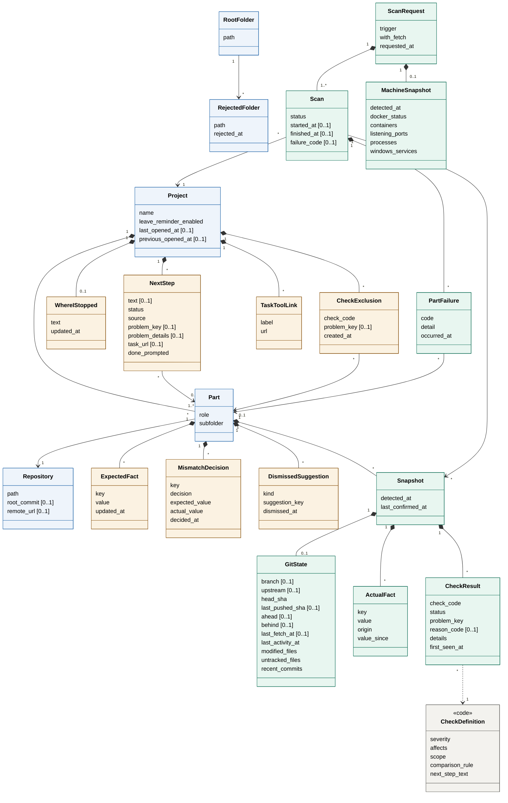
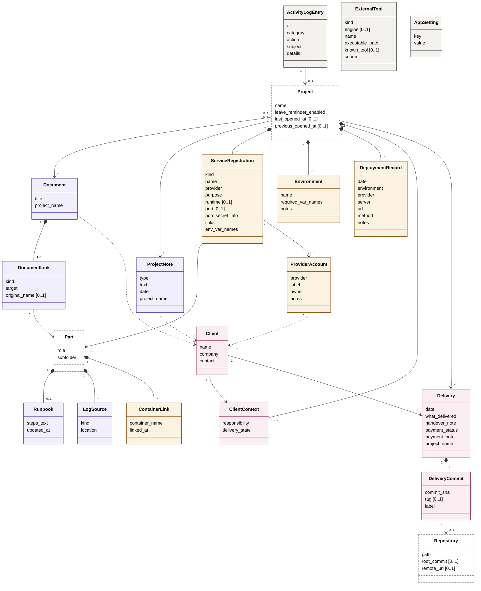

<h1 align="center">ذاكرة · Dhakira</h1>

<a href="../../README.md"><kbd> 🏠 <b>الرئيسية</b> </kbd></a>
&nbsp;&nbsp;
<a href="DhakiraSRS.md"><kbd> 📄 وثيقة المتطلبات </kbd></a>
&nbsp;&nbsp;
<a href="DhakiraVision.md"><kbd> 📄 وثيقة الرؤية vision </kbd></a>
&nbsp;&nbsp;
<a href="DhaliraUseCase.md"><kbd> 📄 وثيقة مخطط حالات الأستخدام </kbd></a>
&nbsp;&nbsp;
<a href="DhakiraDomainModel.md"><kbd> 📄 وثيقة Domain Model  </kbd></a>
&nbsp;&nbsp;
<a href="ActivityDiagrams.md"><kbd> 📄 وثيقة مخطط النشاط لأهم حالات الأستخدام </kbd></a>
&nbsp;&nbsp;
<a href="DhakiraC4.md"><kbd> 📄 وثيقة ال C4 </kbd></a>
&nbsp;&nbsp;
<a href="DhakiraERD.md"><kbd> 📄 وثيقة مخطط قاعدة البيانات </kbd></a>
&nbsp;&nbsp;
<a href="SequenceResume.md"><kbd> 📄 وثيقة مخطط التسلسل لحالة أستئناف المشروع في التطبيق </kbd></a>
&nbsp;&nbsp;
<a href="DhakiraArc42.md"><kbd> 📄 وثيقة المعمارية </kbd></a>
&nbsp;&nbsp;
<a href="DhakiraApiContract.md"><kbd> 📄 وثيقة عقد ال Api  </kbd></a>

# النموذج المفاهيمي: تطبيق ذاكرة
 
Domain Model — Dhakira
 
> **الإصدار:** 1.2 · **الحالة:** معتمدة · **صاحب المنتج:** محمد
>
> مبني على [وثيقة المتطلبات](DhakiraSRS.md).
 
يصف هذا النموذج المفاهيم التي يتعامل معها التطبيق والعلاقات بينها: ما المشروع، وما الذي يتذكره التطبيق عنه، وما الذي يكتبه المطور. هو خريطة للمعنى قبل أن يكون تصميماً لقاعدة البيانات، ولذلك يعرض المفاهيم وأهم خصائصها دون أي سلوك أو كود.
 
أسماء المفاهيم والخصائص بالإنجليزية لأنها الأسماء التي ستُستعمل في التصميم والكود، وشرحها كله بالعربية.
 
## طريقة قراءة المخططات
 
كل صندوق مفهوم: اسمه في الأعلى، وخصائصه تحته. وكل خط علاقة بين مفهومين، والأرقام عند طرفيه تقول كم عنصراً يشارك فيها.
 
| ما تراه في المخطط | المعنى | المصطلح في UML |
|---|---|---|
| خط ينتهي بمعيّن ممتلئ | الجزء يعيش مع الكل ويُحذف معه، والمعيّن عند الكل | Composition |
| خط ينتهي بسهم | علاقة بين مفهومين مستقلين | Association |
| خط متقطع ينتهي بسهم | المفهوم يشير إلى آخر دون أن يملكه | Dependency |
| `<<code>>` فوق اسم المفهوم | تعريف ثابت في كود التطبيق، لا يُحفظ | Stereotype |
| `1` | واحد بالضبط | Multiplicity |
| `0..1` | واحد أو لا شيء | Multiplicity |
| `*` | صفر أو أكثر | Multiplicity |
| `1..*` | واحد أو أكثر | Multiplicity |
 
الرقم يُقرأ عند الطرف الآخر من الخط. فالعلاقة بين المشروع والجزء تُقرأ هكذا: كل مشروع له جزء واحد أو أكثر، وكل جزء ينتمي إلى مشروع واحد.
 
ألوان الصناديق تدل على المجموعة: الأزرق للبنية، والأخضر للذاكرة التلقائية، والبرتقالي لمعرفة المطور، والبنفسجي للوثائق والسجلات، والوردي للعملاء، والرمادي لما هو داخلي. والصندوق ذو الإطار المتقطع مفهوم مشروح في مخطط آخر.
 
## 1. النواة
 
النواة هي ما يجعل التطبيق مفيداً حتى لو لم يكتب المطور شيئاً: المشروع وأجزاؤه، والفحص الذي يتذكر حالة كل جزء مع الوقت، وما يضيفه المطور فوق ذلك من قيم متوقعة وقرارات وملاحظات.
 

 
### قرارات التصميم
 
| القرار | السبب |
|---|---|
| الجزء منفصل عن المستودع. | قد يضم مستودع واحد عدة أجزاء، لكل منها مجلده. |
| الفحص طلب، وفيه فحص لكل مشروع. | ما يخص الطلب يُحفظ مرة واحدة، ولكل مشروع حالته، ولا يُفحص مشروع مرتين في الوقت نفسه. |
| لكل جزء لقطة حالة، وتُحفظ فقط عندما تتغير. | إذا تعذر فحص جزء، تُحفظ حالة الأجزاء الأخرى. ومعرفة ما تغيّر تعني مقارنة لقطتين مختلفتين للجزء نفسه، دون عشرات اللقطات المتطابقة. |
| تعذر فحص الجزء يُحفظ وحده. | يبقى عمر آخر لقطة للجزء صادقاً، ويعرف المطور سبب العطل. |
| للفحص حالة «انقطع». | ما اكتمل من الأجزاء قبل إغلاق التطبيق يبقى، والمشروع لا يُعتبر مفحوصاً كاملاً، ولا يُعرض الانقطاع كعطل. |
| آخر لقطة للجهاز فقط. | الاستئناف يحتاج حالة الجهاز الآن، لا تاريخها. |
| القيمة المتوقعة والقيمة الفعلية مفهومان منفصلان. | الأولى يكتبها المطور ويعدّلها، والثانية يجدها الفحص ولا تتغير بعد حفظها. فلا يكتب أي مصدر فوق الآخر. |
| اختيار المطور يُحفظ قيمةً متوقعة. | مثل تقنية الجزء، فيغلب ما يكتشفه التطبيق دون أن يُعرض كاختلاف. |
| قرار الاختلاف يحفظ القيمتين وقت القرار. | يبقى القرار صالحاً ما دامت القيمتان كما هما، ولا يعود قرار قديم وحده إذا رجعت القيمة إلى ما كانت عليه. |
| تعريفات الفحوصات جزء من كود التطبيق. | خطورة كل فحص ونطاقه وقاعدة المقارنة والخطوة المقترحة ثابتة، فلا حاجة لحفظها. |
| نتيجة الفحص رمز وقيم، لا جملة. | الواجهة بلغتين، فتكتب كل لغة الجملة من قالبها. |
| الخطوة التالية ترتبط بالمشكلة عبر هويتها الثابتة، ومعها نسخة من قيمها. | لقطات الحالة القديمة تُحذف مع الوقت، والهوية والقيم تبقى. |
| الإخفاء لمشكلة واحدة في جزء، أو لفحص كامل في المشروع. | إخفاء إنذار كاذب لا يخفي مشكلة حقيقية من الفحص نفسه ولا في جزء آخر. |
| اقتراحات المشاريع لا تُحفظ، ويُحفظ ما رفضه المطور. وكذلك الاقتراحات داخل المشروع: يُحفظ ما تجاهله فقط. | الاقتراح يُحسب من جديد في كل بحث أو فحص، والاقتراح الذي لم يقرر فيه المطور يظهر في المرة القادمة تلقائياً. |
| كل جزء مستودع Git. | المجلدات الأخرى تُضاف كروابط وثائق. |
| ملاحظة أين توقفت واحدة للمشروع كله. | تُحفظ نسختها الحالية فقط، وتحديثها يُسجَّل في سجل النشاط، وتُقارن بآخر نشاط في كل الأجزاء. |
| يحفظ المشروع وقت الزيارة السابقة. | ما تغيّر منذ زيارة المطور أهم له مما تغيّر منذ آخر فحص، لأن الفحوصات قد تتكرر وهو غائب. |
| يُسأل المطور مرة واحدة فقط عن إنجاز خطوة. | عندما تختفي المشكلة المرتبطة بالخطوة، لا يتكرر السؤال. |
 
### ما يُحسب ولا يُحفظ
 
بعض ما يعرضه التطبيق لا يظهر في المخطط، لأنه يُحسب عند العرض من آخر لقطات الحالة ومن معرفة المطور، ولا يُحفظ كمعلومة مستقلة: الاختلاف بين القيمة المتوقعة والقيمة الفعلية ومنذ متى ظهر، وهل ما زال قرار المطور فيه صالحاً، وحالة كل قسم (متوقف، أو يحتاج انتباهاً، أو لا مشاكل مكتشفة)، وما تغيّر منذ الزيارة السابقة، وتعارض المنافذ، ومركز الانتباه، وحالة المستودع المفقود، وعدد الـ commits منذ آخر تسليم.
 
## 2. المفاهيم الطرفية
 
هذه المفاهيم تحفظ ما لا يمكن اكتشافه: كيف يُشغَّل الجزء، وأين الوثائق، وبماذا يرتبط المشروع، ولمن سُلّم. وأغلبها يتفرع من المشروع أو من أجزائه، وسجل العميل يبقى مع العميل.
 

 
### قرارات التصميم
 
| القرار | السبب |
|---|---|
| دليل التشغيل نص حر لكل جزء. | القيم التي تُقارن، مثل المنفذ والنسخة والخدمات، تبقى قيماً متوقعة، لأن النص الحر لا يُقارن. |
| للوثيقة أكثر من رابط بأنواع مختلفة. | الوثيقة نفسها قد تكون على الجهاز وعلى الإنترنت معاً، والملف المرفوع نوع من الروابط. |
| قواعد البيانات والخدمات المحلية والخارجية تُسجَّل بالطريقة نفسها، وكل خدمة مرتبطة بجزء. | كلها خدمات يعتمد عليها المشروع دون أي قيمة سرية، والفحص يجري لكل جزء على حدة. |
| لكل حساب لدى مزوّد مالك. | قد يملك العميل الحساب، وقد يملكه المطور. والحساب الواحد قد يخدم أكثر من مشروع. |
| المسؤولية وحالة التسليم في سياق العميل، لا في المشروع. | الاثنتان تخصان علاقة المشروع بالعميل، وحالة التسليم منفصلة عن حالة النشر. |
| سجل العميل مرتبط بالعميل مباشرة، وبالمشروع ما دام موجوداً. | يبقى ما سُلّم وما دُفع والملاحظات والوثائق بعد إزالة المشروع، باسم المشروع، ما لم يختر المطور حذفها. |
| نسخة الكود المسلَّمة سطر لكل مستودع. | المشروع قد يتكون من عدة مستودعات، ولكل منها نسخته. |
| ملاحظات الاجتماعات ملاحظات من نوع العميل. | التطبيق يحفظ ما يغيّر شيئاً في المشروع، ولا يدير العلاقة مع العميل. |
| للمشروع عميل واحد أو لا عميل. | العميل معلومة مرتبطة بالمشروع، وليس نوعاً خاصاً من المشاريع. |
| أدوات المطور تُكتشف وتُحفظ. | يعرض التطبيق المتاح على الجهاز فقط، واختيار المطور يغلب ما اكتُشف. |
 
## 3. جدول توصيف مخطط الكلاسات
 
لكل مفهوم في المخططين سطر يشرح معناه وخصائصه وعلاقاته. الأرقام من 1 إلى 27 ثابتة منذ الإصدار الأول، والمفاهيم التي أضيفت بعده تبدأ من 28.
 
| # | الكلاس | المجموعة | الوصف | الخصائص | العلاقات |
|---|---|---|---|---|---|
| 1 | `RootFolder` | البنية | مجلد يختاره المطور ليبحث التطبيق داخله عن المشاريع. يبحث التطبيق في المجلدات الموجودة مباشرة داخله فقط. | `path` | يملك قائمة المجلدات المرفوضة. |
| 2 | `RejectedFolder` | البنية | مجلد اقترحه التطبيق كمشروع ورفضه المطور. القائمة ظاهرة ويمكن استعادة أي عنصر منها. أما الاقتراحات نفسها فلا تُحفظ، بل تُحسب من جديد في كل بحث. | `path` `rejected_at` | يتبع مجلداً رئيسياً واحداً. |
| 3 | `Project` | البنية | وحدة العمل التي يحددها المطور. المشروع ليس مجلداً ولا مستودعاً، بل مجموعة أجزاء يجمعها المطور. ويحفظ وقت آخر زيارتين، لتعرض شاشة الاستئناف ما تغيّر منذ الزيارة السابقة. | `name` `leave_reminder_enabled`: تذكير ملاحظة أين توقفت عند المغادرة `last_opened_at`: وقت الزيارة الحالية، اختياري `previous_opened_at`: وقت الزيارة السابقة، اختياري | يتكون من جزء أو أكثر، وله ملاحظة أين توقفت واحدة على الأكثر، وخطوات تالية، وإخفاءات، وفحوصات، وسياق عميل واحد على الأكثر. |
| 4 | `Part` | البنية | قسم من المشروع له دور، مثل الواجهة الخلفية أو الأمامية. قد تكون عدة أجزاء في مستودع واحد، لكل منها مجلده. وكل جزء مرتبط بمستودع Git. | `role` `subfolder`: المجلد داخل المستودع | ينتمي إلى مشروع واحد ويشير إلى مستودع واحد. يملك القيم المتوقعة، وقرارات الاختلاف، والاقتراحات المتجاهلة، ولقطات الحالة. |
| 5 | `Repository` | البنية | مستودع Git على الجهاز، بهوية لا تتغير إذا نُقل. | `path` `root_commit`: بصمة ثابتة لاكتشاف النقل، اختياري `remote_url`: بلا اسم مستخدم أو كلمة سر، اختياري | يشير إليه جزء أو أكثر، وتشير إليه نسخ الكود المسلَّمة. |
| 6 | `Scan` | الذاكرة التلقائية | فحص مشروع واحد داخل طلب فحص. له حالة: بالانتظار، أو جارٍ، أو اكتمل، أو اكتمل جزئياً، أو انقطع، أو فشل. والفحص الذي انقطع بإغلاق التطبيق يُبقي ما اكتمل من الأجزاء، ولا يُعتبر عطلاً. | `status` `started_at`: اختياري `finished_at`: اختياري `failure_code`: سبب الفشل أو الانقطاع، اختياري | ينتمي إلى طلب فحص وإلى مشروع، وينتج لقطة حالة لكل جزء تغيّرت حالته، ويسجّل أعطال الأجزاء. |
| 7 | `Snapshot` | الذاكرة التلقائية | لقطة الحالة: ما وجده الفحص لجزء واحد في لحظة معينة. تاريخ اللقطات هو الذاكرة التلقائية، ويُحذف القديم منها وفق سياسة ثابتة. وإذا لم تتغير حالة الجزء، لا تُحفظ لقطة جديدة، بل يُسجَّل أن اللقطة الأخيرة ما زالت صحيحة. | `detected_at` `last_confirmed_at`: آخر مرة شوهدت فيها الحالة صحيحة، ومنه يُحسب عمرها | تنتمي إلى جزء واحد وفحص واحد، وتضم حالة Git والقيم الفعلية ونتائج الفحوصات. |
| 8 | `GitState` | الذاكرة التلقائية | حالة Git التي وجدها الفحص للجزء، وهي أساس شاشة الاستئناف. | `branch`: اختياري `upstream`: الفرع البعيد المقابل، اختياري `head_sha`: آخر commit محلي `last_pushed_sha`: آخر commit مرفوع، اختياري `ahead`: ما لم يُرفع، اختياري `behind`: ما لم يُسحب، بعد التحديث من المستودع البعيد فقط، اختياري `last_fetch_at`: اختياري `last_activity_at` `modified_files`: الأسماء فقط `untracked_files`: الأسماء فقط `recent_commits` | جزء من لقطة الحالة، وقد تغيب إذا تعذرت القراءة. |
| 9 | `ActualFact` | الذاكرة التلقائية | قيمة فعلية غير سرية وجدها الفحص، مثل المنفذ أو النسخة أو الخدمة. لا تتغير بعد حفظها، وتحمل منذ متى هي بهذه القيمة. | `key` `value` `origin`: الملف أو المصدر الذي قُرئت منه `value_since`: منذ متى بهذه القيمة | جزء من لقطة الحالة. |
| 10 | `CheckResult` | الذاكرة التلقائية | نتيجة فحص واحد: سليم، أو تنبيه، أو خطر، أو لم يُفحص. لا تُحفظ الرسالة جملة، بل رمزها وقيمها، فتكتبها الواجهة بلغتها. | `check_code` `status` `problem_key`: هوية المشكلة الثابتة عبر الفحوصات `reason_code`: اختياري `details`: قيم الرسالة `first_seen_at`: أول ظهور للمشكلة | جزء من لقطة الحالة، ويعتمد على تعريف الفحص. |
| 11 | `CheckDefinition` | داخلي | تعريف ثابت لكل فحص، مكتوب في كود التطبيق ولا يُحفظ في قاعدة البيانات. ونطاق الفحص الجزء، أو المستودع كله فتُعرض مشكلته وتُعدّ مرة واحدة. | `severity` `affects` `scope`: الجزء أو المستودع `comparison_rule`: تطابق تام، أو بداية، أو احتواء `next_step_text` | تشير إليه نتائج الفحوصات والإخفاءات. |
| 12 | `ExpectedFact` | معرفة المطور | قيمة محددة كتبها المطور أو أكدها، مثل المنفذ أو النسخة. هي القيمة المتوقعة التي تُقارن بها القيمة الفعلية. النص الحر لا يُقارن. ومنها اختيارات المطور التي تغلب ما يكتشفه التطبيق، مثل تقنية الجزء وملف إعدادات الإنتاج. | `key` `value` `updated_at` | تنتمي إلى جزء. |
| 13 | `MismatchDecision` | معرفة المطور | قرار المطور في اختلاف: مقصود، أو المشروع هو المخطئ. يحفظ القيمتين وقت القرار، والقرار يبقى صالحاً ما دامت القيمتان كما هما. وإذا عاد الاختلاف، يُذكَّر المطور بقراره السابق. | `key` `decision` `expected_value` `actual_value` `decided_at` | ينتمي إلى جزء. |
| 14 | `WhereIStopped` | معرفة المطور | ملاحظة أين توقفت، واحدة للمشروع كله. اختيارية، وتُحفظ نسختها الحالية فقط، ولا يُستنتج منها شيء. | `text` `updated_at`: يُقارن بآخر نشاط Git في كل الأجزاء | تنتمي إلى مشروع، واحدة على الأكثر. |
| 15 | `NextStep` | معرفة المطور | خطوة تالية تساعد على الاستئناف، لا على التخطيط. والخطوة التي جاءت من مشكلة تحفظ هويتها ونسخة من قيمها، فيبقى نصها مفهوماً بعد حذف لقطتها. | `text`: يُكتب من قيم المشكلة إذا لم يكتبه المطور، اختياري `status` `source`: المطور، أو مشكلة، أو طلب عميل `problem_key`: اختياري `problem_details`: قيم المشكلة وقت الإضافة، اختياري `task_url`: اختياري `done_prompted`: هل سُئل المطور عن إنجازها | تنتمي إلى مشروع، وقد تخص جزءاً منه، وترتبط بالمشكلة عبر هويتها الثابتة. |
| 16 | `Runbook` | الوثائق والسجلات | دليل التشغيل: ما يكتبه المطور عن طريقة تشغيل جزء، كنص حر. القيم القابلة للمقارنة تبقى قيماً متوقعة. | `steps_text` `updated_at` | ينتمي إلى جزء، واحد على الأكثر. |
| 17 | `LogSource` | الوثائق والسجلات | مكان سجلات الأخطاء لجزء. المحتوى يُقرأ للعرض فقط ولا يُحفظ. | `kind`: ملف، أو حاوية، أو نافذة أوامر، أو خدمة خارجية `location` | ينتمي إلى جزء. |
| 18 | `Document` | الوثائق والسجلات | وثيقة من وثائق المشروع، مثل عقد أو متطلبات أو دليل. والوثيقة المرتبطة بعميل تبقى معه بعد إزالة المشروع، إذا اختار المطور إبقاء سجل العميل. | `title` `project_name`: اسم المشروع، يبقى بعد إزالته | تنتمي إلى مشروع، ولها رابط أو أكثر، وقد ترتبط بعميل. |
| 19 | `DocumentLink` | الوثائق والسجلات | مكان من أماكن الوثيقة. لكل وثيقة أكثر من رابط، ويُرفع المهم فقط. | `kind`: مسار على الجهاز، أو رابط، أو ملف في المستودع، أو ملف مرفوع `target` `original_name`: للملف المرفوع، اختياري | جزء من وثيقة. والملف داخل المستودع يشير إلى الجزء الذي فيه. |
| 20 | `ProjectNote` | الوثائق والسجلات | ملاحظة شخصية، أو قرار، أو ملاحظة عن العميل. والنوع الأخير لمشروع له عميل، ويبقى مع العميل بعد إزالة المشروع إذا اختار المطور ذلك. | `type` `text` `date` `project_name`: اسم المشروع، يبقى بعد إزالته | تنتمي إلى مشروع، وملاحظة العميل تشير إلى العميل. |
| 21 | `ServiceRegistration` | معرفة المطور | قاعدة بيانات، أو خدمة محلية، أو خدمة خارجية يستخدمها جزء من المشروع، دون أي قيمة سرية. ومعها مكان تشغيلها: مثبتة على الجهاز، أو داخل Docker، أو برنامج يشغّله المطور، أو خارجية. | `kind`: قاعدة بيانات، أو محلية، أو خارجية `name` `provider` `purpose` `runtime`: مكان التشغيل، اختياري `port`: اختياري `non_secret_info` `links`: لوحة التحكم والوثائق وصفحة الحالة `env_var_names`: الأسماء فقط | تنتمي إلى مشروع، وترتبط بالجزء الذي يستخدمها، وقد تشير إلى حساب لدى المزوّد. |
| 22 | `ProviderAccount` | معرفة المطور | حساب لدى مزوّد الخدمة. قد يخدم الحساب الواحد أكثر من خدمة في أكثر من مشروع. | `provider` `label` `owner`: المطور أو العميل `notes` | قد يشير إلى عميل. |
| 23 | `DeploymentRecord` | معرفة المطور | عملية نشر مسجلة، مع البيئة التي نُشر إليها. | `date` `environment`: من بيئات المشروع، أو غيرها `provider` `server` `url` `method`: طريقة النشر `notes` | ينتمي إلى مشروع. |
| 24 | `Client` | العملاء | ملف بسيط للعميل، وليس نظام إدارة عملاء. الاسم وحده إلزامي. | `name` `company` `contact` | يرتبط بسياق عميل لمشروع أو أكثر، ويملك سجل تسليماته. |
| 25 | `ClientContext` | العملاء | علاقة المشروع بعميله. للمشروع عميل واحد أو لا عميل، وحالة التسليم منفصلة عن حالة النشر. | `responsibility`: المطور، أو العميل، أو مشتركة `delivery_state`: قيد العمل، أو مكتمل، أو مُسلَّم | ينتمي إلى مشروع واحد ويرتبط بعميل واحد. |
| 26 | `Delivery` | العملاء | تسليم واحد: الأول أو تحديث لاحق. لكل تسليم حالة دفع، والمبلغ يُكتب في الملاحظة. والتسليم جزء من سجل العميل، فيبقى بعد إزالة المشروع إذا اختار المطور ذلك. | `date` `what_delivered` `handover_note` `payment_status`: لم يُدفع، أو جزئي، أو دُفع، أو مجاني `payment_note` `project_name`: اسم المشروع، يبقى بعد إزالته | ينتمي إلى عميل، ويشير إلى مشروعه ما دام موجوداً، ويضم نسخ الكود المسلَّمة. |
| 27 | `ActivityLogEntry` | داخلي | سجل لأهم ما قام به التطبيق ولقرارات المطور، مثل حسم اختلاف أو تحديث ملاحظة أين توقفت. قرارات المطور تبقى دائماً، وأحداث التطبيق سنة. | `at` `category`: قرار أو حدث `action` `subject` `details` | قد يشير إلى مشروع. |
| 28 | `ScanRequest` | الذاكرة التلقائية | طلب فحص واحد، من المطور أو عند فتح مشروع أو بعد إضافته، لمشروع واحد أو لكل المشاريع. وفحص كل المشاريع طلب جديد في كل مرة. | `trigger` `with_fetch`: هل يشمل التحديث من المستودع البعيد `requested_at` | يضم فحصاً لكل مشروع، ولقطة واحدة لحالة الجهاز. |
| 29 | `PartFailure` | الذاكرة التلقائية | جزء تعذر فحصه في فحص معين، مع السبب كما هو، أو جزء لم يكتمل فحصه لأن الفحص انقطع. يبقى بها عمر آخر لقطة للجزء صادقاً. | `code` `detail`: رسالة النظام كما هي `occurred_at` | ينتمي إلى فحص، ويشير إلى الجزء. |
| 30 | `MachineSnapshot` | الذاكرة التلقائية | حالة الجهاز كله وقت الطلب: Docker والحاويات، والمنافذ المستعملة، والبرامج قيد التشغيل، وخدمات Windows. تُحفظ آخر لقطة فقط، لأن الاستئناف يحتاج حالة الجهاز الآن لا تاريخها. | `detected_at` `docker_status`: يعمل، أو متوقف، أو غير معروف `containers` `listening_ports` `processes` `windows_services` | تنتمي إلى طلب فحص. |
| 31 | `CheckExclusion` | معرفة المطور | إخفاء قرره المطور: مشكلة واحدة في جزء معين، مثل إنذار كاذب، أو فحص كامل لا ينطبق على المشروع. الإخفاء لا يوقف الفحص، ويمكن التراجع عنه. | `check_code` `problem_key`: فارغ يعني الفحص كله، اختياري `created_at` | ينتمي إلى مشروع، وإخفاء المشكلة الواحدة يخص جزءاً. |
| 32 | `DismissedSuggestion` | معرفة المطور | اقتراح تجاهله المطور، مثل خدمة أو مكان سجل أو قيمة متوقعة. الاقتراح يُحسب من جديد في كل فحص، فيُحفظ ما تجاهله حتى لا يعود، ويمكن إرجاعه. | `kind` `suggestion_key`: هوية الاقتراح الثابتة `dismissed_at` | ينتمي إلى جزء. |
| 33 | `TaskToolLink` | معرفة المطور | رابط أداة مهام خارجية يستخدمها المشروع، مثل لوحة مهام. | `label` `url` | ينتمي إلى مشروع. |
| 34 | `Environment` | معرفة المطور | بيئة من بيئات المشروع، مثل التطوير أو التجريب أو الإنتاج، مع أسماء المتغيرات المطلوبة فيها دون قيمها. | `name` `required_var_names`: الأسماء فقط `notes` | تنتمي إلى مشروع. |
| 35 | `ContainerLink` | معرفة المطور | ربط يدوي لحاوية بجزء، عندما لا تدل معلومات الحاوية على مسار المشروع. | `container_name` `linked_at` | ينتمي إلى جزء. |
| 36 | `DeliveryCommit` | العملاء | نسخة الكود المسلَّمة لمستودع واحد في تسليم، كما يقرؤها التطبيق من الجهاز لحظة التسجيل. ومنها يُعرف عدد الـ commits منذ آخر تسليم. | `commit_sha` `tag`: اسم النسخة للعرض، اختياري `label`: أدوار الأجزاء وقت التسليم | جزء من تسليم، وتشير إلى المستودع ما دام موجوداً. |
| 37 | `ExternalTool` | داخلي | أداة على الجهاز يفتح بها التطبيق موارد المشروع: محرر الكود، أو نافذة الأوامر، أو أداة قاعدة بيانات لكل نوع. يكتشفها التطبيق أو يختارها المطور. | `kind` `engine`: نوع قاعدة البيانات، اختياري `name` `executable_path` `known_tool`: من الأدوات المعروفة، اختياري `source`: اكتشفها التطبيق، أو اختارها المطور | مستقلة عن المشاريع. |
| 38 | `AppSetting` | داخلي | إعداد للتطبيق كله، مثل لغة الواجهة والمظهر وحجم النص، فيفتح التطبيق بها مباشرة. | `key` `value` | مستقل عن المشاريع. |
 

