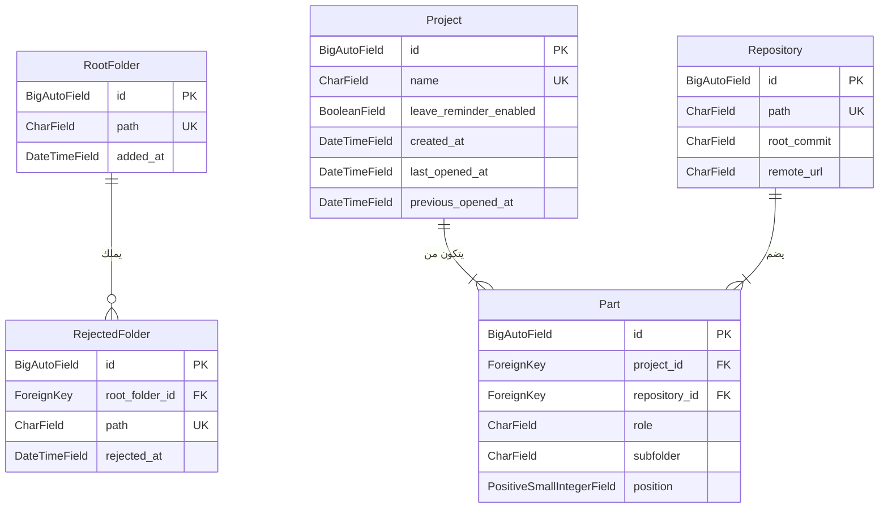
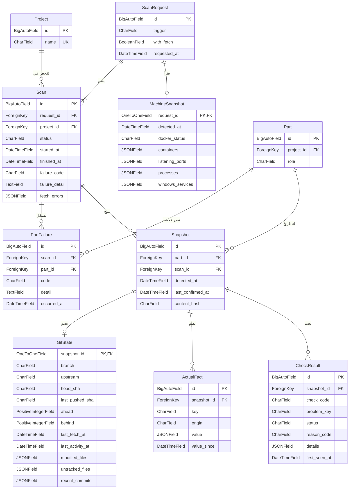
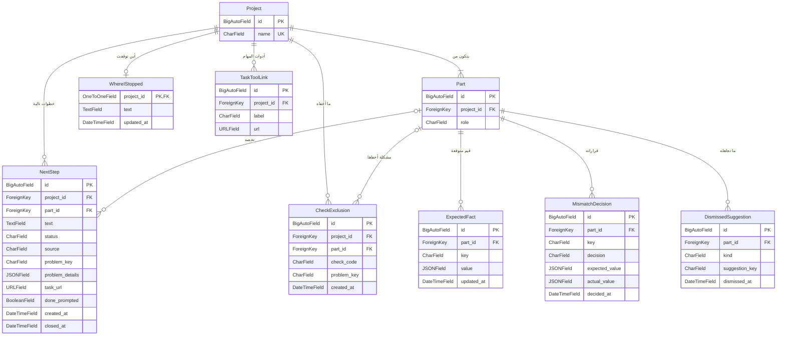
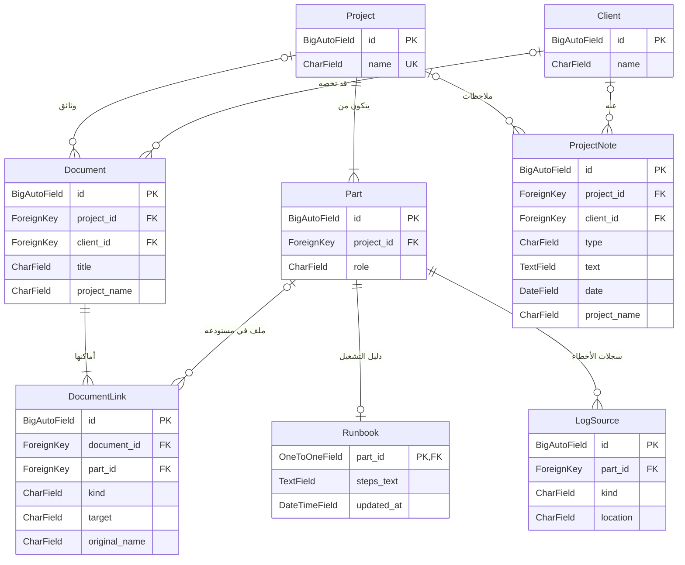
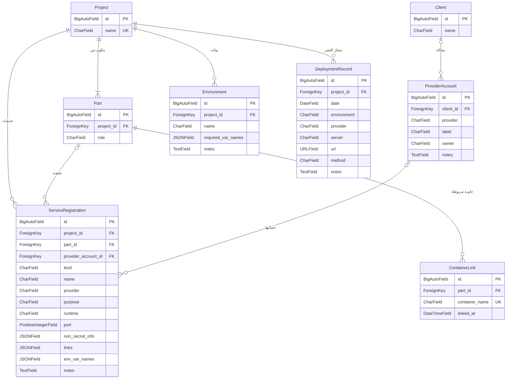
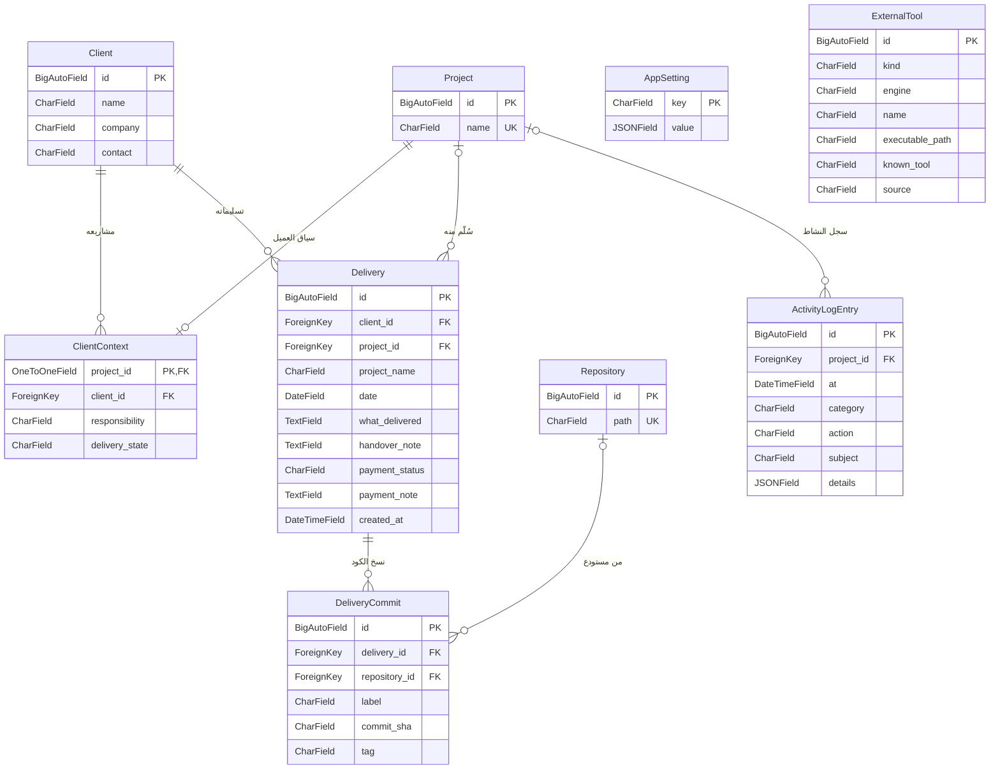

<h1 align="center">ذاكرة · Dhakira</h1>

<a href="../../README.md"><kbd> 🏠 <b>الرئيسية</b> </kbd></a>
&nbsp;&nbsp;
<a href="DhakiraSRS.md"><kbd> 📄 وثيقة المتطلبات </kbd></a>
&nbsp;&nbsp;
<a href="DhakiraVision.md"><kbd> 📄 وثيقة الرؤية vision </kbd></a>
&nbsp;&nbsp;
<a href="DhaliraUseCase.md"><kbd> 📄 وثيقة مخطط حالات الأستخدام </kbd></a>
&nbsp;&nbsp;
<a href="DhakiraDomainModel.md"><kbd> 📄 وثيقة Domain Model  </kbd></a>
&nbsp;&nbsp;
<a hrevf="ActivityDiagrams.md"><kbd> 📄 وثيقة مخطط النشاط لأهم حالات الأستخدام </kbd></a>
&nbsp;&nbsp;
<a href="DhakiraC4.md"><kbd> 📄 وثيقة ال C4 </kbd></a>
&nbsp;&nbsp;
<a href="DhakiraERD.md"><kbd> 📄 وثيقة مخطط قاعدة البيانات </kbd></a>
&nbsp;&nbsp;
<a href="SequenceResume.md"><kbd> 📄 وثيقة مخطط التسلسل لحالة أستئناف المشروع في التطبيق </kbd></a>
&nbsp;&nbsp;
<a href="DhakiraArc42.md"><kbd> 📄 وثيقة المعمارية </kbd></a>
&nbsp;&nbsp;
<a href="DhakiraApiContract.md"><kbd> 📄 وثيقة عقد ال Api  </kbd></a>

# مخطط قاعدة البيانات: تطبيق ذاكرة
 
Entity Relationship Diagram — Dhakira
 
> **الإصدار:** 1.2 · **الحالة:** معتمد · **صاحب المنتج:** محمد
>
> مبني على [النموذج المفاهيمي](DhakiraDomainModel.md) و[وثيقة المعمارية](DhakiraC4.md).
 
يصف هذا المخطط الجداول التي يحفظ فيها التطبيق بياناته، وأعمدة كل جدول، والعلاقات بينها. كل البيانات في قاعدة بيانات واحدة على جهاز المطور، والتطبيق مقسّم إلى ثمانية أقسام، لكل قسم جداوله.
 
أسماء الجداول والأعمدة وأنواعها بالإنجليزية لأنها الأسماء نفسها في الكود، وشرحها كله بالعربية.
 
## طريقة قراءة المخطط
 
كل صندوق جدول: اسمه في الأعلى، وتحته أعمدته. لكل عمود نوعه ثم اسمه، وبجانبه نوع المفتاح إن وُجد. وكل خط علاقة بين جدولين، والرمز عند طرف الخط يقول كم صفاً من الجدول القريب منه يشارك فيها.
 
| ما تراه في المخطط | المعنى |
|---|---|
| `PK` | المفتاح الأساسي: رقم الصف |
| `FK` | عمود يشير إلى صف في جدول آخر |
| `UK` | قيمة لا تتكرر في الجدول |
| `\|\|` | واحد بالضبط |
| `\|o` أو `o\|` | واحد أو لا شيء |
| `\|{` | واحد أو أكثر |
| `o{` | صفر أو أكثر |
 
مثال: الخط بين `Project` و`Part` عليه `||` عند المشروع و`|{` عند الجزء. يُقرأ: لكل مشروع جزء أو أكثر، وكل جزء ينتمي إلى مشروع واحد، ولذلك في جدول الجزء عمود `project_id`.
 
وصف كل عمود في قائمة "أعمدة الجداول" تحت كل مخطط. والجدول الذي يُشرح في قسم آخر يظهر في المخطط باسمه وأعمدته الأساسية فقط.
 
## المصطلحات
 
| المصطلح | المعنى |
|---|---|
| الفحص | قراءة حالة مشروع من الجهاز في لحظة معينة. |
| طلب الفحص | ضغطة واحدة تبدأ فحصاً لمشروع أو أكثر. |
| لقطة الحالة | ما وجده الفحص لجزء واحد، مع وقته. |
| لقطة الجهاز | حالة الجهاز كله وقت الطلب. |
| القيمة المتوقعة | ما يقول المطور إنه يجب أن يكون، مثل رقم المنفذ. |
| القيمة الفعلية | ما وجده الفحص على الجهاز. |
| الاختلاف | عدم تطابق القيمة الفعلية مع المتوقعة. |
| هوية المشكلة | اسم ثابت للمشكلة، يعرف به التطبيق أنها نفسها في كل فحص. |
| سجل العميل | ما سُلّم للعميل، والملاحظات عنه، والوثائق المرتبطة به. |
 
## 1. تقسيم الجداول
 
كل قسم من التطبيق يملك جداوله ولا يكتب في جداول غيره. وكل قسم يقرأ من المشاريع وأجزائها، وبعض الأقسام تقرأ من غيرها، مثل الفحص الذي يقرأ الخدمات المسجلة قبل أن يبدأ. ولا يقرأ قسم من قسم يقرأ منه.
 
| القسم | دوره | الجداول |
|---|---|---|
| `projects` | المشاريع وبنيتها | 1 إلى 5 |
| `memory` | الفحص والذاكرة التلقائية، وهو وحده يكتب في جداوله | 6 إلى 13 |
| `resume` | العودة للمشروع | 14 إلى 16 |
| `expectations` | القيم المتوقعة وقرارات المطور فيما وجده التطبيق | 17 إلى 20 |
| `docs` | الوثائق ودليل التشغيل وأماكن السجلات | 21 إلى 25 |
| `services` | الخدمات والبيئات والنشر | 26 إلى 30 |
| `clients` | العملاء والتسليمات | 31 إلى 34 |
| `core` | سجل النشاط والإعدادات والأدوات، وتستعملها كل الأقسام | 35 إلى 37 |
 
## 2. المشاريع وبنيتها
 
هذا ما يعرفه التطبيق عن مكان المشاريع وتكوينها. المشروع ليس مجلداً ولا مستودعاً، بل مجموعة أجزاء يجمعها المطور. فمشروع CoachLink مثلاً قد يتكون من جزء للواجهة الخلفية وجزء للواجهة الأمامية، في مستودعين أو في مستودع واحد.
 

 
| # | الجدول | الوصف | العلاقات |
|---|---|---|---|
| 1 | `RootFolder` | مجلد يختاره المطور ليبحث التطبيق داخله عن المشاريع. | يملك المجلدات المرفوضة. |
| 2 | `RejectedFolder` | مجلد اقترحه التطبيق كمشروع فرفضه المطور. القائمة ظاهرة، ويمكن استعادة أي عنصر منها. | يتبع مجلداً رئيسياً واحداً. |
| 3 | `Project` | وحدة العمل التي يحددها المطور، وتتكون من جزء أو أكثر. ويُحفظ وقت آخر فتح له ووقت الزيارة التي قبلها، ليعرض التطبيق ما تغيّر منذ زيارة المطور. | له أجزاء وفحوص، وكل ما يكتبه المطور عنه. |
| 4 | `Repository` | مستودع Git على الجهاز، ببصمة ثابتة تكشف نقله إلى مسار آخر. | يشير إليه جزء أو أكثر. |
| 5 | `Part` | قسم من المشروع له دور، مثل الواجهة الخلفية. قد تكون عدة أجزاء في مستودع واحد، لكل منها مجلده. | ينتمي إلى مشروع ومستودع. |
 

أعمدة الجداول

 
**1. `RootFolder`**
 
| العمود | النوع | المفتاح | اختياري | الوصف |
|---|---|---|---|---|
| `id` | `BigAutoField` | PK |  |  |
| `path` | `CharField` | UK |  | المسار |
| `added_at` | `DateTimeField` |  |  |  |
 
**2. `RejectedFolder`**
 
| العمود | النوع | المفتاح | اختياري | الوصف |
|---|---|---|---|---|
| `id` | `BigAutoField` | PK |  |  |
| `root_folder_id` | `ForeignKey` | FK |  |  |
| `path` | `CharField` | UK |  | المجلد المرفوض |
| `rejected_at` | `DateTimeField` |  |  |  |
 
**3. `Project`**
 
| العمود | النوع | المفتاح | اختياري | الوصف |
|---|---|---|---|---|
| `id` | `BigAutoField` | PK |  |  |
| `name` | `CharField` | UK |  | اسم المشروع |
| `leave_reminder_enabled` | `BooleanField` |  |  | تذكير عند المغادرة |
| `created_at` | `DateTimeField` |  |  |  |
| `last_opened_at` | `DateTimeField` |  | نعم | آخر فتح |
| `previous_opened_at` | `DateTimeField` |  | نعم | الزيارة السابقة |
 
**4. `Repository`**
 
| العمود | النوع | المفتاح | اختياري | الوصف |
|---|---|---|---|---|
| `id` | `BigAutoField` | PK |  |  |
| `path` | `CharField` | UK |  | المسار على الجهاز |
| `root_commit` | `CharField` |  | نعم | بصمة ثابتة لاكتشاف النقل |
| `remote_url` | `CharField` |  | نعم | بلا اسم مستخدم أو كلمة سر |
 
**5. `Part`**
 
| العمود | النوع | المفتاح | اختياري | الوصف |
|---|---|---|---|---|
| `id` | `BigAutoField` | PK |  |  |
| `project_id` | `ForeignKey` | FK |  |  |
| `repository_id` | `ForeignKey` | FK |  |  |
| `role` | `CharField` |  |  | الدور بكلمات المطور |
| `subfolder` | `CharField` |  |  | فارغ يعني جذر المستودع |
| `position` | `PositiveSmallIntegerField` |  |  | ترتيب العرض |
 

## 3. الفحص والذاكرة التلقائية
 
كل فحص يضيف صفحة إلى تاريخ المشروع، وهذه الصفحات هي الذاكرة التلقائية. عندما يضغط المطور "افحص الكل" يُنشأ طلب فحص واحد، وفيه فحص لكل مشروع، ولقطة واحدة لحالة الجهاز. وكل فحص ينتج لقطة حالة لكل جزء نجح فحصه، ويسجّل لكل جزء تعذر فحصه سبب ذلك.
 

 
| # | الجدول | الوصف | العلاقات |
|---|---|---|---|
| 6 | `ScanRequest` | طلب فحص واحد: عند فتح مشروع، أو تحديث مشروع، أو تحديث كل المشاريع، أو بعد اكتشاف مشاريع جديدة أو إضافتها. | له فحص لكل مشروع، ولقطة جهاز واحدة. |
| 7 | `Scan` | فحص مشروع واحد داخل الطلب، بحالته: بالانتظار، أو جارٍ، أو اكتمل، أو اكتمل جزئياً، أو انقطع، أو فشل مع السبب. والانقطاع يعني أن التطبيق أُغلق أو توقف قبل أن تكتمل أجزاء المشروع. | ينتمي إلى طلب ومشروع، وينتج لقطات الحالة. |
| 8 | `PartFailure` | جزء تعذر فحصه بسبب انتهاء المهلة أو خطأ أثناء القراءة، أو لم يكتمل فحصه لأن الفحص انقطع. الجزء الذي لم يُفحص لا ينشئ لقطة حالة، فيبقى عمر آخر لقطة صادقاً. | ينتمي إلى فحص وجزء. |
| 9 | `MachineSnapshot` | حالة الجهاز كله وقت الطلب: Docker، والحاويات، والمنافذ المستخدمة، والبرامج قيد التشغيل، والخدمات المثبتة. تبقى آخر لقطة فقط. | تنتمي إلى طلب فحص. |
| 10 | `Snapshot` | لقطة الحالة: ما وجده الفحص لجزء واحد. إذا تطابق المحتوى مع اللقطة السابقة لا تُنشأ لقطة جديدة، بل يُحدَّث وقت آخر تأكيد. | تنتمي إلى جزء وفحص، وتضم حالة Git والقيم الفعلية ونتائج الفحوصات. |
| 11 | `GitState` | حالة Git للجزء: الفرع، وما لم يُرفع وما لم يُسحب، والملفات المعدّلة، وآخر خمسين commit. | جزء من لقطة الحالة. |
| 12 | `ActualFact` | قيمة فعلية غير سرية وجدها الفحص، مع مصدرها ومنذ متى بقيت كما هي. قد يكون للمفتاح الواحد أكثر من مصدر. | جزء من لقطة الحالة. |
| 13 | `CheckResult` | نتيجة فحص واحد: سليم، أو تنبيه، أو خطر، أو لم يُفحص. تحتفظ المشكلة بهويتها وتاريخ أول ظهورها. | جزء من لقطة الحالة. |
 

أعمدة الجداول

 
**6. `ScanRequest`**
 
| العمود | النوع | المفتاح | اختياري | الوصف |
|---|---|---|---|---|
| `id` | `BigAutoField` | PK |  |  |
| `trigger` | `CharField` |  |  | فتح، تحديث، تحديث الكل، بعد الاكتشاف أو الإضافة |
| `with_fetch` | `BooleanField` |  |  | مع تحديث من المستودع البعيد |
| `requested_at` | `DateTimeField` |  |  |  |
 
**7. `Scan`**
 
| العمود | النوع | المفتاح | اختياري | الوصف |
|---|---|---|---|---|
| `id` | `BigAutoField` | PK |  |  |
| `request_id` | `ForeignKey` | FK |  |  |
| `project_id` | `ForeignKey` | FK |  |  |
| `status` | `CharField` |  |  | بالانتظار، جارٍ، اكتمل، جزئي، انقطع، فشل |
| `started_at` | `DateTimeField` |  | نعم |  |
| `finished_at` | `DateTimeField` |  | نعم |  |
| `failure_code` | `CharField` |  | نعم | سبب الفشل أو الانقطاع |
| `failure_detail` | `TextField` |  | نعم | رسالة النظام كما هي |
| `fetch_errors` | `JSONField` |  |  | أخطاء التحديث من المستودع البعيد |
 
**8. `PartFailure`**
 
| العمود | النوع | المفتاح | اختياري | الوصف |
|---|---|---|---|---|
| `id` | `BigAutoField` | PK |  |  |
| `scan_id` | `ForeignKey` | FK |  |  |
| `part_id` | `ForeignKey` | FK |  |  |
| `code` | `CharField` |  |  | رمز السبب، أو لم يكتمل فحصه |
| `detail` | `TextField` |  |  | رسالة النظام كما هي |
| `occurred_at` | `DateTimeField` |  |  |  |
 
**9. `MachineSnapshot`**
 
| العمود | النوع | المفتاح | اختياري | الوصف |
|---|---|---|---|---|
| `request_id` | `OneToOneField` | PK, FK |  |  |
| `detected_at` | `DateTimeField` |  |  |  |
| `docker_status` | `CharField` |  |  | يعمل، متوقف، غير معروف |
| `containers` | `JSONField` |  |  | كل الحاويات وحالتها |
| `listening_ports` | `JSONField` |  |  | المنافذ ومن يستخدمها |
| `processes` | `JSONField` |  |  | البرامج الشغالة ومساراتها |
| `windows_services` | `JSONField` |  |  | الخدمات المثبتة وحالتها |
 
**10. `Snapshot`**
 
| العمود | النوع | المفتاح | اختياري | الوصف |
|---|---|---|---|---|
| `id` | `BigAutoField` | PK |  |  |
| `part_id` | `ForeignKey` | FK |  |  |
| `scan_id` | `ForeignKey` | FK |  |  |
| `detected_at` | `DateTimeField` |  |  |  |
| `last_confirmed_at` | `DateTimeField` |  |  | آخر مرة شوهدت صحيحة |
| `content_hash` | `CharField` |  |  | بصمة المحتوى بلا أوقات |
 
**11. `GitState`**
 
| العمود | النوع | المفتاح | اختياري | الوصف |
|---|---|---|---|---|
| `snapshot_id` | `OneToOneField` | PK, FK |  |  |
| `branch` | `CharField` |  | نعم | الفرع الحالي |
| `upstream` | `CharField` |  | نعم | الفرع البعيد المقابل |
| `head_sha` | `CharField` |  |  | آخر commit محلي |
| `last_pushed_sha` | `CharField` |  | نعم | آخر commit مرفوع |
| `ahead` | `PositiveIntegerField` |  | نعم | لم تُرفع |
| `behind` | `PositiveIntegerField` |  | نعم | لم تُسحب |
| `last_fetch_at` | `DateTimeField` |  | نعم | آخر تحديث من البعيد |
| `last_activity_at` | `DateTimeField` |  |  | آخر نشاط |
| `modified_files` | `JSONField` |  |  | الأسماء فقط |
| `untracked_files` | `JSONField` |  |  | الأسماء فقط |
| `recent_commits` | `JSONField` |  |  | آخر خمسين commit |
 
**12. `ActualFact`**
 
| العمود | النوع | المفتاح | اختياري | الوصف |
|---|---|---|---|---|
| `id` | `BigAutoField` | PK |  |  |
| `snapshot_id` | `ForeignKey` | FK |  |  |
| `key` | `CharField` |  |  | مفتاح معرّف في الكود |
| `origin` | `CharField` |  |  | الملف أو المصدر |
| `value` | `JSONField` |  |  | قيمة أو قائمة |
| `value_since` | `DateTimeField` |  |  | منذ متى بهذه القيمة |
 
**13. `CheckResult`**
 
| العمود | النوع | المفتاح | اختياري | الوصف |
|---|---|---|---|---|
| `id` | `BigAutoField` | PK |  |  |
| `snapshot_id` | `ForeignKey` | FK |  |  |
| `check_code` | `CharField` |  |  | رمز الفحص |
| `problem_key` | `CharField` |  |  | هوية المشكلة الثابتة |
| `status` | `CharField` |  |  | سليم، تنبيه، خطر، لم يُفحص |
| `reason_code` | `CharField` |  | نعم | رمز السبب |
| `details` | `JSONField` |  |  | قيم الرسالة |
| `first_seen_at` | `DateTimeField` |  |  | أول ظهور |
 

## 4. العودة للمشروع وما يجب أن يكون
 
هنا ما يكتبه المطور ليستأنف عمله، والقيم التي يتوقعها، وقراراته فيما وجده التطبيق: الاختلافات، والمشاكل التي أخفاها، والاقتراحات التي تجاهلها. فإذا قال المطور إن منفذ الجزء 8000 ووجد الفحص 8001، يُحفظ قوله في جدول، وما وجده الفحص في جدول آخر، ولا يكتب أحدهما فوق الآخر.
 

 
| # | الجدول | الوصف | العلاقات |
|---|---|---|---|
| 14 | `WhereIStopped` | ملاحظة "أين توقفت"، واحدة للمشروع، بنسختها الحالية فقط. | تنتمي إلى مشروع. |
| 15 | `NextStep` | خطوة تساعد على الاستئناف، مصدرها المطور أو مشكلة أو طلب عميل. الخطوة التي جاءت من مشكلة تحفظ نسخة من قيمها، فيُكتب نصها بلغة الواجهة حتى يعدّله المطور. | تنتمي إلى مشروع، وقد ترتبط بجزء ومشكلة. |
| 16 | `TaskToolLink` | رابط لأداة مهام خارجية يستخدمها المشروع. | ينتمي إلى مشروع. |
| 17 | `ExpectedFact` | قيمة محددة كتبها المطور أو أكدها، وتُقارن بالقيمة الفعلية. ومنها أيضاً ما يغيّر طريقة الفحص، مثل التقنية وملف إعدادات الإنتاج، وهذا لا يُعرض عليه اختلاف. | تنتمي إلى جزء. |
| 18 | `MismatchDecision` | قرار المطور في اختلاف: مقصود، أو المشروع هو المخطئ. يبقى أثره ما دامت القيم كما كانت وقت القرار، ولا يعود وحده إذا تغيرت ثم رجعت. | ينتمي إلى جزء. |
| 19 | `CheckExclusion` | مشكلة واحدة أخفاها المطور في جزء معين، أو فحص كامل أخفاه من مشروعه، مثل إنذار كاذب أو فحص لا ينطبق. الفحص يبقى يعمل، والإخفاء في العرض فقط. | ينتمي إلى مشروع، وإلى جزء للمشكلة الواحدة. |
| 20 | `DismissedSuggestion` | اقتراح تجاهله المطور، حتى لا يعود بعد كل فحص. ويستطيع إرجاعه متى شاء. | ينتمي إلى جزء. |
 

أعمدة الجداول

 
**14. `WhereIStopped`**
 
| العمود | النوع | المفتاح | اختياري | الوصف |
|---|---|---|---|---|
| `project_id` | `OneToOneField` | PK, FK |  |  |
| `text` | `TextField` |  |  | نص الملاحظة |
| `updated_at` | `DateTimeField` |  |  |  |
 
**15. `NextStep`**
 
| العمود | النوع | المفتاح | اختياري | الوصف |
|---|---|---|---|---|
| `id` | `BigAutoField` | PK |  |  |
| `project_id` | `ForeignKey` | FK |  |  |
| `part_id` | `ForeignKey` | FK | نعم | الجزء الذي تخصه |
| `text` | `TextField` |  | نعم | فارغ لخطوة المشكلة حتى تُعدَّل |
| `status` | `CharField` |  |  | مفتوحة، مغلقة |
| `source` | `CharField` |  |  | المطور، مشكلة، طلب عميل |
| `problem_key` | `CharField` |  | نعم | هوية المشكلة |
| `problem_details` | `JSONField` |  | نعم | قيم المشكلة وقت الإضافة |
| `task_url` | `URLField` |  | نعم | مهمة في أداة خارجية |
| `done_prompted` | `BooleanField` |  |  | سُئل عن إنجازها |
| `created_at` | `DateTimeField` |  |  |  |
| `closed_at` | `DateTimeField` |  | نعم |  |
 
**16. `TaskToolLink`**
 
| العمود | النوع | المفتاح | اختياري | الوصف |
|---|---|---|---|---|
| `id` | `BigAutoField` | PK |  |  |
| `project_id` | `ForeignKey` | FK |  |  |
| `label` | `CharField` |  |  | اسم الأداة |
| `url` | `URLField` |  |  |  |
 
**17. `ExpectedFact`**
 
| العمود | النوع | المفتاح | اختياري | الوصف |
|---|---|---|---|---|
| `id` | `BigAutoField` | PK |  |  |
| `part_id` | `ForeignKey` | FK |  |  |
| `key` | `CharField` |  |  | نفس مفتاح القيمة الفعلية |
| `value` | `JSONField` |  |  | قيمة أو قائمة |
| `updated_at` | `DateTimeField` |  |  |  |
 
**18. `MismatchDecision`**
 
| العمود | النوع | المفتاح | اختياري | الوصف |
|---|---|---|---|---|
| `id` | `BigAutoField` | PK |  |  |
| `part_id` | `ForeignKey` | FK |  |  |
| `key` | `CharField` |  |  |  |
| `decision` | `CharField` |  |  | مقصود، المشروع هو المخطئ |
| `expected_value` | `JSONField` |  |  | القيمة المتوقعة وقتها |
| `actual_value` | `JSONField` |  |  | القيم الفعلية وقتها |
| `decided_at` | `DateTimeField` |  |  |  |
 
**19. `CheckExclusion`**
 
| العمود | النوع | المفتاح | اختياري | الوصف |
|---|---|---|---|---|
| `id` | `BigAutoField` | PK |  |  |
| `project_id` | `ForeignKey` | FK |  |  |
| `part_id` | `ForeignKey` | FK | نعم | للمشكلة الواحدة |
| `check_code` | `CharField` |  |  | الفحص المخفي |
| `problem_key` | `CharField` |  | نعم | مشكلة واحدة، أو فارغ للكل |
| `created_at` | `DateTimeField` |  |  |  |
 
**20. `DismissedSuggestion`**
 
| العمود | النوع | المفتاح | اختياري | الوصف |
|---|---|---|---|---|
| `id` | `BigAutoField` | PK |  |  |
| `part_id` | `ForeignKey` | FK |  |  |
| `kind` | `CharField` |  |  | خدمة، خطوة، سجل، قيمة |
| `suggestion_key` | `CharField` |  |  | هوية الاقتراح الثابتة |
| `dismissed_at` | `DateTimeField` |  |  |  |
 

## 5. الوثائق
 
بعض المعرفة لا يمكن اكتشافها: أين عقد العميل، وكيف يُشغَّل الجزء، وأين يكتب سجلات أخطائه. للوثيقة الواحدة أكثر من مكان، فقد تكون على الجهاز وعلى الإنترنت معاً، ويُرفع المهم منها فقط.
 

 
| # | الجدول | الوصف | العلاقات |
|---|---|---|---|
| 21 | `Document` | وثيقة من وثائق المشروع، مثل عقد أو متطلبات. الوثيقة المرتبطة بالعميل تبقى معه بعد إزالة المشروع، إذا اختار المطور ذلك. | تنتمي إلى مشروع، وقد ترتبط بعميل. |
| 22 | `DocumentLink` | مكان من أماكن الوثيقة: مسار على الجهاز، أو رابط، أو ملف داخل مستودع أحد الأجزاء، أو ملف مرفوع. | جزء من وثيقة، وقد يشير إلى جزء. |
| 23 | `ProjectNote` | ملاحظة شخصية، أو قرار، أو ملاحظة عن العميل. والملاحظة عن العميل تحفظ عميلها، وتبقى معه بعد إزالة المشروع إذا اختار المطور ذلك. | تنتمي إلى مشروع، وقد ترتبط بعميل. |
| 24 | `Runbook` | دليل التشغيل: ما يكتبه المطور عن طريقة تشغيل الجزء. | ينتمي إلى جزء. |
| 25 | `LogSource` | مكان سجلات الأخطاء لجزء. المحتوى نفسه لا يُحفظ أبداً. | ينتمي إلى جزء. |
 

أعمدة الجداول

 
**21. `Document`**
 
| العمود | النوع | المفتاح | اختياري | الوصف |
|---|---|---|---|---|
| `id` | `BigAutoField` | PK |  |  |
| `project_id` | `ForeignKey` | FK | نعم | فارغ بعد إزالة المشروع |
| `client_id` | `ForeignKey` | FK | نعم |  |
| `title` | `CharField` |  |  | عنوان الوثيقة |
| `project_name` | `CharField` |  |  | اسم المشروع بعد إزالته |
 
**22. `DocumentLink`**
 
| العمود | النوع | المفتاح | اختياري | الوصف |
|---|---|---|---|---|
| `id` | `BigAutoField` | PK |  |  |
| `document_id` | `ForeignKey` | FK |  |  |
| `part_id` | `ForeignKey` | FK | نعم | للملف داخل المستودع |
| `kind` | `CharField` |  |  | مسار، رابط، ملف في المستودع، مرفوع |
| `target` | `CharField` |  |  |  |
| `original_name` | `CharField` |  | نعم | للملف المرفوع فقط |
 
**23. `ProjectNote`**
 
| العمود | النوع | المفتاح | اختياري | الوصف |
|---|---|---|---|---|
| `id` | `BigAutoField` | PK |  |  |
| `project_id` | `ForeignKey` | FK | نعم | فارغ بعد إزالة المشروع |
| `client_id` | `ForeignKey` | FK | نعم | للملاحظة عن العميل |
| `type` | `CharField` |  |  | شخصية، قرار، عن العميل |
| `text` | `TextField` |  |  |  |
| `date` | `DateField` |  |  |  |
| `project_name` | `CharField` |  |  | اسم المشروع بعد إزالته |
 
**24. `Runbook`**
 
| العمود | النوع | المفتاح | اختياري | الوصف |
|---|---|---|---|---|
| `part_id` | `OneToOneField` | PK, FK |  |  |
| `steps_text` | `TextField` |  |  | الخطوات والأوامر |
| `updated_at` | `DateTimeField` |  |  |  |
 
**25. `LogSource`**
 
| العمود | النوع | المفتاح | اختياري | الوصف |
|---|---|---|---|---|
| `id` | `BigAutoField` | PK |  |  |
| `part_id` | `ForeignKey` | FK |  |  |
| `kind` | `CharField` |  |  | ملف، حاوية، نافذة أوامر، خارجية |
| `location` | `CharField` |  |  | المكان |
 

## 6. التشغيل والخدمات والنشر
 
يكفي أن يعرف المطور بماذا يرتبط مشروعه وأين يجد كل خدمة. الخدمة تختلف عن مزوّدها، فقد تُشترى خدمة عبر منصة وسيطة، ويخدم الحساب الواحد أكثر من خدمة. ولكل خدمة مكان تشغيل: مثبتة على Windows، أو في حاوية، أو برنامج يشغّله المطور بنفسه، أو على الإنترنت. ولا يُحفظ أي مفتاح أو كلمة سر.
 

 
| # | الجدول | الوصف | العلاقات |
|---|---|---|---|
| 26 | `ServiceRegistration` | قاعدة بيانات أو خدمة محلية أو خدمة خارجية يعتمد عليها الجزء، ومكان تشغيلها، دون أي قيمة سرية. خدمات الجزء المسجلة هي الخدمات المطلوبة عند المقارنة. | تنتمي إلى مشروع وجزء، وقد ترتبط بحساب لدى المزوّد. |
| 27 | `ProviderAccount` | حساب لدى مزوّد الخدمة، مالكه المطور أو العميل. قد يخدم الحساب الواحد أكثر من خدمة في أكثر من مشروع. | قد يرتبط بعميل. |
| 28 | `Environment` | بيئة من بيئات المشروع، والمتغيرات المطلوبة فيها بأسمائها فقط. | تنتمي إلى مشروع. |
| 29 | `DeploymentRecord` | عملية نشر مسجلة. | تنتمي إلى مشروع. |
| 30 | `ContainerLink` | حاوية ربطها المطور بجزء يدوياً، لأن التطبيق لم يستطع نسبتها. | تنتمي إلى جزء. |
 

أعمدة الجداول

 
**26. `ServiceRegistration`**
 
| العمود | النوع | المفتاح | اختياري | الوصف |
|---|---|---|---|---|
| `id` | `BigAutoField` | PK |  |  |
| `project_id` | `ForeignKey` | FK |  |  |
| `part_id` | `ForeignKey` | FK | نعم | إلزامي عند الإضافة |
| `provider_account_id` | `ForeignKey` | FK | نعم |  |
| `kind` | `CharField` |  |  | قاعدة بيانات، محلية، خارجية |
| `name` | `CharField` |  |  | اسم الخدمة |
| `provider` | `CharField` |  |  | المزوّد أو نوع القاعدة |
| `purpose` | `CharField` |  |  | الغرض |
| `runtime` | `CharField` |  | نعم | مثبتة، حاوية، برنامج، خارجية |
| `port` | `PositiveIntegerField` |  | نعم |  |
| `non_secret_info` | `JSONField` |  |  | اسم القاعدة والعنوان |
| `links` | `JSONField` |  |  | لوحة التحكم والوثائق والحالة |
| `env_var_names` | `JSONField` |  |  | الأسماء فقط |
| `notes` | `TextField` |  |  |  |
 
**27. `ProviderAccount`**
 
| العمود | النوع | المفتاح | اختياري | الوصف |
|---|---|---|---|---|
| `id` | `BigAutoField` | PK |  |  |
| `client_id` | `ForeignKey` | FK | نعم |  |
| `provider` | `CharField` |  |  |  |
| `label` | `CharField` |  |  | الحساب أو البريد |
| `owner` | `CharField` |  |  | المطور، العميل |
| `notes` | `TextField` |  |  |  |
 
**28. `Environment`**
 
| العمود | النوع | المفتاح | اختياري | الوصف |
|---|---|---|---|---|
| `id` | `BigAutoField` | PK |  |  |
| `project_id` | `ForeignKey` | FK |  |  |
| `name` | `CharField` |  |  | تطوير، تجريب، إنتاج |
| `required_var_names` | `JSONField` |  |  | الأسماء فقط |
| `notes` | `TextField` |  |  |  |
 
**29. `DeploymentRecord`**
 
| العمود | النوع | المفتاح | اختياري | الوصف |
|---|---|---|---|---|
| `id` | `BigAutoField` | PK |  |  |
| `project_id` | `ForeignKey` | FK |  |  |
| `date` | `DateField` |  |  |  |
| `environment` | `CharField` |  |  |  |
| `provider` | `CharField` |  |  |  |
| `server` | `CharField` |  |  |  |
| `url` | `URLField` |  |  |  |
| `method` | `CharField` |  |  | طريقة النشر |
| `notes` | `TextField` |  |  |  |
 
**30. `ContainerLink`**
 
| العمود | النوع | المفتاح | اختياري | الوصف |
|---|---|---|---|---|
| `id` | `BigAutoField` | PK |  |  |
| `part_id` | `ForeignKey` | FK |  |  |
| `container_name` | `CharField` | UK |  | اسم الحاوية |
| `linked_at` | `DateTimeField` |  |  |  |
 

## 7. العملاء والجداول المشتركة
 
العميل معلومة مرتبطة بالمشروع، وليس نوعاً خاصاً من المشاريع. وللعميل سجل تاريخ لا نظام إدارة: ماذا سُلّم، ومتى، وماذا دُفع. والتسليم يخص العميل نفسه، فيبقى في صفحته حتى بعد إزالة المشروع من الجهاز. وفي هذا القسم أيضاً سجل النشاط وإعدادات التطبيق وأدوات المطور، لأن كل الأقسام تستعملها.
 

 
| # | الجدول | الوصف | العلاقات |
|---|---|---|---|
| 31 | `Client` | ملف بسيط للعميل. الاسم وحده إلزامي. | يرتبط بمشروع أو أكثر، وله تسليمات. |
| 32 | `ClientContext` | علاقة المشروع بعميله: المسؤولية وحالة التسليم. للمشروع عميل واحد أو لا عميل. | ينتمي إلى مشروع وعميل. |
| 33 | `Delivery` | تسليم واحد مع حالة الدفع، والمبلغ يُكتب في الملاحظة. التسليم يخص العميل، ويبقى معه بعد إزالة المشروع إذا اختار المطور ذلك، باسم المشروع وقتها. | ينتمي إلى عميل، وإلى مشروع ما دام موجوداً. |
| 34 | `DeliveryCommit` | نسخة الكود المسلَّمة لمستودع واحد. للتسليم نسخة لكل مستودع، وكلها اختيارية، وتبقى بعد حذف المستودع. | جزء من تسليم، ويشير إلى مستودع. |
| 35 | `ActivityLogEntry` | سجل لأهم ما قام به التطبيق ولقرارات المطور. قرارات المطور تبقى دائماً، وأحداث التطبيق تُحذف بعد سنة. | قد يشير إلى مشروع. |
| 36 | `AppSetting` | إعداد عام للتطبيق، مثل لغة الواجهة ومظهرها وحجم النص. | لا علاقات. |
| 37 | `ExternalTool` | أداة يفتح بها التطبيق أجزاء المشاريع: المحرر، ونافذة الأوامر، وأداة لكل نوع قاعدة بيانات. يكتشفها التطبيق على الجهاز، ويستطيع المطور اختيار غيرها. | لا علاقات. |
 

أعمدة الجداول

 
**31. `Client`**
 
| العمود | النوع | المفتاح | اختياري | الوصف |
|---|---|---|---|---|
| `id` | `BigAutoField` | PK |  |  |
| `name` | `CharField` |  |  |  |
| `company` | `CharField` |  |  | اختياري |
| `contact` | `CharField` |  |  | وسيلة التواصل، اختيارية |
 
**32. `ClientContext`**
 
| العمود | النوع | المفتاح | اختياري | الوصف |
|---|---|---|---|---|
| `project_id` | `OneToOneField` | PK, FK |  |  |
| `client_id` | `ForeignKey` | FK |  |  |
| `responsibility` | `CharField` |  |  | المطور، العميل، مشتركة |
| `delivery_state` | `CharField` |  |  | قيد العمل، مكتمل، مُسلَّم |
 
**33. `Delivery`**
 
| العمود | النوع | المفتاح | اختياري | الوصف |
|---|---|---|---|---|
| `id` | `BigAutoField` | PK |  |  |
| `client_id` | `ForeignKey` | FK |  |  |
| `project_id` | `ForeignKey` | FK | نعم | فارغ بعد إزالة المشروع |
| `project_name` | `CharField` |  |  | اسم المشروع |
| `date` | `DateField` |  |  |  |
| `what_delivered` | `TextField` |  |  | ما سُلّم |
| `handover_note` | `TextField` |  |  |  |
| `payment_status` | `CharField` |  |  | لم يُدفع، جزئي، دُفع، مجاني |
| `payment_note` | `TextField` |  |  | المبلغ يُكتب هنا |
| `created_at` | `DateTimeField` |  |  |  |
 
**34. `DeliveryCommit`**
 
| العمود | النوع | المفتاح | اختياري | الوصف |
|---|---|---|---|---|
| `id` | `BigAutoField` | PK |  |  |
| `delivery_id` | `ForeignKey` | FK |  |  |
| `repository_id` | `ForeignKey` | FK | نعم | فارغ بعد حذف المستودع |
| `label` | `CharField` |  |  | أدوار الأجزاء وقت التسليم |
| `commit_sha` | `CharField` |  |  | النسخة المسلَّمة |
| `tag` | `CharField` |  | نعم | اسم النسخة للعرض |
 
**35. `ActivityLogEntry`**
 
| العمود | النوع | المفتاح | اختياري | الوصف |
|---|---|---|---|---|
| `id` | `BigAutoField` | PK |  |  |
| `project_id` | `ForeignKey` | FK | نعم |  |
| `at` | `DateTimeField` |  |  |  |
| `category` | `CharField` |  |  | قرار، حدث |
| `action` | `CharField` |  |  | رمز الحدث |
| `subject` | `CharField` |  |  |  |
| `details` | `JSONField` |  |  |  |
 
**36. `AppSetting`**
 
| العمود | النوع | المفتاح | اختياري | الوصف |
|---|---|---|---|---|
| `key` | `CharField` | PK |  | مثل لغة الواجهة |
| `value` | `JSONField` |  |  |  |
 
**37. `ExternalTool`**
 
| العمود | النوع | المفتاح | اختياري | الوصف |
|---|---|---|---|---|
| `id` | `BigAutoField` | PK |  |  |
| `kind` | `CharField` |  |  | محرر، نافذة أوامر، أداة قاعدة |
| `engine` | `CharField` |  | نعم | نوع قاعدة البيانات |
| `name` | `CharField` |  |  | اسم الأداة |
| `executable_path` | `CharField` |  |  | مكانها على الجهاز |
| `known_tool` | `CharField` |  | نعم | من الأدوات المعروفة |
| `source` | `CharField` |  |  | اكتشفناها، اختارها المطور |
 

## 8. قرارات التصميم
 
هذه القرارات تفسّر شكل الجداول. لكل قرار سببه بجملة.
 
| القرار | السبب |
|---|---|
| تُقسم الجداول على ثمانية تطبيقات حسب الدور. | كل تطبيق يكتب في جداوله فقط، ويُعرف مكان الجدول من وظيفته. |
| الفحص في جدولين: الطلب، وفحص لكل مشروع داخله. | ما يخص الطلب يُحفظ مرة واحدة، ولكل مشروع حالته وسبب فشله، ولا يُفحص مشروع مرتين في الوقت نفسه. |
| لقطة حالة لكل جزء، وفشل الجزء في جدول مستقل. | تبقى حالة الأجزاء الأخرى محفوظة، ويبقى عمر آخر لقطة صادقاً. |
| حالة خاصة للفحص الذي انقطع. | ما اكتمل من الأجزاء قبل إغلاق التطبيق يبقى، لكن المشروع لا يُعتبر مفحوصاً كاملاً، ولا يُعرض الانقطاع كعطل. |
| المسار المفقود نتيجة فحص، لا فشل. | حتى يظهر "المسار غير موجود" مع اقتراح إعادة الربط، بدل خطأ عام. |
| القيمة المتوقعة والقيمة الفعلية في جدولين. | الأولى يكتبها المطور، والثانية يجدها الفحص، فلا يكتب مصدر فوق الآخر. |
| تقنية الجزء ليست عموداً فيه. | التقنية التي يختارها المطور تُحفظ مع قيمه المتوقعة وتغلب ما يكتشفه التطبيق، فلا حاجة لعمود في الجزء. |
| قرار المطور في الاختلاف لا يُحذف حين تتغير القيم. | يُحسب أثره عند العرض من القيم وأوقاتها، فلا يكتب الفحص في جداول غيره، ولا يعود قرار قديم وحده. |
| تاريخ أول ظهور المشكلة وثبات القيمة يُحفظان داخل اللقطة. | اللقطات القديمة تُحذف مع الوقت، والتاريخ يبقى مع آخر لقطة. |
| الخطوة التالية ترتبط بالمشكلة بهويتها الثابتة، وتحفظ نسخة من قيمها. | الهوية تبقى عبر الفحوصات، ونص الخطوة يُكتب من القيم المحفوظة بلغة الواجهة، حتى بعد حذف لقطتها. |
| الاقتراح المتجاهل يُحفظ بهويته. | الاقتراح يُحسب من جديد في كل فحص، فبلا حفظ يعود بعد كل فحص. |
| الإخفاء لمشكلة واحدة في جزء، أو للفحص كله في المشروع، في جدول واحد. | إخفاء إنذار كاذب لا يخفي مشكلة حقيقية من الفحص نفسه، ولا المشكلة نفسها في جزء آخر، ولا ما يظهر منه لاحقاً. |
| سجل العميل مرتبط بالعميل مباشرة، وبالمشروع ما دام موجوداً. | يبقى ما سُلّم للعميل وما دُفع، والملاحظات والوثائق التي تخصه، بعد إزالة المشروع من الجهاز. |
| نسخة الكود المسلَّمة في جدول مستقل، سطر لكل مستودع. | المشروع قد يتكون من عدة مستودعات، ولكل منها نسخته المسلَّمة. |
| القيم التي تُقرأ كاملة تُحفظ بصيغة JSON. | قيمة واحدة أو قائمة في عمود واحد، مثل أسماء المتغيرات أو حالة الحاويات. وما يُبحث فيه يبقى أعمدة عادية. |
| الرسائل تُحفظ رموزاً وقيماً، لا جملاً جاهزة. | الواجهة بلغتين، فتكتب كل لغة الجملة من قالبها، وتبقى المصطلحات التقنية بالإنجليزية في اللغتين. |
| تُحفظ آخر لقطة للجهاز فقط. | الاستئناف يحتاج حالة الجهاز الآن، لا تاريخها. |
| مفاتيح القيم ورموز الفحوصات والأدوات المعروفة معرّفة في كود التطبيق. | هي ثابتة، فلا حاجة لجدول لها. |
 
## 9. ماذا يحدث عند الحذف
 
لكل عمود يشير إلى جدول آخر قاعدة تحدد ما يحدث لصفه إذا حُذف الصف الذي يشير إليه. الهدف ألا يبقى صف معلّق بلا معنى، وألا يضيع تاريخ مهم بالخطأ.
 
| العلاقة | القاعدة | السبب |
|---|---|---|
| كل ما يخص المشروع أو الجزء | يُحذف معه | لا معنى له وحده. |
| سجل العميل والمشروع | يُحذف معه، إلا ما اختار المطور إبقاءه | عند إزالة المشروع، يُفصل عنه سجل العميل أولاً إذا اختار المطور إبقاءه، فيبقى في صفحة العميل باسم المشروع. |
| الفحص ولقطة الجهاز مع طلبهما | يُحذفان معه | يُحذف الطلب فقط عندما لا يبقى له فحص. |
| الجزء والمستودع | يمنع الحذف | لا يُحذف مستودع يستخدمه جزء، والمستودع الذي لم يبقَ له جزء يحذفه التطبيق. |
| لقطة الحالة والفحص | يمنع الحذف إلا مع المشروع | لا يُحذف فحص ما دامت له لقطة، إلا إذا حُذفا معاً مع مشروعهما. |
| الخطوة التالية والجزء | يُفرَّغ الربط | تبقى الخطوة بهوية مشكلتها وقيمها، فيبقى نصها. |
| الخدمة مع الجزء أو الحساب، والوثيقة والحساب مع العميل | يُفرَّغ الربط | تبقى المعلومة ويختفي الربط فقط. |
| نسخة الكود المسلَّمة والمستودع | يُفرَّغ الربط | تبقى النسخة واسمها بعد حذف المستودع. |
| سياق العميل والتسليم والملاحظة مع العميل | يمنع الحذف | لا يُحذف عميل مرتبط بمشروع أو له سجل، إلا إذا قرر المطور حذف سجله معه، حتى لا يضيع تاريخه بالخطأ. |
| سجل النشاط والمشروع | يُفرَّغ الربط | يبقى السجل بعد حذف المشروع. |
 
## 10. قيود لا تظهر في المخطط
 
بعض القواعد لا يرسمها المخطط، لكنها تحمي البيانات من التكرار وتجعل الأسئلة الشائعة سريعة.
 
- لا تتكرر القيمة المتوقعة للمفتاح نفسه في الجزء، ولا القيمة الفعلية للمفتاح والمصدر نفسيهما في اللقطة، ولا هوية المشكلة في اللقطة، ولا قرار المطور للمفتاح نفسه في الجزء.
- لا يتكرر فشل الجزء في الفحص نفسه، ولا المجلد الفرعي في المستودع نفسه، ولا إخفاء الفحص نفسه في المشروع ولا المشكلة نفسها في الجزء، ولا الاقتراح المتجاهل نفسه، ولا اسم البيئة في المشروع، ولا مكان السجل نفسه في الجزء، ولا نسخة المستودع نفسه في التسليم.
- لا تكون للمشكلة الواحدة أكثر من خطوة مفتوحة في الجزء نفسه، ويمكن إضافة خطوة جديدة لها بعد إغلاق القديمة.
- أداة واحدة لكل نوع، وأداة واحدة لكل نوع قاعدة بيانات.
- يُرتَّب البحث في اللقطات حسب الجزء والوقت، لأن أكثر سؤال يسأله التطبيق: ما آخر لقطتين لهذا الجزء؟
- يُرتَّب البحث في الفحوص حسب المشروع والحالة، حتى لا يبدأ فحص ثانٍ لمشروع يُفحص الآن.

