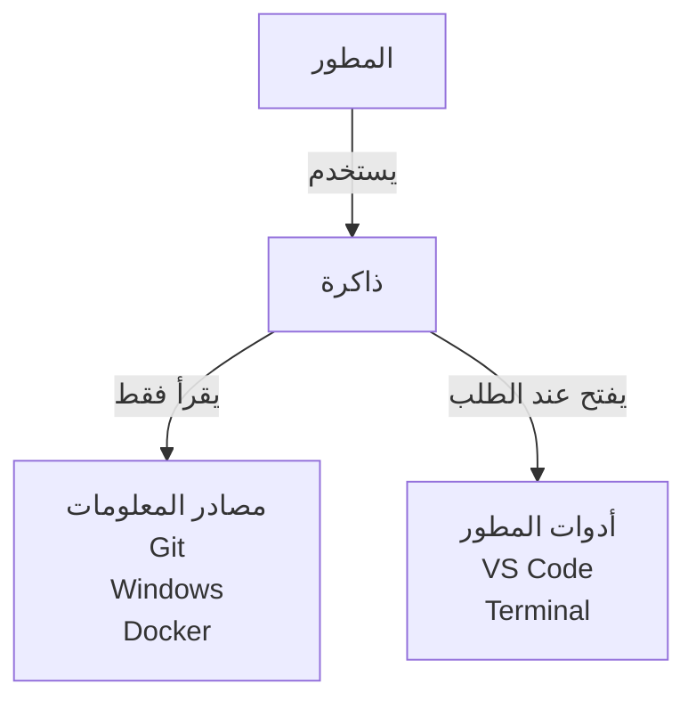

<h1 align="center">ذاكرة · Dhakira</h1>

<a href="../../README.md"><kbd> 🏠 <b>الرئيسية</b> </kbd></a>
&nbsp;&nbsp;
<a href="DhakiraSRS.md"><kbd> 📄 وثيقة المتطلبات </kbd></a>
&nbsp;&nbsp;
<a href="DhakiraVision.md"><kbd> 📄 وثيقة الرؤية vision </kbd></a>
&nbsp;&nbsp;
<a href="DhaliraUseCase.md"><kbd> 📄 وثيقة مخطط حالات الأستخدام </kbd></a>
&nbsp;&nbsp;
<a href="DhakiraDomainModel.md"><kbd> 📄 وثيقة Domain Model  </kbd></a>
&nbsp;&nbsp;
<a href="ActivityDiagrams.md"><kbd> 📄 وثيقة مخطط النشاط لأهم حالات الأستخدام </kbd></a>
&nbsp;&nbsp;
<a href="DhakiraC4.md"><kbd> 📄 وثيقة ال C4 </kbd></a>
&nbsp;&nbsp;
<a href="DhakiraERD.md"><kbd> 📄 وثيقة مخطط قاعدة البيانات </kbd></a>
&nbsp;&nbsp;
<a href="SequenceResume.md"><kbd> 📄 وثيقة مخطط التسلسل لحالة أستئناف المشروع في التطبيق </kbd></a>
&nbsp;&nbsp;
<a href="DhakiraArc42.md"><kbd> 📄 وثيقة المعمارية </kbd></a>
&nbsp;&nbsp;
<a href="DhakiraApiContract.md"><kbd> 📄 وثيقة عقد ال Api  </kbd></a>

# وثيقة متطلبات البرمجيات: تطبيق ذاكرة
 
Software Requirements Specification — Dhakira
 
> **الإصدار:** 1.4 · **الحالة:** معتمدة · **صاحب المنتج:** محمد
>
> تغطي هذه الوثيقة الإصدار الأول من التطبيق.
 
---
 
## 1. مقدمة
 
### 1.1 الغرض من الوثيقة
 
تصف هذه الوثيقة ما يجب أن يفعله الإصدار الأول من "ذاكرة"، وما يجب ألا يفعله، بصياغة يمكن التحقق منها. بُنيت عليها باقي وثائق المشروع، ونرجع إليها كلما سألنا: هل هذه الميزة من الإصدار الأول أم لا؟
 
الوثيقة لا تتحدث عن طريقة البناء. التقنيات وبنية الكود وقاعدة البيانات مكانها وثائق التصميم.
 
### 1.2 المشكلة
 
المطور الذي يعمل على عدة مشاريع يدفع ثمناً كلما عاد إلى مشروع تركه: أين مجلده؟ كيف أشغّله؟ أين توقفت؟ ما الذي تغيّر؟ هل بقي عمل لم أرفعه؟
 
المعلومات موجودة، لكنها موزعة بين المجلدات وGit والجهاز والوثائق وذاكرة المطور نفسه. فيعيد تجميعها من الصفر في كل مرة.
 
### 1.3 المنتج
 
"ذاكرة" تطبيق سطح مكتب يجمع ما يعرفه المطور عن مشاريعه مع ما يكتشفه التطبيق بنفسه من الجهاز، ويتذكر كيف تتغير حالة كل مشروع مع الوقت. وعندما يختلف ما كتبه المطور عما وجده التطبيق، يُظهر الاختلاف ولا يقرر وحده أيهما الصحيح.
 
الفكرة التي يقوم عليها كل شيء: **التطبيق مفيد حتى لو لم يكتب المطور عن مشروعه شيئاً.** ما يكتبه المطور يضيف معنى فوق ما يتذكره التطبيق، لكنه ليس شرطاً.
 
### 1.4 حدود الإصدار الأول
 
**ضمن الإصدار الأول:** مستخدم واحد على جهاز Windows واحد. التطبيق يقرأ من الجهاز ولا يغيّر فيه شيئاً.
 
**خارج الإصدار الأول:** الربط مع الخدمات الخارجية مثل GitHub، وأي فعل يغيّر المشاريع أو الجهاز مثل التشغيل والإيقاف والتعديل، وحفظ كلمات السر، والعمل كفريق. التفاصيل في القسم 8.
 
### 1.5 المصطلحات
 
| المصطلح | المعنى |
|---|---|
| المشروع | وحدة عمل يحددها المطور، وتتكون من جزء أو أكثر. المشروع ليس بالضرورة مجلداً واحداً. |
| الجزء | قسم من المشروع مرتبط بمستودع Git، مثل الواجهة الخلفية أو الأمامية. قد تكون عدة أجزاء في مستودع واحد، لكل منها مجلده. |
| المجلد الرئيسي | مجلد يختاره المطور ليبحث التطبيق داخله عن المشاريع. |
| الفحص | قراءة حالة المشروع من الجهاز في لحظة معينة. |
| لقطة الحالة | ما وجده الفحص لجزء واحد، مع وقت الفحص. |
| الذاكرة التلقائية | تاريخ لقطات الحالة عبر الوقت، يتكوّن دون أن يكتب المطور شيئاً. |
| القيمة المتوقعة | ما يقول المطور إنه يجب أن يكون، مثل رقم المنفذ أو نسخة لغة البرمجة. |
| القيمة الفعلية | ما وجده الفحص على الجهاز. |
| الاختلاف | عدم تطابق القيمة الفعلية مع القيمة المتوقعة. |
| المشكلة | نتيجة فحص تستحق انتباه المطور، تُعرض مع سببها وخطوة مقترحة. |
| الاقتراح | معلومة استنتجها التطبيق من ملفات المشروع، ولا تُعتمد إلا بموافقة المطور. |
| شاشة الاستئناف | الشاشة التي تظهر عند فتح مشروع. |
| الزيارة | فتح المطور لمشروع في التطبيق. |
| مركز الانتباه | قائمة واحدة بكل ما يحتاج انتباهاً في كل المشاريع. |
| دليل التشغيل | ما يكتبه المطور عن طريقة تشغيل جزء: الخطوات والأوامر والملاحظات. |
| سجل العميل | ما سُلّم للعميل، والملاحظات عنه، والوثائق المرتبطة به. |
 
### 1.6 طريقة كتابة المتطلبات
 
لكل متطلب رمز ثابت يُستعمل للإشارة إليه في الوثائق الأخرى وفي الاختبارات. وكل متطلب في هذه الوثيقة إلزامي في الإصدار الأول.
 
---
 
## 2. الوصف العام
 
### 2.1 موقع التطبيق
 

 
يعمل التطبيق بالكامل على جهاز المطور، ولا يرسل بيانات المشاريع إلى أي مكان. يقرأ من الجهاز فقط، وعندما يحتاج المطور أداة يفتحها له خارج التطبيق، بدل أن يعيد بناءها داخله.
 
### 2.2 الوظائف الرئيسية
 
1. **بناء الذاكرة:** اكتشاف المشاريع من مجلدات المطور، وتعريف أجزائها، وإعادة ربطها إذا انتقلت.
2. **العودة إلى المشروع:** شاشة واحدة تقول أين توقفت، وما الذي تغيّر منذ زيارتك، وما الذي يحتاج انتباهك.
3. **فهم الحالة:** فحص Git وبيئة التشغيل وDocker وإعدادات النشر، وتذكّر تطورها، وكشف الاختلافات.
4. **حفظ المعرفة:** دليل التشغيل، والوثائق، والخدمات المرتبطة، وسجل النشر.
5. **العملاء:** ربط المشروع بعميل، وسجل التسليمات.
6. **حماية الذاكرة:** نسخة احتياطية مشفّرة.
### 2.3 المستخدم
 
مستخدم واحد: مطور يعمل على عدة مشاريع، شخصية ولعملاء، على جهازه الخاص. لا حسابات ولا أدوار ولا تسجيل دخول.
 
### 2.4 بيئة التشغيل
 
- نظام Windows.
- Git مثبت على الجهاز.
- Docker اختياري. إذا لم يكن يعمل، تظهر حالة ما يخصه "غير معروفة"، ولا يُعتبر ذلك خطأ.
- خدمات المشاريع، مثل قواعد البيانات، قد تكون مثبتة على Windows مباشرة، أو تعمل داخل Docker، أو تكون برامج يشغّلها المطور بنفسه حين يعمل، والتطبيق يتعامل مع الحالات الثلاث دون أن يخلط بينها.
### 2.5 القيود
 
| الرمز | القيد |
|---|---|
| CON-01 | يعمل الإصدار الأول على Windows فقط. |
| CON-02 | تعمل كل وظائف التطبيق دون إنترنت، ما عدا تحديث المعلومات من المستودع البعيد عندما يطلبه المطور. |
| CON-03 | لا يعتمد التطبيق في عمله على أي خدمة من الخدمات التي يفحصها. |
| CON-04 | كل بيانات التطبيق محفوظة في مجلد واحد معروف على الجهاز، ليسهل نسخها. |
| CON-05 | كل جزء من المشروع يجب أن يكون مستودع Git. المجلدات الأخرى تُضاف كروابط وثائق. |
 
### 2.6 الافتراضات
 
| الرمز | الافتراض |
|---|---|
| ASM-01 | مستخدم واحد وجهاز واحد. لذلك يكفي ما يعرفه الجهاز عن المستودع البعيد لمعرفة العمل غير المرفوع، دون اتصال بالإنترنت. |
| ASM-02 | التحديث من المستودع البعيد يستعمل صلاحيات Git الموجودة على الجهاز، والتطبيق لا يحفظها. |
| ASM-03 | التطبيق يتذكر ما فحصه فقط، ولا يعرف ما حدث بين فحصين. |
 
---
 
## 3. مبادئ تحكم كل المتطلبات
 
هذه ليست ميزات، بل طريقة تصرّف تلتزم بها كل شاشة ووظيفة في التطبيق.
 
| الرمز | المبدأ |
|---|---|
| BR-01 | لكل معلومة مصدر واحد: ما يكتبه المطور مصدره المطور، وما يكتشفه التطبيق مصدره الفحص. لا يكتب التطبيق أحدهما فوق الآخر، ويظهر دائماً مصدر كل معلومة ووقتها. |
| BR-02 | ما يستنتجه التطبيق من ملفات المشروع اقتراح، ولا يصبح معلومة معتمدة إلا بموافقة المطور. |
| BR-03 | ما لم يُفحص لا يُعرض أبداً كأنه سليم. "غير معروف" ليس "متوقفاً"، و"لم يعد يظهر" ليس "تم حله". |
| BR-04 | كل معلومة معروضة يظهر معها عمرها، مثل "آخر فحص قبل 3 أيام". |
| BR-05 | لا يقول التطبيق عن مشروع إنه "جاهز"، بل يقول ماذا فحص وما الذي يحتاج انتباهاً. ولا يجزم بسبب مشكلة، بل يعرض ما يدل عليها. |
| BR-06 | يعرض التطبيق الأدلة بدل نسب الثقة. فبدل أن يقول "الخدمة موجودة بثقة عالية"، يقول: المكتبة موجودة في متطلبات المشروع، والمتغيرات الخاصة بها موجودة في ملف الإعدادات. |
| BR-07 | كل مشكلة تُعرض مع سببها وخطوة مقترحة. ودرجة خطورة كل فحص والخطوة المقترحة له ثابتتان ومعروفتان مسبقاً، لا يؤلفهما التطبيق في كل مرة. |
| BR-08 | فتح أداة للمطور مسموح. أما تشغيل أي شيء أو إيقافه أو تعديله فممنوع. |
| BR-09 | الكتابة اختيارية دائماً. لا تتوقف قيمة أي شاشة أساسية على أن يكتب المطور شيئاً. |
| BR-10 | العميل معلومة مرتبطة بالمشروع، وليس نوعاً خاصاً من المشاريع. للمشروع عميل واحد أو لا عميل. |
 
---
 
## 4. المتطلبات الوظيفية
 
### 4.1 اكتشاف المشاريع وبنيتها
 
إدخال المشاريع يدوياً عمل ممل، والعمل الممل يُترك. لذلك يبدأ التطبيق بالبحث عن المشاريع بنفسه، ويترك القرار للمطور.
 
| الرمز | المتطلب |
|---|---|
| DSC-01 | يستطيع المطور إضافة مجلد رئيسي أو أكثر، ويحفظ التطبيق قائمتها. |
| DSC-02 | يبحث التطبيق في المجلدات الموجودة مباشرة داخل كل مجلد رئيسي فقط، ولا يبحث في القرص كله. |
| DSC-03 | المجلد الذي هو مستودع Git يُقترح كمشروع من جزء واحد، والمجلد الذي يحتوي عدة مستودعات يُقترح كمشروع من عدة أجزاء. وما عدا ذلك يُتجاهل. |
| DSC-04 | لا تظهر في الاقتراحات المستودعات المسجلة مسبقاً، ولا المجلدات التي رفضها المطور. |
| DSC-05 | يعرض كل اقتراح: الاسم، والمسار، وعدد المستودعات، ورابط المستودع البعيد دون أي اسم مستخدم أو كلمة سر. |
| DSC-06 | يستطيع المطور أن يؤكد الاقتراح ويعدّل اسمه، أو يرفضه، أو يدمج عدة اقتراحات في مشروع واحد، أو يقسم اقتراحاً إلى عدة مشاريع، أو يتركه لوقت لاحق. |
| DSC-07 | تُطبَّق قرارات المطور كلها معاً، أو لا يُطبَّق منها شيء. |
| DSC-08 | قائمة المرفوضات ظاهرة، ويمكن استعادة أي عنصر منها. |
| DSC-09 | إعادة البحث لا تعدّل أي مشروع مسجل إلا بموافقة المطور. |
| DSC-10 | إذا ظهر مستودع جديد بجانب مستودعات تنتمي كلها إلى مشروع واحد، يقترحه التطبيق كجزء جديد في ذلك المشروع. |
| DSC-11 | يتعرف التطبيق على المستودع المنقول من بصمة في تاريخه لا تتغير بنقله. إذا طابق مستودع جديد مستودعاً مفقوداً واحداً فقط، يقترح إعادة الربط. وإذا طابق أكثر من واحد، أو لم تكن له بصمة، لا يخمّن. |
| DSC-12 | إذا كان مجلد رئيسي غير موجود أو لا يمكن قراءته، يبلغ التطبيق المطور ويكمل بالمجلدات الأخرى. |
| DSC-13 | بعد التأكيد، يبدأ التطبيق أول فحص للمشاريع الجديدة. |
| PRJ-01 | يستطيع المطور إضافة مشروع يدوياً وتعريف أجزائه: المستودع، والمجلد داخله إن وُجد، ودور الجزء بكلماته. ويمكن أن تكون عدة أجزاء في مستودع واحد. |
| PRJ-02 | إذا اختفى مستودع من مساره، يظهر "المسار غير موجود"، لا "متوقف". |
| PRJ-03 | يستطيع المطور ربط المستودع المفقود بمساره الجديد دون أن يخسر أي معلومة. |
| PRJ-04 | يستطيع المطور إزالة جزء من مشروع، أو المشروع كله، من التطبيق بعد أن يؤكد. يُحذف ما كتبه عنه، ولا يلمس التطبيق ملفاته على الجهاز. ويقترح التطبيق نسخة احتياطية قبل الحذف، ويستطيع المطور إضافة مجلدات المشروع إلى المرفوضات حتى لا تُقترح مرة أخرى. وإذا كان للمشروع سجل عميل، يبقى السجل في صفحة العميل بعد إزالة المشروع، ما لم يختر المطور حذفه معه. |
 
### 4.2 الفحص والذاكرة التلقائية
 
الفحص هو ما يغذي الذاكرة. كل فحص يضيف صفحة إلى تاريخ المشروع، فيعرف التطبيق ما تغيّر ومتى.
 
| الرمز | المتطلب |
|---|---|
| SCN-01 | يبدأ الفحص عندما يطلبه المطور، لمشروع واحد أو لكل المشاريع، ويعمل في الخلفية دون أن تتجمد الواجهة. وفحص كل المشاريع يبدأ من جديد في كل مرة، ولا يكمل فحصاً سابقاً لم ينتهِ. |
| SCN-02 | فتح مشروع يبدأ فحصاً له وحده تلقائياً. ولا يبدأ فحص ثانٍ لنفس المشروع ما دام هناك فحص جارٍ. |
| SCN-03 | التحديث من المستودع البعيد اختياري، ولا يحدث إلا بطلب المطور، لأنه أبطأ ويحتاج إنترنت. |
| SCN-04 | فشل فحص جزء لا يوقف فحص الأجزاء الأخرى. تُحفظ النتائج الناجحة، ويظهر أن الفحص اكتمل جزئياً. |
| SCN-05 | إذا كان مصدر ما غير متاح، مثل Docker متوقف، تظهر فحوصاته "لم يُفحص" مع السبب، وتظهر بقية النتائج طبيعياً. |
| SCN-06 | كل عطل في الفحص يُعرض للمطور مع سببه، ولا يبقى فحص معلقاً بلا نهاية. |
| SCN-07 | يحفظ التطبيق حالة كل جزء عند كل فحص، فيتكوّن تاريخ للمشروع دون أن يكتب المطور شيئاً. |
| SCN-08 | يحتفظ التطبيق بتاريخ كل جزء لمدة سنة: كل الفحوصات في آخر 30 يوماً، ثم حالة واحدة لكل يوم. ولا تُحذف أبداً الحالة الحالية ولا آخر حالة مختلفة عنها، مهما مرّ من وقت. |
| SCN-09 | تظهر آخر حالة معروفة دائماً مع عمرها، حتى قبل انتهاء أي فحص جديد. |
| SCN-10 | عندما ينتهي فحص أي مشروع، تتحدث الشاشات المعروضة وأرقامها تلقائياً، دون أن يطلب المطور ذلك. |
| SCN-11 | يحتفظ التطبيق بسجل لأهم ما قام به ولقرارات المطور، مثل حسم اختلاف أو تحديث ملاحظة "أين توقفت". قرارات المطور تبقى في السجل دائماً، وأحداث التطبيق سنة. ولا يحتوي هذا السجل أي نص من سجلات أخطاء المشاريع. |
| SCN-12 | إذا أُغلق التطبيق أو توقف أثناء الفحص، يبقى ما اكتمل فحصه من الأجزاء، ولا يُعتبر المشروع مفحوصاً كاملاً، ويظهر أن فحصه الأخير انقطع. والفحوص التي لم تبدأ بعد تُلغى دون أن تُعرض كأعطال. |
 
### 4.3 حالة Git
 
Git هو أصدق دليل على آخر ما فعله المطور. يقرؤه التطبيق من الجهاز مباشرة، دون أي اتصال بـ GitHub.
 
| الرمز | المتطلب |
|---|---|
| GIT-01 | يعرض التطبيق لكل مستودع: الفرع الحالي والفرع البعيد المقابل له، والملفات المعدّلة وغير المحفوظة، والملفات الجديدة غير المتتبعة، وعدد الـ commits التي لم تُرفع وعدد التي لم تُسحب، وآخر commit محلي وآخر commit مرفوع، ووقت آخر نشاط. |
| GIT-02 | عدد الـ commits التي لم تُسحب يُحسب من آخر تحديث من المستودع البعيد، ويظهر معه وقت ذلك التحديث. |
| GIT-03 | إذا كانت عدة أجزاء في مستودع واحد، فالفرع والأعداد مشتركة بينها، أما الملفات المعدّلة فتظهر لكل جزء حسب مجلده. والمشكلة التي تخص المستودع كله تُعرض وتُعدّ مرة واحدة. |
| GIT-04 | يعرض التطبيق رابطاً مباشراً لصفحة المستودع على الإنترنت، مبنياً من إعدادات المستودع المحلية دون الاتصال بأي خدمة. |
| GIT-05 | إذا لم يكن للمستودع مستودع بعيد، أو لم يكن للفرع فرع بعيد مقابل، تظهر هذه المعلومات "لم تُفحص" مع السبب. |
| GIT-06 | يعرض التطبيق ملخصاً لحالة Git في كل المشاريع معاً. |
| GIT-07 | يكشف التطبيق الملفات التي لا يجب أن تكون في المستودع، مثل قاعدة بيانات محلية، أو البيئة الافتراضية، أو الملفات التي يرفعها مستخدمو المشروع، أو الملفات المؤقتة. |
 
### 4.4 بيئة التشغيل المحلية
 
لسؤال "لماذا لا يعمل المشروع؟" أجوبة تتكرر: خدمة متوقفة، أو منفذ محجوز، أو نسخة غير مناسبة، أو مكتبة ناقصة. هذا القسم يجيب عنها قبل أن يضيع المطور وقته.
 
| الرمز | المتطلب |
|---|---|
| ENV-01 | يعرف التطبيق الخدمات التي يحتاجها كل جزء، مثل قاعدة بيانات، ومكان تشغيل كل منها: مثبتة على Windows، أو داخل Docker، أو برنامج يشغّله المطور بنفسه، ومنفذها. يكتشفها من ملفات المشروع والجهاز ويقترحها، ويستطيع المطور تسجيلها بنفسه أيضاً. ويبحث التطبيق عن كل خدمة في المكان الذي سُجّلت فيه فقط، ويعرض حالتها الفعلية. |
| ENV-02 | يعرض التطبيق سجلاً للمنافذ في كل المشاريع: المنفذ المتوقع لكل جزء، ومن يستخدمه الآن، ويكشف التعارض، مثل خدمة على Windows تحجز منفذاً يحتاجه مشروع داخل Docker. |
| ENV-03 | يعرض التطبيق البرامج قيد التشغيل التي تخص المشاريع، ويربط كل برنامج بمشروعه من المنفذ أو من مسار المشروع. ما لا يمكن ربطه بثقة يظهر "غير منسوب" دون تخمين. والعرض للمعرفة فقط، دون تحكم. |
| ENV-04 | يقارن التطبيق نسخة لغة البرمجة المطلوبة للمشروع بالنسخة الموجودة على الجهاز. والنسخة المطلوبة تُقرأ من ملفات المشروع أو يكتبها المطور. |
| ENV-05 | يكشف التطبيق هل البيئة الافتراضية للمشروع موجودة، وأين، وهل تناسب نسختها المطلوب. |
| ENV-06 | يقارن التطبيق ملف المتغيرات المحلي بملف المثال المرفق مع المشروع، بأسماء المتغيرات فقط، ويُظهر الناقص منها. |
| ENV-07 | يكشف التطبيق المكتبات المطلوبة غير المثبتة، والمكتبات المثبتة بنسخة مختلفة عن المطلوبة. |
| ENV-08 | يتحقق التطبيق من أن منفذ المشروع يستقبل اتصالات، ويعرض النتيجة بكلمة "يستجيب" لا "يعمل بشكل سليم"، لأن قبول الاتصال لا يعني أن كل ما خلفه يعمل. |
| ENV-09 | يعرض التطبيق لكل جزء ملخصاً لبيئته ومشاكلها. |
| ENV-10 | يكشف التطبيق الخدمة المثبتة على Windows التي لا تبدأ وحدها مع تشغيل الجهاز، لأن المطور سيجدها متوقفة بعد كل إعادة تشغيل. |
| ENV-11 | يكشف التطبيق المتغيرات التي سجلها المطور لخدمة ولا توجد في ملف المتغيرات المحلي، بأسمائها فقط. |
| ENV-12 | توقف الخدمة المثبتة على Windows مشكلة دائماً، لأنها يجب أن تعمل مع تشغيل الجهاز. أما الخدمة التي تعمل داخل Docker أو يشغّلها المطور بنفسه، فتوقفها مشكلة فقط إذا كان الجزء نفسه يعمل، لأن المطور يشغّلها حين يعمل على المشروع. وفي غير ذلك يظهر توقفها كمعلومة. |
 
### 4.5 Docker
 
يقرأ التطبيق حالة Docker ليفهم المشروع، لا ليديره.
 
| الرمز | المتطلب |
|---|---|
| DKR-01 | يكشف التطبيق هل Docker يعمل. إذا لم يكن يعمل، تظهر حالة الحاويات "غير معروفة" لا "متوقفة". |
| DKR-02 | يقرأ التطبيق ملف تعريف خدمات Docker في المشروع، ليعرف الخدمات ومنافذها وما يعتمد عليه كل منها. ما لا يمكن معرفته من الملف دون كشف قيم سرية يظهر "غير محدد". ونتائج القراءة اقتراح يعتمده المطور، ولا يُقترح منها المشروع نفسه، ولا قاعدة بيانات معرّفة في الملف بينما المشروع يستعمل قاعدة بيانات مثبتة على الجهاز. |
| DKR-03 | يعرض التطبيق حالة كل حاوية: تعمل، أو متوقفة، أو خرجت مع رمز الخروج، وحالة فحص الصحة إن كان معرّفاً. والحاوية بلا فحص صحة لا تُعرض كأنها غير سليمة. |
| DKR-04 | يربط التطبيق الحاوية بمشروعها تلقائياً عندما تدل معلوماتها على مسار المشروع. التطابق الجزئي يظهر كاقتراح، والحاوية التي لا يمكن ربطها تظهر "غير منسوبة"، ويستطيع المطور ربطها يدوياً. |
| DKR-05 | يعرض التطبيق الحاويات العاملة على الجهاز كله، وملخص Docker لكل مشروع، ومشاكله. |
| DKR-06 | يكشف التطبيق الحاوية التي تعمل بنسخة غير التي يطلبها ملف تعريف الخدمات الآن، وحاوية الخدمة المسجلة التي لا يصل إليها الجهاز لأن منفذها غير منشور. |
 
### 4.6 قاعدة بيانات المشروع
 
يكفي أن يعرف المطور أي قاعدة بيانات يستخدم مشروعه وأين هي، دون أن يتصل التطبيق بها أو يطلب كلمة سرها.
 
| الرمز | المتطلب |
|---|---|
| DB-01 | يكتشف التطبيق نوع قاعدة بيانات كل جزء ومكان تشغيلها من ملفات المشروع والجهاز، ويقترحهما مع أدلتهما، ويثبتهما المطور. ويعتمد أولاً على ما تستعمله إعدادات المشروع فعلاً. وإذا تعارضت الأدلة، يعرضها كلها ويقرر المطور. |
| DB-02 | يحفظ التطبيق معلومات الوصول غير السرية فقط: اسم القاعدة، والعنوان، والمنفذ. يقرؤها من ملفات المشروع إذا كانت قراءتها آمنة، وإلا يكتبها المطور. |
| DB-03 | يربط التطبيق القاعدة بالجزء، وبالخدمة أو الحاوية التي تشغّلها. |
| DB-04 | يعرض التطبيق حالة خدمة القاعدة ومنفذها ومكان تشغيلها، بعبارة "الخدمة تعمل والمنفذ يستجيب"، لا "قاعدة البيانات تعمل"، لأنه لا يتصل بها. |
| DB-05 | يكشف التطبيق تعارض تحديثات بنية القاعدة في ملفات المشروع، مثل تحديثين أخيرين معاً بعد دمج فرعين، بقراءة الملفات فقط، دون اتصال بالقاعدة ودون تشغيل شيء. |
| DB-06 | يكشف التطبيق اختلاف نسخة خدمة القاعدة على الجهاز عن النسخة التي يذكرها المشروع. وإذا كانت القاعدة ملفاً، يتحقق من وجوده. |
 
### 4.7 إعدادات الإنتاج والنشر
 
قبل النشر يريد المطور أن يعرف: هل في مشروعي ما سيكسر الإنتاج أو يكشف أسراراً؟ يفحص التطبيق الملفات ليجيب، دون أن يدّعي أن المشروع جاهز.
 
| الرمز | المتطلب |
|---|---|
| PRD-01 | يفحص التطبيق ملفات المشروع بحثاً عن مخاطر الإنتاج المعروفة، مثل ملف أسرار غير مستثنى من Git، أو وضع التطوير مكتوب ثابتاً في الكود. ويفحص هل الإعداد قابل للضبط عند النشر، لا قيمته على الجهاز المحلي، لأن الجهاز المحلي بيئة تطوير بطبيعته. |
| PRD-02 | يستطيع المطور تسجيل كل عملية نشر: التاريخ، والبيئة، والمزوّد، والخادم، والرابط، وطريقة النشر، وملاحظات، دون أي معلومة سرية. ويختار البيئة من بيئات المشروع الموثقة، أو يكتب غيرها. |
| PRD-03 | إذا وُجد ملف إعدادات خادم الويب داخل المشروع، يحلله التطبيق: هل يستخدم HTTPS، وهل يحوّل إليه، وهل فيه إعدادات الأمان الأساسية. |
| PRD-04 | يستطيع المطور توثيق بيئات المشروع (تطوير، وتجريب، وإنتاج) والمتغيرات المطلوبة لكل منها، دون قيمها السرية. |
| PRD-05 | يكشف التطبيق كلمات السر والمفاتيح المكتوبة مباشرة في ملفات المشروع التي يتتبعها Git، ويعرض الملف والسطر فقط. لا تُعرض القيمة ولا تُحفظ. |
| PRD-06 | تظهر جاهزية النشر قسماً مستقلاً عن حالة المشروع المحلية، بحالة تُحسب من نتائج الفحوصات، مع أعدادها. وفي أعلاه حكم واضح: لا شيء يمنع النشر فيما فحصه التطبيق، أو ما الذي يمنعه بالتحديد. ولا يقول التطبيق إن المشروع جاهز للنشر، لأنه يقرأ ملفات المشروع فقط، ولا يعرف إعدادات الخادم ولا الاستضافة. |
| PRD-07 | يقترح التطبيق ملف إعدادات الإنتاج من ملفات المشروع، ويؤكده المطور أو يغيّره. وما يختاره المطور يغلب ما يكتشفه التطبيق، ولا يُعرض كاختلاف. ومن هذا الملف، ومما يعتمد عليه من ملفات الإعدادات الأخرى، تُقرأ فحوصات الإعدادات. وإذا لم يُعرف، تظهر هذه الفحوصات "لم يُفحص" حتى يحدده المطور. |
 
### 4.8 سجلات الأخطاء
 
عند ظهور مشكلة، أسرع طريق لفهمها هو آخر ما كُتب في سجل الأخطاء.
 
| الرمز | المتطلب |
|---|---|
| LOG-01 | يستطيع المطور تسجيل مكان سجلات كل جزء: ملف، أو حاوية Docker، أو نافذة الأوامر، أو خدمة خارجية. ويقترح التطبيق أماكنها من إعدادات المشروع. والسجل الذي يظهر في نافذة الأوامر يُحفظ مكانه كمعلومة فقط، لأن التطبيق لا يستطيع قراءته. |
| LOG-02 | يعرض التطبيق آخر الأخطاء عند الطلب فقط، ويستطيع المطور أن يعرض آخر الأسطر كلها. وإذا لم يكن للمشروع سجل يمكن قراءته، يظهر ذلك كمعلومة لا كخطأ. |
| LOG-03 | عند عرض مشكلة، يعرض التطبيق آخر الأخطاء من نفس المصدر بعنوان "آخر الأخطاء من هذا المصدر"، حتى لو لم يسجّل المطور مكانه، ولا يقول إنها سبب المشكلة. |
 
### 4.9 الوثائق ودليل التشغيل
 
هنا يحفظ المطور ما لا يمكن اكتشافه: كيف يشغّل المشروع، وأين وثائقه، ولماذا اتخذ قراراته.
 
| الرمز | المتطلب |
|---|---|
| KNW-01 | يستطيع المطور تسجيل وثائق المشروع، ولكل وثيقة أكثر من رابط: مسار على الجهاز، أو رابط على الإنترنت، أو ملف داخل مستودع أحد الأجزاء، أو ملف مرفوع. ويُرفع المهم فقط. ويمكن ربط الوثيقة بالعميل. |
| KNW-02 | يعرض التطبيق ملف التعريف ومجلد الوثائق ودليل التشغيل الموجودة داخل مستودع كل جزء، للقراءة فقط. |
| KNW-03 | يستطيع المطور كتابة ملاحظات للمشروع من ثلاثة أنواع: شخصية، وقرارات، وملاحظات عن العميل مع تاريخها. والنوع الأخير لمشروع له عميل فقط. |
| KNW-04 | يستطيع المطور كتابة دليل تشغيل لكل جزء: الخطوات والأوامر والملاحظات. ويعرض الدليل بجانبه القيم المتوقعة للجزء (المنافذ والنسخ والخدمات) وسجل النشر، دون أن ينسخها داخله. ويستطيع التطبيق اقتراح محتوى يعتمده المطور. |
 
### 4.10 الخدمات المرتبطة بالمشروع
 
لا يعيد التطبيق بناء لوحات الخدمات الخارجية. يكفي أن يعرف المطور بماذا يرتبط مشروعه، وأين يجد كل خدمة.
 
| الرمز | المتطلب |
|---|---|
| SVC-01 | يحفظ التطبيق الخدمات التي يستخدمها كل جزء من المشروع، مثل قاعدة بيانات أو خدمة دفع: المزوّد، والغرض، والروابط (لوحة التحكم، والوثائق، وصفحة الحالة)، وأسماء المتغيرات المرتبطة بها، وملاحظات، دون أي قيمة سرية. وكل خدمة مرتبطة بالجزء الذي يستخدمها، لأن الفحص يجري لكل جزء على حدة. |
| SVC-02 | يُسجَّل الحساب لدى المزوّد منفصلاً عن الخدمة، لأن حساباً واحداً قد يخدم أكثر من خدمة في أكثر من مشروع. ولكل حساب مالك: المطور أو العميل. ويعرض التطبيق الحسابات كلها في قائمة واحدة، ولكل حساب الخدمات والمشاريع التي تستعمله. |
| SVC-03 | يكتشف التطبيق الخدمات من المكتبات وأسماء المتغيرات المعروفة ومن الجهاز، ومعها الجزء الذي يستخدمها ومكان تشغيلها، ويعرضها اقتراحاً مع الأدلة التي بنى عليها، ويثبتها المطور. |
 
### 4.11 العودة إلى المشروع
 
هذا هو سبب وجود التطبيق: أن يفتح المطور مشروعاً تركه منذ شهور، فيعرف خلال دقيقة أين توقف وماذا يفعل الآن.
 
| الرمز | المتطلب |
|---|---|
| RES-01 | يستطيع المطور كتابة ملاحظة "أين توقفت" واحدة لكل مشروع، تحمل وقت كتابتها. والكتابة الجديدة تحل محل القديمة. |
| RES-02 | يستطيع المطور إضافة خطوات تالية وإغلاقها. ولكل خطوة مصدر: كتبها المطور، أو جاءت من مشكلة، أو من طلب عميل. ويمكن ربطها بمهمة في أداة خارجية. |
| RES-03 | يستطيع المطور حفظ روابط أدوات المهام الخارجية التي يستخدمها المشروع. |
| RES-04 | عند فتح مشروع، تظهر شاشة الاستئناف فوراً من آخر حالة معروفة مع عمرها، دون انتظار الفحص. وتعرض: ملاحظة "أين توقفت" ووقتها، والخطوات التالية المفتوحة ومصدرها، ولكل جزء: الفرع ورسائل آخر commits والملفات المعدّلة وحالة الرفع، وآخر مرة عمل فيها المطور على المشروع، وأهم ثلاث مشاكل في العمل على الجهاز مع رابط للقائمة الكاملة، وعدد مشاكل جاهزية النشر في سطر واحد، ومعلومات آخر تسليم إن وُجد. |
| RES-05 | تعرض شاشة الاستئناف ما تغيّر منذ آخر زيارة للمطور لهذا المشروع، أو منذ آخر حالة مختلفة إذا كانت هذه أول زيارة، وتتحدث عند انتهاء الفحص. وإذا لم يتغير شيء، تقول ذلك. والمشكلة التي لم تعد تظهر تُعرض بأنها لم تعد تظهر، لا بأنها حُلّت، وفقط إذا فُحص أمرها فعلاً. |
| RES-06 | شاشة الاستئناف مفيدة حتى لمشروع لم يكتب عنه المطور شيئاً. غياب الملاحظة يظهر كاقتراح لطيف لا كنقص، ولا يحاول التطبيق تخمين أين توقف المطور. |
| RES-07 | إذا وُجدت commits بعد وقت كتابة الملاحظة، ينبه التطبيق إلى أن الملاحظة قد تكون قديمة، ويذكر عدد الـ commits منذ كتابتها. |
| RES-08 | يستطيع المطور إضافة أي مشكلة إلى الخطوات التالية بضغطة واحدة. |
| RES-09 | إذا كانت خطوة مرتبطة بمشكلة فُحصت فعلاً ولم تعد موجودة، يسأل التطبيق مرة واحدة: "المشكلة لم تعد موجودة، هل أنجزت الخطوة؟" ويحفظ الجواب. لا يغلق الخطوة تلقائياً، ولا يسأل إذا لم يُفحص الأمر. |
| RES-10 | عند مغادرة المشروع أو إغلاق التطبيق، إذا كان هناك نشاط أحدث من آخر ملاحظة أو لا توجد ملاحظة أصلاً، يظهر تذكير اختياري فيه حقل سطر واحد وزر تخطٍّ. يظهر مرة واحدة في كل زيارة، ويمكن إيقافه لكل مشروع. |
| RES-11 | إذا كان مسار أحد الأجزاء مفقوداً، يظهر الجزء كمفقود ويقترح التطبيق إعادة ربطه. |
 
### 4.12 كشف الاختلافات
 
عندما يقول دليل التشغيل إن المنفذ 8000 والمشروع يستخدم 8001، فأحدهما قديم. التطبيق لا يعرف أيهما، لكنه يضع الاثنين أمام المطور.
 
| الرمز | المتطلب |
|---|---|
| REC-01 | يُعتبر الاختلاف حقيقياً فقط إذا اجتمعت ثلاثة شروط: كتب المطور قيمة متوقعة محددة (منفذ أو نسخة أو خدمة)، وقرأ الفحص القيمة الفعلية فعلاً، ولم تطابقها حسب نوعها. المنفذ يجب أن يطابق تماماً، والنسخة تكفي بدايتها (3.12 تطابق 3.12.4)، والخدمات يكفي أن تكون المطلوبة موجودة في المكان الذي سُجّلت فيه. أما النصوص الحرة فلا تُقارن أبداً. |
| REC-02 | المقارنة مع الإعدادات الثابتة في الملفات فقط. ما يحدث لحظياً، مثل برنامج يعمل الآن على منفذ آخر، يظهر كمعلومة لا كاختلاف. |
| REC-03 | يعرض الاختلاف القيمتين، ومصدر كل منهما، ومنذ متى ظهر. |
| REC-04 | يختار المطور واحداً من أربعة: تحديث القيمة المتوقعة؛ أو اعتبار المشروع هو المخطئ، فيبقى الاختلاف مشكلة مع خطوة مقترحة؛ أو اعتباره مقصوداً، فيُخفى ما دامت القيمتان كما هما، ويعود إذا تغيرت إحداهما حتى لو رجعت بعد ذلك إلى قيمتها القديمة، ويظهر في قائمة "اختلافات مقبولة" يمكن التراجع منها؛ أو تأجيل القرار، فيبقى ظاهراً. ويُسجَّل القرار. وإذا عاد اختلاف قبله المطور من قبل، يذكّره التطبيق بقراره السابق. |
| REC-05 | القيمة المكتشفة التي لا يقابلها شيء مما كتبه المطور تظهر كاقتراح للإضافة، لا كاختلاف. وإذا اختلفت المصادر المكتشفة فيما بينها، تُعرض كلها مع مصادرها. |
| REC-06 | لا يعدّل التطبيق أي طرف تلقائياً، ولا يكتب في ملفات المشروع. |
 
### 4.13 الجاهزية والنظرة العامة
 
| الرمز | المتطلب |
|---|---|
| RDY-01 | يعرض التطبيق المشاكل التي تؤثر على تشغيل المشروع محلياً أو على جاهزيته للنشر، من Git وبيئة التشغيل وDocker وقاعدة البيانات وإعدادات الإنتاج، مع سبب كل مشكلة وخطوة مقترحة. |
| RDY-02 | حالة كل قسم تُحسب من نتائج فحوصاته: وجود خطر يعني "متوقف"، ووجود تنبيه يعني "يحتاج انتباهاً"، وغير ذلك "لا مشاكل مكتشفة". وتظهر معها الأعداد ووقت آخر فحص. |
| RDY-03 | يستطيع المطور إخفاء مشكلة واحدة في جزء معين، مثل إنذار كاذب، فتبقى ظاهرة في الأجزاء الأخرى. ويستطيع إخفاء فحص كامل لا ينطبق على المشروع، مثل فحص إعدادات خادم الويب لمشروع لا يستخدمه. الإخفاء لا يوقف الفحص، والمشكلة الجديدة من الفحص نفسه تظهر ما لم يكن الفحص كله مخفياً. ويستطيع المطور التراجع عن أي إخفاء. |
| RDY-04 | تحتفظ كل مشكلة بهويتها عبر الفحوصات، فيعرف التطبيق أنها نفس المشكلة، ومنذ متى ظهرت. |
| OVR-01 | يعرض التطبيق نظرة عامة على كل المشاريع: ملخص Git، وتعارض المنافذ، ومركز الانتباه. |
| OVR-02 | يُبنى مركز الانتباه من آخر حالة معروفة دون فحص جديد، ويعرض المخاطر والتنبيهات في كل المشاريع مع وقتها، والخطوات التالية المفتوحة. وهو ليس نظام إشعارات. |
 
### 4.14 العملاء
 
للعميل سجل تاريخ، لا نظام إدارة: ماذا سُلّم، ومتى، وماذا دُفع.
 
| الرمز | المتطلب |
|---|---|
| CLI-01 | يستطيع المطور تسجيل عميل: الاسم، والشركة، ووسيلة التواصل. والاسم وحده إلزامي. ولا يُحذف عميل ما دام مرتبطاً بمشروع أو يملك حساباً. |
| CLI-02 | يستطيع المطور ربط المشروع بعميل، مع تحديد المسؤولية (المطور، أو العميل، أو مشتركة)، وحالة التسليم (قيد العمل، أو مكتمل، أو مُسلَّم). وحالة التسليم منفصلة عن حالة النشر. وعند تغيير عميل المشروع، ينتقل سجله معه بعد أن يؤكد المطور. وعند فك الربط، يختار المطور إبقاء السجل في صفحة العميل أو حذفه. |
| CLI-03 | يستطيع المطور تسجيل كل تسليم: التاريخ، وما سُلّم، ونسخة الكود المسلَّمة لكل مستودع (يقرؤها التطبيق من الجهاز لحظة التسجيل ويقترحها)، وملاحظة التسليم، وحالة الدفع (لم يُدفع، أو دُفع جزئياً، أو دُفع، أو مجاني) مع ملاحظة. المبلغ يُكتب في الملاحظة لا كحقل رقمي، حتى لا يتحول التطبيق إلى نظام محاسبة. ويستطيع المطور تعديل التسليم لاحقاً، مثل تغيير حالة الدفع، أو حذفه. |
| CLI-04 | يعرض التطبيق مشاريع كل عميل وحالاتها، وعدد الـ commits منذ آخر تسليم إذا كانت نسخة الكود المسلَّمة مسجلة. وإذا لم يمكن معرفة العدد، يقول ذلك ولا يقدّره. ويعرض سجل العميل من مشاريعه التي أُزيلت من التطبيق. |
 
### 4.15 النسخة الاحتياطية
 
المشاريع نفسها يعيد التطبيق اكتشافها، أما ما كتبه المطور فلا يمكن اكتشافه، ولذلك يُنسخ.
 
| الرمز | المتطلب |
|---|---|
| BAK-01 | يستطيع المطور تصدير كل ما كتبه، مع الملفات المرفوعة، في ملف واحد مشفّر. والتشفير إلزامي. |
| BAK-02 | عند الاستيراد، يتحقق التطبيق من سلامة الملف وتوافق إصداره، ثم يعرض ما سيضيفه وما سيحدّثه، قبل أن يستورد أي شيء. |
| BAK-03 | عند التصدير، إذا وُجد عمل لم يُرفع إلى المستودع البعيد، ينبه التطبيق إلى أن النسخة لا تشمل الكود. والتنبيه لا يمنع التصدير. |
| BAK-04 | بعد الاستيراد، المسارات غير الموجودة تظهر "المسار غير موجود"، ويستطيع المطور إعادة ربطها. |
| BAK-05 | الاستيراد يدمج النسخة مع ما على الجهاز، ولا يحذف منه شيئاً. يضيف ما ينقص، وإذا وُجد الشيء نفسه في الطرفين، يغلب الأحدث منهما لما له وقت كتابة، ويبقى ما على الجهاز لغيره. |
 
### 4.16 الوصول السريع
 
| الرمز | المتطلب |
|---|---|
| ACC-01 | يفتح التطبيق، خارج نفسه: مجلد الجزء، ومحرر الكود، ونافذة الأوامر على مسار الجزء، وصفحة المستودع، والوثائق، وأداة قاعدة البيانات دون تمرير أي كلمة سر، ولوحة الخدمة الخارجية. ويستطيع نسخ مسار الجزء. ويكتشف التطبيق الأدوات المثبتة على الجهاز ويعرض المتاح منها فقط، ويستطيع المطور اختيار غيرها. |
 
---
 
## 5. البيانات
 
| الرمز | المتطلب |
|---|---|
| DAT-01 | يحفظ التطبيق كل ما كتبه المطور أو ثبّته: القيم المتوقعة، ودليل التشغيل، والملاحظات، و"أين توقفت"، والخطوات التالية، والوثائق، والخدمات وحساباتها، وسجل النشر، والعملاء، والتسليمات، وقراراته في الاختلافات، والمجلدات المرفوضة. |
| DAT-02 | ويحفظ ما اكتشفه: الفحوصات وحالة كل منها (جارٍ، أو اكتمل، أو اكتمل جزئياً، أو انقطع، أو فشل مع السبب)، ولقطات الحالة، وسجل نشاطه. |
| DAT-03 | ولا يحفظ أبداً: محتوى سجلات أخطاء المشاريع، وقيم المتغيرات السرية، ونص الأسرار المكتشفة في الكود، وأي كلمة سر. |
 
---
 
## 6. الواجهات
 
### 6.1 واجهة المستخدم
 
| الرمز | المتطلب |
|---|---|
| UI-01 | التطبيق تطبيق سطح مكتب لنظام Windows. |
| UI-02 | كل شاشة تظهر فوراً بآخر معلومات معروفة، ولا تنتظر الفحص. |
| UI-03 | كل معلومة تظهر مع عمرها، وكل ما لم يُفحص يظهر مع سبب عدم فحصه. |
| UI-04 | الواجهة بلغتين: العربية والإنجليزية، مع إبقاء المصطلحات التقنية بالإنجليزية في اللغتين. |
| UI-05 | يفتح التطبيق مباشرة باللغة والمظهر وحجم النص الذي اختاره المطور. |
 
### 6.2 ما يقرأ منه التطبيق
 
| المصدر | ما يقرؤه التطبيق |
|---|---|
| ملفات المشاريع | داخل المجلدات التي سجلها المطور فقط، وملفات سجلات الأخطاء التي سجّل أماكنها. |
| Git | حالة المستودعات، والتحديث من المستودع البعيد عند الطلب فقط. |
| Windows | الخدمات المثبتة ونوع تشغيلها ونسختها، والمنافذ المستخدمة، والبرامج قيد التشغيل. |
| Docker | الحاويات وحالتها وسجلاتها. |
| أدوات المطور | لا يقرأ منها، بل يتحقق من وجودها ويفتحها فقط: محرر الكود، ونافذة الأوامر، والمتصفح، وأداة قاعدة البيانات. |
 
---
 
## 7. المتطلبات غير الوظيفية
 
### 7.1 الأمان: التطبيق لا يغيّر شيئاً
 
أهم وعد يقدمه التطبيق: يمكنك فتحه على أي مشروع دون خوف من أن يغيّر فيه شيئاً.
 
| الرمز | المتطلب |
|---|---|
| SAF-01 | لا يشغّل التطبيق كود أي مشروع، لا مباشرة ولا بشكل غير مباشر. فلا يرسل طلبات إلى تطبيقات المشاريع، ولا يشغّل أدوات تنفّذ كودها. |
| SAF-02 | لا يغيّر التطبيق أي شيء في المشاريع أو في الجهاز، ولا يكتب في ملفات المشاريع. |
| SAF-03 | إذا أمكن معرفة المعلومة بقراءة ملف، يقرأ التطبيق الملف بدل أن يشغّل أداة. |
| SAF-04 | لا يطلب التطبيق ولا يحفظ أي كلمة سر أو مفتاح دخول. |
 
### 7.2 حماية المعلومات الحساسة
 
| الرمز | المتطلب |
|---|---|
| SEC-01 | من ملف المتغيرات يقرأ التطبيق أسماء المتغيرات فقط. ولا يقرأ القيم إلا لمتغيرات معروفة بأنها غير حساسة، مثل رقم المنفذ. كل ما عداها ممنوع افتراضياً، ولا يُستخرج جزء من قيمة سرية. |
| SEC-02 | أي اسم مستخدم أو كلمة سر داخل رابط المستودع يُحذف قبل أن يُعرض أو يُحفظ. |
| SEC-03 | لا يمكن الوصول إلى التطبيق من أي جهاز آخر على الشبكة، ولا من صفحات الويب المفتوحة في المتصفح على نفس الجهاز. |
| SEC-04 | لا يقرأ التطبيق أي ملف خارج مجلدات المشاريع والمجلدات الرئيسية التي سجلها المطور. والاستثناء الوحيد ملفات سجلات الأخطاء التي سجّل المطور أماكنها بنفسه: يقرأ التطبيق الملف نفسه لا المجلد الذي فيه، وآخره فقط، عند الطلب، ولا يحفظ منه شيئاً. |
| SEC-05 | عند عرض سجلات الأخطاء، يحاول التطبيق إخفاء ما يشبه الأسرار. لكن الضمان الحقيقي أن محتوى السجلات لا يُحفظ أبداً. |
| SEC-06 | لا يوجد تسجيل دخول في الإصدار الأول. وحماية بيانات التطبيق على الجهاز تعتمد على حساب Windows وتشفير القرص. |
| SEC-07 | النسخة الاحتياطية مشفّرة إلزامياً. ونتيجة ذلك معلنة: من ينسى كلمة سر النسخة يخسرها، ولا توجد طريقة لاستعادتها. |
 
### 7.3 الأداء
 
| الرمز | المتطلب |
|---|---|
| PRF-01 | تظهر الشاشات فوراً بآخر معلومات معروفة، ولا تنتظر أي فحص. |
| PRF-02 | الفحص لا يجمّد الواجهة، والتحديث من المستودع البعيد منفصل عنه لأنه أبطأ. |
| PRF-03 | الأرقام الدقيقة للأداء تُحدد بعد أول نسخة تعمل (القسم 9). |
 
### 7.4 الموثوقية
 
| الرمز | المتطلب |
|---|---|
| REL-01 | فشل جزء أو مصدر لا يوقف الفحص ولا العرض. |
| REL-02 | قرارات المطور في الاكتشاف تُطبَّق كلها أو لا يُطبَّق منها شيء. |
| REL-03 | يعمل التطبيق حتى لو كانت كل الخدمات التي يفحصها متوقفة. |
| REL-04 | إذا توقف التطبيق أو جزء منه بشكل غير متوقع، يعرف المطور ذلك برسالة واضحة، ولا يبقى أي فحص معلقاً بعد إعادة التشغيل. وبعد الإغلاق العادي لا تظهر هذه الرسالة. |
 
### 7.5 سهولة الاستخدام
 
| الرمز | المتطلب |
|---|---|
| USE-01 | تنبيهات قليلة، وكلها مهمة. المشاكل تظهر في شاشات الجاهزية ومركز الانتباه، لا كإشعارات تقاطع المطور. |
| USE-02 | لا يتكرر تحذير إلى الأبد. يستطيع المطور اعتبار اختلاف مقصوداً أو إخفاء مشكلة أو فحص لا ينطبق، حتى لا يتعود على تجاهل كل التحذيرات. |
| USE-03 | التذكيرات لا تزعج: مرة واحدة في الزيارة، ويمكن إيقافها لكل مشروع. |
| USE-04 | ما يستطيع التطبيق اكتشافه لا يُطلب من المطور كتابته. يعرض التطبيق ما اكتشفه مع أدلته، ويثبّته المطور بضغطة واحدة، ولا يسأله إلا حين تتعارض الأدلة فعلاً. |
 
### 7.6 قابلية التطوير
 
| الرمز | المتطلب |
|---|---|
| MNT-01 | إضافة دعم لنوع مشاريع جديد، بلغة أو إطار عمل آخر، لا تتطلب تغيير بقية التطبيق. |
| MNT-02 | دعم نظام تشغيل آخر لاحقاً لا يتطلب تغيير منطق التطبيق. |
| MNT-03 | لا يمنع التصميم لاحقاً وجود نسخة تعمل عبر الإنترنت، ولا العمل كفريق. |
| MNT-04 | منطق التطبيق مغطى باختبارات آلية. |
 
---
 
## 8. خارج الإصدار الأول
 
هذه أفكار مفيدة، لكنها مؤجلة عمداً حتى يصل الإصدار الأول بسرعة ولا يتضخم.
 
**بعد الإصدار الأول:**
 
- الربط مع GitHub وGitLab وBitbucket: طلبات الدمج، والمشاكل، والبناء الآلي، والإصدارات.
- تشغيل المشاريع وإيقافها من داخل التطبيق، وفحص صحتها بطلبات مباشرة.
- الاتصال بقواعد البيانات: حالة تحديثات البنية، ونسخها الاحتياطي، وحجمها.
- متابعة المشروع المنشور: الرابط العام، وشهادة HTTPS، وتواريخ الانتهاء، ومقارنة النسخة المحلية بالمنشورة، وسجل الخوادم.
- سجلات الأخطاء الحية وسجلات الإنتاج، والبحث فيها، وعدّ الأخطاء الجديدة.
- قراءة حالة الخدمات الخارجية وبياناتها.
- حفظ كلمات السر بشكل مشفّر.
- الكتابة في ملفات المشاريع، ونسخ دليل التشغيل الموجود في المستودع إلى التطبيق.
- إشعارات Windows، والفحص المجدول.
- تاريخ ملاحظة "أين توقفت".
- استهلاك المعالج والذاكرة للحاويات، والمساحة على القرص.
- اكتشاف تعليقات المهام في الكود، ووثائق الواجهات البرمجية، والوثائق القديمة، وقوالب جاهزة للوثائق.
- المكتبات المطلوبة بلا نسخة محددة، وأدوات الفحص قبل كل commit غير المثبتة.
**في المستقبل البعيد:** العمل كفريق، وبوابة للعميل، ونسخة عبر الإنترنت وعلى الجوال، والنشر وإدارة الخوادم وDocker من التطبيق، والمشاريع التي لا تستخدم Git.
 
**أفكار مؤجلة للتفكير:** استنتاج نقطة التوقف تلقائياً، والاقتراحات بالذكاء الاصطناعي، وتسجيل ما يحدث بين فحصين، وإحصائيات الـ commits.
 
**مستبعدة:** إدارة المهام والتخطيط (الأولويات، والمواعيد، والتقديرات)، وإدارة العملاء والفواتير والمحاسبة، ولوحة موحدة للخدمات الخارجية، والعلاقات بين المستودعات.
 
---
 
## 9. مسائل مفتوحة
 
| الرمز | المسألة | متى تُحسم |
|---|---|---|
| OQ-01 | الأرقام الدقيقة للأداء، مثل زمن ظهور الشاشة، ومؤشرات نجاح المنتج. | بعد أول نسخة تعمل |
 

 
