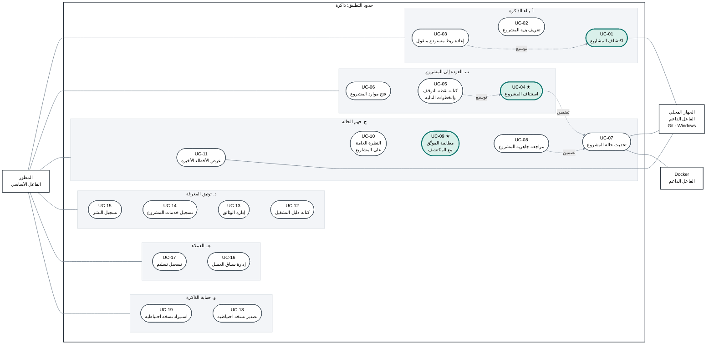

<h1 align="center">ذاكرة · Dhakira</h1>

<a href="../../README.md"><kbd> 🏠 <b>الرئيسية</b> </kbd></a>
&nbsp;&nbsp;
<a href="DhakiraSRS.md"><kbd> 📄 وثيقة المتطلبات </kbd></a>
&nbsp;&nbsp;
<a href="DhakiraVision.md"><kbd> 📄 وثيقة الرؤية vision </kbd></a>
&nbsp;&nbsp;
<a href="DhaliraUseCase.md"><kbd> 📄 وثيقة مخطط حالات الأستخدام </kbd></a>
&nbsp;&nbsp;
<a href="DhakiraDomainModel.md"><kbd> 📄 وثيقة Domain Model  </kbd></a>
&nbsp;&nbsp;
<a href="ActivityDiagrams.md"><kbd> 📄 وثيقة مخطط النشاط لأهم حالات الأستخدام </kbd></a>
&nbsp;&nbsp;
<a href="DhakiraC4.md"><kbd> 📄 وثيقة ال C4 </kbd></a>
&nbsp;&nbsp;
<a href="DhakiraERD.md"><kbd> 📄 وثيقة مخطط قاعدة البيانات </kbd></a>
&nbsp;&nbsp;
<a href="SequenceResume.md"><kbd> 📄 وثيقة مخطط التسلسل لحالة أستئناف المشروع في التطبيق </kbd></a>
&nbsp;&nbsp;
<a href="DhakiraArc42.md"><kbd> 📄 وثيقة المعمارية </kbd></a>
&nbsp;&nbsp;
<a href="DhakiraApiContract.md"><kbd> 📄 وثيقة عقد ال Api  </kbd></a>

# مخطط حالات الاستخدام: تطبيق ذاكرة
 
Use Case Diagram — Dhakira
 
> **الإصدار:** 1.2 · **الحالة:** معتمد · **صاحب المنتج:** محمد
>
> يغطي هذا المخطط الإصدار الأول من التطبيق، وهو مبني على [وثيقة المتطلبات](DhakiraSRS.md).
 
---
 
## 1. مقدمة
 
يعرض هذا المخطط ما يستطيع المطور فعله بتطبيق "ذاكرة" في إصداره الأول، وما يعتمد عليه التطبيق من الجهاز ليقوم بذلك. كل شكل بيضاوي في المخطط حالة استخدام، أي هدف واحد يريد المطور تحقيقه، مثل اكتشاف مشاريعه أو العودة إلى مشروع تركه.
 
حالات الاستخدام تسع عشرة، موزعة على ست مجموعات. ثلاث منها موثّقة بالتفصيل لأنها تحمل فكرة التطبيق: اكتشاف المشاريع لأنه أول ما يراه المطور، واستئناف المشروع لأنه سبب وجود التطبيق، ومطابقة الموثّق مع المكتشف لأنها ما يميزه عن أي تطبيق ملاحظات. والوصف المفصّل لكل منها في وثيقة مستقلة: [اكتشاف المشاريع](use-cases/UC-01-discover-projects.md)، و[استئناف المشروع](use-cases/UC-04-resume-project.md)، و[مطابقة الموثّق مع المكتشف](use-cases/UC-09-reconcile-documented-vs-detected.md).
 
### 1.1 المصطلحات
 
| المصطلح | المعنى |
|---|---|
| حالة الاستخدام | هدف واحد يريد المطور تحقيقه بالتطبيق، ويُرسم شكلاً بيضاوياً. |
| الفاعل الأساسي | من يبدأ حالة الاستخدام ليحقق هدفه. وهو هنا المطور. |
| الفاعل الداعم | نظام يعتمد عليه التطبيق ليكمل حالة الاستخدام، ولا يبدأ شيئاً بنفسه. |
| حدود التطبيق | الإطار الذي يضم حالات الاستخدام. ما بداخله من عمل التطبيق، وما خارجه يتعامل معه التطبيق. |
| التضمين | حالة تحتاج حالة أخرى في كل مرة. فاستئناف المشروع يحدّث حالته دائماً. |
| التوسيع | حالة تضيف سلوكاً اختيارياً إلى حالة أخرى في ظرف معين. |
| موجز ومفصّل | مستوى توثيق حالة الاستخدام: وصف قصير، أو وصف كامل بخطواته وحالاته البديلة. |
 
---
 
## 2. الفاعلون
 
للتطبيق مستخدم واحد، وفاعلان داعمان يقرأ منهما حالة المشاريع دون أن يغيّر فيهما شيئاً.
 
| الفاعل | النوع | الدور |
|---|---|---|
| المطور | أساسي | المستخدم الوحيد. يعمل على عدة مشاريع، شخصية ولعملاء، على جهازه الخاص. |
| الجهاز المحلي | داعم | ملفات المشاريع، ومستودعات Git، والخدمات والمنافذ والبرامج قيد التشغيل والأدوات المثبتة على Windows. يقرأ منه التطبيق فقط. |
| Docker | داعم | الحاويات على الجهاز. إذا لم يكن يعمل، تظهر حالة الحاويات غير معروفة، ولا يُعتبر ذلك خطأ. |
 
وهناك من يبدو فاعلاً وليس كذلك. العميل معلومة يحفظها المطور داخل التطبيق، ولا يستخدم التطبيق بنفسه. والوقت ليس فاعلاً، لأن الإصدار الأول لا يفحص المشاريع وفق جدول زمني. وأدوات المطور، مثل محرر الكود ونافذة الأوامر، يفتحها التطبيق للمطور فقط، فهي طريق وصول وليست طرفاً في حالة الاستخدام.
 
---
 
## 3. المخطط
 
يقف المطور على يسار المخطط، والفاعلان الداعمان على يمينه، كما جرت العادة في هذا النوع من المخططات. خط المطور إلى المجموعة يعني أنه يستخدم كل حالاتها. والمجموعات مرتبة من (أ) في الأعلى إلى (و) في الأسفل، والحالات داخل كل مجموعة مرقّمة من اليمين. الحالات الملوّنة موثّقة بالتفصيل، والنجمة تدل على القيمة الأساسية للتطبيق، والخط المتقطع علاقة تضمين أو توسيع.
 

 
---
 
## 4. مخطط توصيف حالات الاستخدام
 
الفاعل الأساسي في كل الحالات هو المطور. ويذكر عمود "الفاعل الداعم" ما يقرأ منه التطبيق، سواء مباشرة أو من خلال تحديث حالة المشروع.
 
### 4.1 بناء الذاكرة
 
إدخال المشاريع يدوياً عمل ممل، والعمل الممل يُترك. لذلك يبحث التطبيق عن المشاريع بنفسه، ويبقى القرار للمطور.
 
| الرمز | حالة الاستخدام | الوصف | الفاعل الداعم | العلاقات | التوثيق |
|---|---|---|---|---|---|
| UC-01 | اكتشاف المشاريع | يختار المطور مجلداً رئيسياً أو أكثر، فيبحث التطبيق في المجلدات الموجودة مباشرة داخلها ويقترح مشاريع. يستطيع المطور تأكيد الاقتراح أو رفضه أو تركه لوقت لاحق، أو دمج عدة اقتراحات، أو تقسيم اقتراح. والمرفوضات تبقى ظاهرة ويمكن استعادتها. وإذا ظهر مستودع جديد بجانب مستودعات مشروع مسجل، يقترحه التطبيق جزءاً جديداً فيه. ولا يتغير أي مشروع مسجل إلا بموافقة المطور. وبعد التأكيد يبدأ أول فحص للمشاريع الجديدة. | الجهاز المحلي | توسّعها إعادة ربط المستودع المنقول، عندما يطابق مستودع جديد مستودعاً مفقوداً. | مفصّل |
| UC-02 | تعريف بنية المشروع | يضيف المطور مشروعاً بنفسه، ويحدد أجزاءه: المستودع، والمجلد داخله، ودور كل جزء بكلماته. ويمكن أن تكون عدة أجزاء في مستودع واحد. ويستطيع أيضاً إزالة جزء أو المشروع كله بعد أن يؤكد، فيُحذف ما كتبه عنه ولا تُلمس ملفاته. يقترح التطبيق نسخة احتياطية قبل الحذف، ويمكن إضافة مجلدات المشروع إلى المرفوضات. وسجل العميل يبقى في صفحة العميل، ما لم يختر المطور حذفه. | لا يوجد | لا توجد | موجز |
| UC-03 | إعادة ربط مستودع منقول | إذا اختفى مستودع من مساره، يظهر أن مساره غير موجود، لا أنه متوقف. ويربطه المطور بمساره الجديد دون أن يخسر شيئاً مما كتبه عنه. وإذا وجد التطبيق أثناء الاكتشاف مستودعاً يطابق المفقود بثقة، يقترح إعادة الربط بنفسه، ولا يخمّن إذا لم يكن متأكداً. | لا يوجد | توسّع اكتشاف المشاريع. | موجز |
 
### 4.2 العودة إلى المشروع
 
هذا هو سبب وجود التطبيق: أن يفتح المطور مشروعاً تركه منذ شهور، فيعرف خلال دقيقة أين توقف وماذا يفعل الآن.
 
| الرمز | حالة الاستخدام | الوصف | الفاعل الداعم | العلاقات | التوثيق |
|---|---|---|---|---|---|
| UC-04 | استئناف المشروع | عند فتح المشروع تظهر شاشة الاستئناف فوراً من آخر حالة معروفة مع عمرها، ويبدأ فحص جديد في الخلفية. تعرض الشاشة ملاحظة أين توقف المطور، والخطوات التالية المفتوحة، ولكل جزء الفرع ورسائل آخر commits والملفات المعدّلة، وأهم ثلاث مشاكل في العمل على الجهاز، وعدد مشاكل جاهزية النشر في سطر، وآخر تسليم للعميل إن وُجد. وتعرض ما تغيّر منذ زيارته السابقة، والمشكلة التي اختفت تظهر بأنها لم تعد تظهر، لا بأنها حُلّت. وتبقى الشاشة مفيدة حتى لو لم يكتب المطور عن مشروعه شيئاً. | الجهاز المحلي وDocker، من خلال تحديث حالة المشروع | تتضمن تحديث حالة المشروع، وتوسّعها كتابة نقطة التوقف. | مفصّل |
| UC-05 | كتابة نقطة التوقف والخطوات التالية | يكتب المطور أين توقف، ويضيف خطوات تالية ويغلقها، بنفسه أو من مشكلة اكتشفها التطبيق بضغطة واحدة، ويربطها بمهام في أدوات خارجية. وعند مغادرة المشروع يذكّره التطبيق بكتابة الملاحظة إذا كانت أقدم من آخر نشاط. يظهر التذكير مرة واحدة في الزيارة، ويمكن إيقافه لكل مشروع. | لا يوجد | توسّع استئناف المشروع. | موجز |
| UC-06 | فتح موارد المشروع | يفتح المطور بضغطة واحدة مجلد الجزء، أو محرر الكود، أو نافذة الأوامر، أو صفحة المستودع، أو وثيقة، أو أداة قاعدة البيانات، أو لوحة خدمة خارجية. يعرض التطبيق الأدوات المثبتة على الجهاز فقط، ويستطيع المطور اختيار غيرها. ويفتحها التطبيق خارج نفسه، ولا يشغّل بها شيئاً. | لا يوجد | لا توجد | موجز |
 
### 4.3 فهم الحالة
 
الفحص يغذي الذاكرة. كل فحص يحفظ حالة المشروع، فيعرف التطبيق ما تغيّر ومتى، ويكشف ما يحتاج انتباه المطور.
 
| الرمز | حالة الاستخدام | الوصف | الفاعل الداعم | العلاقات | التوثيق |
|---|---|---|---|---|---|
| UC-07 | تحديث حالة المشروع | يفحص التطبيق مشروعاً واحداً أو كل المشاريع في الخلفية، دون أن تتوقف الواجهة، ويحفظ حالة كل جزء في الذاكرة التلقائية. فشل جزء لا يوقف الأجزاء الأخرى، والمصدر غير المتاح تظهر فحوصاته "لم يُفحص" مع السبب. وإذا أُغلق التطبيق أثناء الفحص، يبقى ما اكتمل من الأجزاء ويظهر أن الفحص انقطع. وعند انتهاء أي فحص تتحدث الشاشات المعروضة وحدها. والتحديث من المستودع البعيد لا يحدث إلا بطلب المطور. | الجهاز المحلي وDocker | يتضمنها استئناف المشروع ومراجعة جاهزيته. | موجز |
| UC-08 | مراجعة جاهزية المشروع | يرى المطور المشاكل التي تؤثر على تشغيل المشروع محلياً أو على جاهزيته للنشر، من Git وبيئة التشغيل وDocker وقاعدة البيانات وإعدادات الإنتاج، مع سبب كل مشكلة وخطوة مقترحة. ويستطيع إخفاء مشكلة واحدة في جزء معين، أو فحص كامل لا ينطبق على مشروعه، والتراجع عن ذلك. ولا يقول التطبيق إن المشروع جاهز للنشر، بل يقول ماذا فحص وما الذي يمنع النشر فيما فحصه. | الجهاز المحلي وDocker، من خلال تحديث حالة المشروع | تتضمن تحديث حالة المشروع. | موجز |
| UC-09 | مطابقة الموثّق مع المكتشف | عندما تختلف قيمة كتبها المطور، مثل رقم المنفذ، عن القيمة التي وجدها الفحص، يعرض التطبيق القيمتين ومصدر كل منهما ومنذ متى ظهر الاختلاف. والمطور يقرر: يحدّث ما كتبه، أو يعتبر المشروع هو المخطئ، أو يعتبر الاختلاف مقصوداً، أو يؤجل القرار. وإذا عاد اختلاف قبله من قبل، يذكّره التطبيق بقراره السابق. | الجهاز المحلي، من خلال تحديث حالة المشروع | لا توجد | مفصّل |
| UC-10 | النظرة العامة على المشاريع | صورة واحدة لكل المشاريع: ملخص حالة Git، وسجل المنافذ وتعارضاتها، والبرامج والحاويات العاملة، ومركز الانتباه الذي يجمع ما يحتاج انتباهاً في كل المشاريع من آخر حالة معروفة. | لا يوجد | لا توجد | موجز |
| UC-11 | عرض الأخطاء الأخيرة | يعرض التطبيق عند الطلب آخر الأخطاء من سجلات الأخطاء التي سجّل المطور أماكنها أو اقترحها التطبيق، ويستطيع المطور عرض آخر الأسطر كلها. يقرؤها للعرض فقط، ولا يحفظ محتواها. | الجهاز المحلي | لا توجد | موجز |
 
### 4.4 توثيق المعرفة
 
هنا يحفظ المطور ما لا يمكن اكتشافه: كيف يشغّل المشروع، وأين وثائقه، وبماذا يرتبط.
 
| الرمز | حالة الاستخدام | الوصف | الفاعل الداعم | العلاقات | التوثيق |
|---|---|---|---|---|---|
| UC-12 | كتابة دليل التشغيل | يكتب المطور لكل جزء خطوات تشغيله وأوامره وملاحظاته، ويرى بجانبها القيم المتوقعة للجزء وسجل النشر. ويستطيع التطبيق اقتراح محتوى من ملفات المشروع، ولا يُعتمد الاقتراح إلا بموافقة المطور. | لا يوجد | لا توجد | موجز |
| UC-13 | إدارة الوثائق | يسجّل المطور وثائق المشروع، ولكل وثيقة أكثر من رابط: مسار على الجهاز، أو رابط على الإنترنت، أو ملف داخل مستودع أحد الأجزاء، أو ملف مرفوع. ويكتب ملاحظات شخصية، وقرارات، وملاحظات عن العميل لمشروع له عميل. ويقرأ وثائق المستودع من داخل التطبيق. | لا يوجد | لا توجد | موجز |
| UC-14 | تسجيل خدمات المشروع | يسجّل المطور قاعدة البيانات والخدمات الخارجية التي يستخدمها كل جزء، دون أي قيمة سرية. ويكتشف التطبيق بعضها من المكتبات وأسماء المتغيرات والجهاز، مع مكان تشغيلها وأدلتها، والمطور يثبتها. والحساب لدى المزوّد يُسجَّل منفصلاً، ولكل حساب مالك: المطور أو العميل. | لا يوجد | لا توجد | موجز |
| UC-15 | تسجيل النشر | يسجّل المطور كل عملية نشر ويختار بيئتها من بيئات المشروع، ويوثّق بيئات المشروع والمتغيرات المطلوبة لكل منها دون قيمها السرية. | لا يوجد | لا توجد | موجز |
 
### 4.5 العملاء
 
للعميل سجل تاريخ، لا نظام إدارة: ماذا سُلّم، ومتى، وماذا دُفع.
 
| الرمز | حالة الاستخدام | الوصف | الفاعل الداعم | العلاقات | التوثيق |
|---|---|---|---|---|---|
| UC-16 | إدارة سياق العميل | يسجّل المطور العميل ويربطه بمشروعه، ويحدد من المسؤول عن المشروع وحالة تسليمه. وللمشروع عميل واحد أو لا عميل. عند تغيير العميل ينتقل سجله معه بعد تأكيد، وعند فك الربط يختار المطور إبقاء السجل أو حذفه. وتعرض صفحة العميل مشاريعه، وعدد الـ commits منذ آخر تسليم أو أنه غير معروف، وسجل مشاريعه التي أُزيلت. | لا يوجد | لا توجد | موجز |
| UC-17 | تسجيل تسليم | يضيف المطور تسليماً إلى سجل تسليمات المشروع: التاريخ، وما سُلّم، ونسخة الكود لكل مستودع كما يقرؤها التطبيق لحظة التسجيل، وحالة الدفع. ويستطيع تعديل التسليم لاحقاً أو حذفه. | لا يوجد | لا توجد | موجز |
 
### 4.6 حماية الذاكرة
 
المشاريع نفسها يعيد التطبيق اكتشافها، أما ما كتبه المطور فلا يمكن اكتشافه، ولذلك يُنسخ.
 
| الرمز | حالة الاستخدام | الوصف | الفاعل الداعم | العلاقات | التوثيق |
|---|---|---|---|---|---|
| UC-18 | تصدير نسخة احتياطية | يصدّر المطور كل ما كتبه مع الملفات المرفوعة في ملف واحد مشفّر. وإذا وُجد عمل لم يُرفع إلى المستودع البعيد، ينبهه التطبيق إلى أن النسخة لا تشمل الكود. | لا يوجد | لا توجد | موجز |
| UC-19 | استيراد نسخة احتياطية | يستورد المطور النسخة، فيتحقق التطبيق من سلامتها ويعرض ما سيضيفه وما سيحدّثه قبل أن يعتمد شيئاً. والاستيراد يدمج ولا يحذف: يضيف ما ينقص، ويغلب الأحدث عند وجود الشيء نفسه في الطرفين. والمسارات غير الموجودة بعده يعيد المطور ربطها. | لا يوجد | لا توجد | موجز |
 
---
 
## 5. ما ليس حالة استخدام
 
بعض ما يفعله التطبيق لا يظهر في المخطط، لأنه ليس هدفاً يطلبه المطور بنفسه.
 
- **حماية الأسرار** قاعدة تسري في كل مكان يكتب فيه المطور، مثل دليل التشغيل والوثائق والخدمات. فالتطبيق لا يحفظ كلمة سر ولا مفتاح دخول.
- مركز الانتباه وملخص Git في شاشة الاستئناف عرضان يحسبهما التطبيق داخل حالات أخرى، ولا يطلبهما المطور وحدهما.
- سجل النشاط يكتبه التطبيق بنفسه، ليحفظ أهم ما قام به وقرارات المطور.
وفوق هذا كله قاعدة واحدة: قيمة التطبيق لا تتوقف على ما يكتبه المطور. ما يكتبه يضيف معنى فوق ما يتذكره التطبيق، لكنه ليس شرطاً.
 

