<h1 align="center">ذاكرة · Dhakira</h1>

<a href="../../README.md"><kbd> 🏠 <b>الرئيسية</b> </kbd></a>
&nbsp;&nbsp;
<a href="DhakiraSRS.md"><kbd> 📄 وثيقة المتطلبات </kbd></a>
&nbsp;&nbsp;
<a href="DhakiraVision.md"><kbd> 📄 وثيقة الرؤية vision </kbd></a>
&nbsp;&nbsp;
<a href="DhaliraUseCase.md"><kbd> 📄 وثيقة مخطط حالات الأستخدام </kbd></a>
&nbsp;&nbsp;
<a href="DhakiraDomainModel.md"><kbd> 📄 وثيقة Domain Model  </kbd></a>
&nbsp;&nbsp;
<a href="ActivityDiagrams.md"><kbd> 📄 وثيقة مخطط النشاط لأهم حالات الأستخدام </kbd></a>
&nbsp;&nbsp;
<a href="DhakiraC4.md"><kbd> 📄 وثيقة ال C4 </kbd></a>
&nbsp;&nbsp;
<a href="DhakiraERD.md"><kbd> 📄 وثيقة مخطط قاعدة البيانات </kbd></a>
&nbsp;&nbsp;
<a href="SequenceResume.md"><kbd> 📄 وثيقة مخطط التسلسل لحالة أستئناف المشروع في التطبيق </kbd></a>
&nbsp;&nbsp;
<a href="DhakiraArc42.md"><kbd> 📄 وثيقة المعمارية </kbd></a>
&nbsp;&nbsp;
<a href="DhakiraApiContract.md"><kbd> 📄 وثيقة عقد ال Api  </kbd></a>

# مخطط التسلسل: استئناف المشروع
 
Sequence Diagram — Dhakira
 
> **الإصدار:** 1.1 · **الحالة:** معتمد · **صاحب المنتج:** محمد
>
> مبني على [وثيقة المتطلبات](DhakiraSRS.md) و[وثيقة المعمارية](DhakiraC4.md) و[مخطط قاعدة البيانات](DhakiraERD.md).
 
يصف هذا المخطط ما يحدث داخل التطبيق، وبأي ترتيب، من لحظة اختيار المطور لمشروع حتى يرى شاشة الاستئناف محدّثة بعد الفحص. فإذا فتح المطور مشروع CoachLink مثلاً، يرى فوراً آخر حالة معروفة مع عمرها، بينما يجري فحص جديد في الخلفية، ثم تتحدث الشاشة وحدها عند انتهائه.
 
## طريقة قراءة المخطط
 
كل عمود في المخطط مشارك في العملية، واسمه في صندوق أعلاه، والخط المنقط تحته يمثل وجوده عبر الزمن. الزمن يجري من الأعلى إلى الأسفل، فكل سهم يحدث بعد الذي فوقه. المطور في أقصى اليمين، والطلبات تتجه يساراً نحو داخل الخادم.
 
| ما تراه في المخطط | المعنى |
|---|---|
| سهم متصل | طلب: من يرسل إلى من |
| سهم متقطع | رد يرجع بالنتيجة |
| سهم يعود إلى المشارك نفسه | خطوة داخلية يحسبها المشارك بنفسه |
| رقم على السهم | رقم الخطوة في جدول التوصيف |
| صندوق أصفر | ملاحظة على مشارك أو أكثر، أو عنوان مرحلة |
| إطار `par` | فرعان يحدثان في الوقت نفسه، يفصلهما `and` |
| إطار `alt` | يحدث فرع واحد فقط، والفروع يفصلها `else` |
| إطار `loop` | يتكرر ما دام الشرط صحيحاً |
 
اكتشاف تقنية الجزء وتقييم الفحوصات يظهران خطوة واحدة داخل منسّق الفحص، لأنهما حساب داخلي لا يغيّر الترتيب.
 
## المصطلحات
 
هذه المصطلحات تتكرر في المخطط وفي جدول التوصيف.
 
| المصطلح | المعنى |
|---|---|
| شاشة الاستئناف | ما يراه المطور عند فتح مشروع: أين توقف، والخطوات التالية، وحالة كل جزء، وأهم المشاكل. |
| الفحص | قراءة حالة مشروع من الجهاز في لحظة معينة. |
| طلب الفحص | ضغطة واحدة تبدأ فحصاً لمشروع أو أكثر. |
| الزيارة | فتح المطور لمشروع في التطبيق. فتحه مرة ثانية خلال نصف ساعة لا يُعدّ زيارة جديدة. |
| انقطاع الفحص | فحص لم يكتمل لأن التطبيق أُغلق أو توقف فجأة. يبقى ما اكتمل من أجزائه، ولا يُعتبر المشروع مفحوصاً كاملاً. |
| لقطة الحالة | ما وجده الفحص لجزء واحد، مع وقته. |
| لقطة الجهاز | حالة الجهاز كله وقت الطلب: البرامج قيد التشغيل، والمنافذ، والحاويات، والخدمات. |
| بصمة اللقطة | ملخص لمحتوى اللقطة بلا أوقاتها، يعرف به التطبيق هل تغيّر شيء. |
| وقت آخر تأكيد | آخر مرة شوهدت فيها اللقطة صحيحة. |
| الخيط | مسار عمل مستقل داخل الخادم. للفحص خيطان: خيط المشروع المفتوح، وخيط الخلفية للفحص الشامل والتحديث من المستودع البعيد. |
| المهلة | أقصى وقت يُنتظر فيه جمع حالة جزء، وبعده يُسجَّل فشله. |
 
## المشاركون
 
يتكون المشاركون من الواجهة ومكوّنات الخادم وقاعدة البيانات، بالأسماء نفسها المستعملة في وثيقة المعمارية. الاسم الإنجليزي هو اسم المكوّن في التصميم.
 
| # | المشارك | اسم المكوّن | مكانه | دوره |
|---|---|---|---|---|
| 1 | المطور | Developer | مستخدم | يفتح المشروع ويقرأ شاشة الاستئناف. |
| 2 | التطبيق | Desktop App (Flutter) | واجهة التطبيق | يرسل الطلبات، ويعرض الشاشة، ويتابع حالة الفحص. |
| 3 | استقبال الطلبات | API Layer | الخادم: طبقة الدخول | يستقبل طلبات الواجهة ويوجّه كلاً منها إلى المكوّن المسؤول. |
| 4 | بناء العرض | Views | الخادم: منطق التطبيق | يبني بيانات الشاشات بالقراءة والحساب، ولا يكتب شيئاً. |
| 5 | منسّق الفحص | Scan Coordinator | الخادم: الفحص | يقرر هل يبدأ فحصاً، ويضعه في دوره، ويجمع الحالة من الجهاز. |
| 6 | الوصول للجهاز | Local Access Layer | الخادم: الوصول المحلي | الطريق الوحيد إلى الجهاز: المستودعات والملفات والبرامج والحاويات. |
| 7 | المشاريع والأجزاء | Projects & Discovery | الخادم: منطق التطبيق | يعطي أجزاء المشروع ومساراتها. |
| 8 | الذاكرة التلقائية | Automatic Memory | الخادم: الفحص | وحده يكتب الفحوصات ولقطات الحالة، ويحذف القديم منها. |
| 9 | قاعدة البيانات | Database (SQLite) | التخزين | ملف واحد على جهاز المطور يحفظ المعرفة والفحوصات واللقطات. |
 
## المخطط
 
المخطط ثلاث مراحل. في الأولى يرسل التطبيق طلبين معاً، فتظهر الشاشة من آخر حالة محفوظة ويُطلب فحص جديد. في الثانية يجري الفحص في الخلفية ويُحفظ كل جزء بالدور. وفي الثالثة يتابع التطبيق حالة الفحص حتى ينتهي، ثم يطلب بيانات الشاشة من جديد.

```mermaid
%%{init: {"theme": "base", "themeVariables": {"actorBkg": "#FFFFFF", "actorBorder": "#454C56", "actorTextColor": "#000000", "actorLineColor": "#8E9AA8", "signalColor": "#000000", "signalTextColor": "#000000", "labelBoxBkgColor": "#EBEEF2", "labelBoxBorderColor": "#454C56", "labelTextColor": "#000000", "loopTextColor": "#000000", "noteBkgColor": "#FFF7CF", "noteBorderColor": "#C7AE3A", "noteTextColor": "#000000", "sequenceNumberColor": "#FFFFFF", "primaryColor": "#EBEEF2", "primaryTextColor": "#000000", "lineColor": "#454C56"}, "sequence": {"wrap": true, "width": 180, "messageAlign": "center", "noteAlign": "center"}}}%%
sequenceDiagram
    autonumber
    participant db as قاعدة البيانات<br/>Database (SQLite)
    participant mem as الذاكرة التلقائية<br/>Automatic Memory
    participant proj as المشاريع والأجزاء<br/>Projects & Discovery
    participant local as الوصول للجهاز<br/>Local Access Layer
    participant coord as منسّق الفحص<br/>Scan Coordinator
    participant views as بناء العرض<br/>Views
    participant api as استقبال الطلبات<br/>API Layer
    participant app as التطبيق<br/>Desktop App (Flutter)
    participant dev as المطور<br/>Developer
    rect rgb(255, 255, 255)
        Note over db,dev: ‏أ. فتح المشروع وعرض آخر حالة معروفة‏
        dev->>app: ‏يختار مشروعاً من القائمة‏
        par ‏يُرسَل الطلبان معاً،‏ ولا ينتظر أحدهما الآخر‏
            app->>api: ‏طلب بيانات شاشة الاستئناف‏
            api->>views: ‏ابنِ بيانات شاشة الاستئناف لهذا المشروع‏
            views->>db: ‏اقرأ نقطة التوقف،‏ والخطوات المفتوحة،‏ ولكل جزء لقطته الحالية ولقطته وقت الزيارة السابقة،‏ وآخر فحص‏
            db-->>views: ‏البيانات‏
            views->>views: ‏يحسب عمر كل معلومة،‏ وأهم ثلاث مشاكل،‏ والاختلافات،‏ وما تغيّر منذ الزيارة السابقة‏
            views-->>api: ‏بيانات الشاشة‏
            api-->>app: ‏نجاح،‏ ومعه بيانات الشاشة‏
        and ‏وفي الوقت نفسه‏
            app->>api: ‏طلب فحص عند فتح المشروع،‏ بلا تحديث من المستودع البعيد‏
            api->>coord: ‏اطلب فحصاً لهذا المشروع‏
            Note over coord: ‏القرار التالي تحت قفل واحد،‏ قبل أي كتابة‏
            alt ‏المشروع يُفحص الآن‏
                Note over coord: ‏لا فحص ثانٍ للمشروع نفسه‏
                coord-->>api: ‏رقم الفحص الجاري‏
            else ‏المشروع ينتظر دوره في فحص كل المشاريع‏
                coord->>coord: ‏ينقله من دور خيط الخلفية إلى دور خيط المشروع المفتوح،‏ بالفحص نفسه‏
                coord-->>api: ‏رقم ذلك الفحص‏
            else ‏لا فحص لهذا المشروع‏
                coord->>mem: ‏أنشئ طلب فحص،‏ وفحصاً للمشروع بحالة ‏«في الانتظار»‏‏
                mem->>db: ‏كتابة‏
                mem-->>coord: ‏رقم الفحص‏
                coord->>coord: ‏يضعه في دور خيط المشروع المفتوح‏
                coord-->>api: ‏رقم الفحص‏
            end
            api-->>app: ‏قُبل الطلب،‏ ومعه رقم الفحص وحالته‏
        end
        app-->>dev: ‏يرى الشاشة فوراً مع عمر كل معلومة،‏ وإشارة ‏«جارٍ الفحص»‏‏
        Note over dev,app: ‏إذا لم يُفحص المشروع من قبل،‏ يظهر ‏«لم يُفحص»‏ مكان الحالة حتى تصل نتيجة الفحص‏
        Note over db,dev: ‏ب. الفحص في الخلفية،‏ داخل خيط المشروع المفتوح‏
        coord->>mem: ‏اجعل حالة الفحص ‏«جارياً»‏ مع وقت البدء‏
        mem->>db: ‏كتابة‏
        coord->>proj: ‏أعطني أجزاء المشروع ومساراتها‏
        proj->>db: ‏قراءة‏
        db-->>proj: ‏الأجزاء‏
        proj-->>coord: ‏الأجزاء ومساراتها‏
        coord->>local: ‏اجمع حالة الجهاز:‏ البرامج قيد التشغيل،‏ والمنافذ،‏ والحاويات،‏ والخدمات‏
        local-->>coord: ‏حالة الجهاز‏
        loop ‏لكل جزء،‏ بالتوازي،‏ ولكل جزء مهلة‏
            coord->>local: ‏اجمع حالة المستودع بلا تحديث من البعيد،‏ والملفات،‏ وأسماء المتغيرات‏
            local-->>coord: ‏حقائق الجزء‏
            coord->>coord: ‏يتعرّف على تقنية الجزء ويضيف حقائقها،‏ ثم يحوّل الحقائق إلى نتائج فحص‏
            alt ‏انتهت المهلة أو فشلت القراءة‏
                coord->>mem: ‏سجّل فشل الجزء مع السبب‏
                mem->>db: ‏سطر فشل للجزء،‏ بلا لقطة‏
            else ‏نجح الجمع‏
                coord->>mem: ‏احفظ نتيجة الجزء‏
                mem->>mem: ‏يحسب بصمة المحتوى بلا الأوقات‏
                alt ‏البصمة مطابقة للقطة الحالية‏
                    mem->>db: ‏حدّث وقت آخر تأكيد فقط‏
                else ‏البصمة مختلفة‏
                    mem->>db: ‏لقطة جديدة مع حالة المستودع والحقائق والنتائج‏
                end
            end
        end
        coord->>mem: ‏أنهِ الفحص:‏ احفظ لقطة الجهاز،‏ وطبّق قاعدة الحذف،‏ واجعل الحالة ‏«انتهى»‏ أو ‏«جزئي»‏‏
        mem->>db: ‏كتابة‏
        Note over db,dev: ‏ج. المتابعة وتحديث الشاشة‏
        loop ‏كل ثانيتين،‏ ما دام الفحص ‏«في الانتظار»‏ أو ‏«جارياً»‏‏
            app->>api: ‏ما حالة الفحص؟‏‏
            api->>coord: ‏اقرأ حالة الفحص‏
            coord->>mem: ‏اقرأ حالة الفحص‏
            mem->>db: ‏قراءة‏
            db-->>mem: ‏الحالة‏
            mem-->>coord: ‏الحالة‏
            coord-->>api: ‏الحالة‏
            api-->>app: ‏الحالة‏
        end
        alt ‏انتهى أو جزئي‏
            app->>api: ‏طلب بيانات شاشة الاستئناف من جديد‏
            api->>views: ‏ابنِ بيانات الشاشة‏
            views->>db: ‏قراءة‏
            db-->>views: ‏البيانات‏
            views->>views: ‏يقارن الحالة الآن بحالة كل جزء وقت الزيارة السابقة،‏ أو يكتب ‏«لا تغيير منذ زيارتك»‏‏
            views-->>api: ‏بيانات الشاشة‏
            api-->>app: ‏بيانات الشاشة‏
            app-->>dev: ‏يحدّث الشاشة ويبرز ما تغيّر،‏ والأجزاء الفاشلة ‏«لم تُفحص»‏ مع السبب‏
        else ‏فشل الفحص كله‏
            app-->>dev: ‏رسالة بسبب الفشل،‏ وتبقى الشاشة السابقة مع عمرها‏
        end
        Note over dev,app: ‏إذا غادر المطور شاشة المشروع:‏ تتوقف المتابعة فقط،‏ ويكمل الفحص ويحفظ‏
        Note over dev,app: ‏إذا أُغلق التطبيق:‏ يتوقف الفحص،‏ وما حُفظ من أجزاء يبقى،‏ ويُسجَّل الفحص منقطعاً بسبب ‏«أُغلق التطبيق أثناء الفحص»‏‏
    end
```
 

 
## جدول توصيف المخطط
 
لكل رقم في المخطط سطر هنا: من يرسل، وإلى من، وماذا يطلب أو يرجع. والملاحظة تشرح ما لا يظهر في السهم نفسه.
 

أ. فتح المشروع وعرض آخر حالة معروفة

| # | من | إلى | الرسالة | ملاحظة |
|---|---|---|---|---|
| 1 | المطور | التطبيق | يختار مشروعاً من القائمة |  |
| 2 | التطبيق | استقبال الطلبات | طلب بيانات شاشة الاستئناف | قراءة فقط، يمكن تكرارها بأمان |
| 3 | استقبال الطلبات | بناء العرض | ابنِ بيانات شاشة الاستئناف لهذا المشروع |  |
| 4 | بناء العرض | قاعدة البيانات | اقرأ نقطة التوقف، والخطوات المفتوحة، ولكل جزء لقطته الحالية ولقطته وقت الزيارة السابقة، وآخر فحص |  |
| 5 | قاعدة البيانات | بناء العرض | رد: البيانات |  |
| 6 | بناء العرض | نفسه | يحسب عمر كل معلومة، وأهم ثلاث مشاكل، والاختلافات، وما تغيّر منذ الزيارة السابقة | حساب عند الطلب، لا يُحفظ |
| 7 | بناء العرض | استقبال الطلبات | رد: بيانات الشاشة |  |
| 8 | استقبال الطلبات | التطبيق | رد: نجاح، ومعه بيانات الشاشة |  |
| 9 | التطبيق | استقبال الطلبات | طلب فحص عند فتح المشروع، بلا تحديث من المستودع البعيد | ويسجّل وقت هذه الزيارة، إلا إذا فُتح المشروع قبل أقل من نصف ساعة |
| 10 | استقبال الطلبات | منسّق الفحص | اطلب فحصاً لهذا المشروع |  |
| 11 | منسّق الفحص | استقبال الطلبات | رد: رقم الفحص الجاري |  |
| 12 | منسّق الفحص | نفسه | ينقله من دور خيط الخلفية إلى دور خيط المشروع المفتوح، بالفحص نفسه |  |
| 13 | منسّق الفحص | استقبال الطلبات | رد: رقم ذلك الفحص |  |
| 14 | منسّق الفحص | الذاكرة التلقائية | أنشئ طلب فحص، وفحصاً للمشروع بحالة «في الانتظار» |  |
| 15 | الذاكرة التلقائية | قاعدة البيانات | كتابة |  |
| 16 | الذاكرة التلقائية | منسّق الفحص | رد: رقم الفحص |  |
| 17 | منسّق الفحص | نفسه | يضعه في دور خيط المشروع المفتوح |  |
| 18 | منسّق الفحص | استقبال الطلبات | رد: رقم الفحص |  |
| 19 | استقبال الطلبات | التطبيق | رد: قُبل الطلب، ومعه رقم الفحص وحالته | يرجع فوراً، والفحص يجري بعده |
| 20 | التطبيق | المطور | رد: يرى الشاشة فوراً مع عمر كل معلومة، وإشارة «جارٍ الفحص» |  |
 

ب. الفحص في الخلفية، داخل خيط المشروع المفتوح

| # | من | إلى | الرسالة | ملاحظة |
|---|---|---|---|---|
| 21 | منسّق الفحص | الذاكرة التلقائية | اجعل حالة الفحص «جارياً» مع وقت البدء |  |
| 22 | الذاكرة التلقائية | قاعدة البيانات | كتابة |  |
| 23 | منسّق الفحص | المشاريع والأجزاء | أعطني أجزاء المشروع ومساراتها |  |
| 24 | المشاريع والأجزاء | قاعدة البيانات | قراءة |  |
| 25 | قاعدة البيانات | المشاريع والأجزاء | رد: الأجزاء |  |
| 26 | المشاريع والأجزاء | منسّق الفحص | رد: الأجزاء ومساراتها |  |
| 27 | منسّق الفحص | الوصول للجهاز | اجمع حالة الجهاز: البرامج قيد التشغيل، والمنافذ، والحاويات، والخدمات | مرة واحدة لكل طلب فحص |
| 28 | الوصول للجهاز | منسّق الفحص | رد: حالة الجهاز |  |
| 29 | منسّق الفحص | الوصول للجهاز | اجمع حالة المستودع بلا تحديث من البعيد، والملفات، وأسماء المتغيرات | حالة المستودع تُقرأ مرة واحدة وتُشارك بين أجزائه |
| 30 | الوصول للجهاز | منسّق الفحص | رد: حقائق الجزء |  |
| 31 | منسّق الفحص | نفسه | يتعرّف على تقنية الجزء ويضيف حقائقها، ثم يحوّل الحقائق إلى نتائج فحص | اكتشاف التقنية وتقييم الفحوصات في خطوة واحدة هنا |
| 32 | منسّق الفحص | الذاكرة التلقائية | سجّل فشل الجزء مع السبب | الحفظ بالدور |
| 33 | الذاكرة التلقائية | قاعدة البيانات | سطر فشل للجزء، بلا لقطة | يبقى عمر اللقطة السابقة صادقاً |
| 34 | منسّق الفحص | الذاكرة التلقائية | احفظ نتيجة الجزء | بالدور، في عملية كتابة قصيرة |
| 35 | الذاكرة التلقائية | نفسه | يحسب بصمة المحتوى بلا الأوقات |  |
| 36 | الذاكرة التلقائية | قاعدة البيانات | حدّث وقت آخر تأكيد فقط |  |
| 37 | الذاكرة التلقائية | قاعدة البيانات | لقطة جديدة مع حالة المستودع والحقائق والنتائج | ينقل تاريخ أول ظهور لما لم يتغير |
| 38 | منسّق الفحص | الذاكرة التلقائية | أنهِ الفحص: احفظ لقطة الجهاز، وطبّق قاعدة الحذف، واجعل الحالة «انتهى» أو «جزئي» | الحذف على أجزاء هذا الفحص فقط |
| 39 | الذاكرة التلقائية | قاعدة البيانات | كتابة |  |
 

ج. المتابعة وتحديث الشاشة

| # | من | إلى | الرسالة | ملاحظة |
|---|---|---|---|---|
| 40 | التطبيق | استقبال الطلبات | ما حالة الفحص؟ |  |
| 41 | استقبال الطلبات | منسّق الفحص | اقرأ حالة الفحص |  |
| 42 | منسّق الفحص | الذاكرة التلقائية | اقرأ حالة الفحص |  |
| 43 | الذاكرة التلقائية | قاعدة البيانات | قراءة |  |
| 44 | قاعدة البيانات | الذاكرة التلقائية | رد: الحالة |  |
| 45 | الذاكرة التلقائية | منسّق الفحص | رد: الحالة |  |
| 46 | منسّق الفحص | استقبال الطلبات | رد: الحالة |  |
| 47 | استقبال الطلبات | التطبيق | رد: الحالة |  |
| 48 | التطبيق | استقبال الطلبات | طلب بيانات شاشة الاستئناف من جديد |  |
| 49 | استقبال الطلبات | بناء العرض | ابنِ بيانات الشاشة |  |
| 50 | بناء العرض | قاعدة البيانات | قراءة |  |
| 51 | قاعدة البيانات | بناء العرض | رد: البيانات |  |
| 52 | بناء العرض | نفسه | يقارن الحالة الآن بحالة كل جزء وقت الزيارة السابقة، أو يكتب «لا تغيير منذ زيارتك» | في أول زيارة تكون المقارنة بآخر حالة مختلفة |
| 53 | بناء العرض | استقبال الطلبات | رد: بيانات الشاشة |  |
| 54 | استقبال الطلبات | التطبيق | رد: بيانات الشاشة |  |
| 55 | التطبيق | المطور | رد: يحدّث الشاشة ويبرز ما تغيّر، والأجزاء الفاشلة «لم تُفحص» مع السبب |  |
| 56 | التطبيق | المطور | رد: رسالة بسبب الفشل، وتبقى الشاشة السابقة مع عمرها |  |
 

## قرارات التصميم
 
كل قرار هنا يجيب عن سؤال ظهر عند رسم التسلسل، ومكتوب بنتيجته وسببه.
 
| # | القرار | السبب |
|---|---|---|
| 1 | عند فتح المشروع يرسل التطبيق طلبين معاً: طلب بيانات الشاشة، وطلب الفحص. | طلب البيانات قراءة لا تغيّر شيئاً، فيمكن تكراره بأمان عند الرجوع للشاشة وبعد انتهاء الفحص. وطلب الفحص وحده يكتب. |
| 2 | طلب الفحص يرجع رقمه فوراً، والفحص يجري بعد ذلك في الخلفية. | لا ينتظر المطور فحصاً قد يطول حتى يرى شاشته. |
| 3 | لا يُفحص المشروع الواحد مرتين في الوقت نفسه. يقرر منسّق الفحص ذلك تحت قفل واحد قبل أي كتابة، ويرجع رقم الفحص الموجود. | فحصان معاً يقرآن الشيء نفسه ويحاولان حفظ لقطتين متداخلتين. والواجهة تتابع الرقم الذي يصلها في كل الحالات. |
| 4 | حالة الجهاز تُجمع مرة لكل طلب فحص، وحالة المستودع مرة لكل مستودع. | البرامج والمنافذ والحاويات مشتركة بين الأجزاء، والمستودع الواحد قد يحوي أكثر من جزء. |
| 5 | الأجزاء تُجمع بالتوازي، ولكل جزء مهلة، والحفظ بالدور في عمليات كتابة قصيرة. | جزء عالق لا يؤخر الباقي، والكتابات القصيرة بالدور لا تتعارض. |
| 6 | الجزء الفاشل لا ينشئ لقطة، واللقطة المطابقة للسابقة لا تتكرر بل يتحدّث وقت تأكيدها. | يبقى عمر آخر لقطة صادقاً، ولا تمتلئ الذاكرة بلقطات متطابقة. |
| 7 | المتابعة تسأل عن حالة الفحص فقط، وتُطلب بيانات الشاشة مرة واحدة عند الانتهاء. | سؤال الحالة خفيف ويتكرر كل ثانيتين، أما بناء بيانات الشاشة فأثقل. |
| 8 | ما تغيّر منذ زيارة المطور السابقة يُحسب عند بناء الشاشة ولا يُحفظ. وفي أول زيارة يُقارن بآخر حالة مختلفة. | ما يهم المطور هو ما تغيّر منذ رآه آخر مرة، لا منذ آخر فحص، لأن الفحوصات قد تتكرر وهو غائب. ووقت الزيارة محفوظ مع المشروع، واللقطة التي كانت قائمة وقتها محفوظة، أو أقرب لقطة أقدم منها إذا حُذفت، فالمقارنة ممكنة في أي وقت. |
| 9 | مغادرة شاشة المشروع لا تلغي الفحص. | كل فحص يغذي الذاكرة، وما جُمع لا يضيع. |
| 10 | إغلاق التطبيق يوقف الفحص، فيُسجَّل منقطعاً بسبب الإغلاق، ويبقى ما اكتمل من أجزائه. أما التوقف المفاجئ فيُسجَّل منقطعاً بسببه الخاص عند التشغيل التالي. | يرى المطور سبباً يطابق ما حدث، ولا يُعرض الانقطاع كأنه عطل، ولا يبقى فحص معلّق. |
 
## ما لا يشمله المخطط
 
بعض ما يحدث حول شاشة الاستئناف لا يحتاج تسلسلاً خاصاً، أو موصوف في وثيقة أخرى.
 
- طلب التحديث من المستودع البعيد لمعرفة تأخر الفرع: التسلسل نفسه، لكنه يجري في خيط الخلفية ومع التحديث.
- المسار المفقود لجزء: يظهر نتيجةَ فحص داخل اللقطة مثل أي مشكلة أخرى، فلا تسلسل خاص به.
- الكتابات الصغيرة بعد ظهور الشاشة: سؤال «هل أنجزت الخطوة؟»، وإضافة مشكلة إلى الخطوات التالية، وتحديث نقطة التوقف.
- تذكير المغادرة، واكتشاف توقف الخادم وإعادة تشغيله: موصوفة في مخططات النشاط ووثيقة المعمارية.

